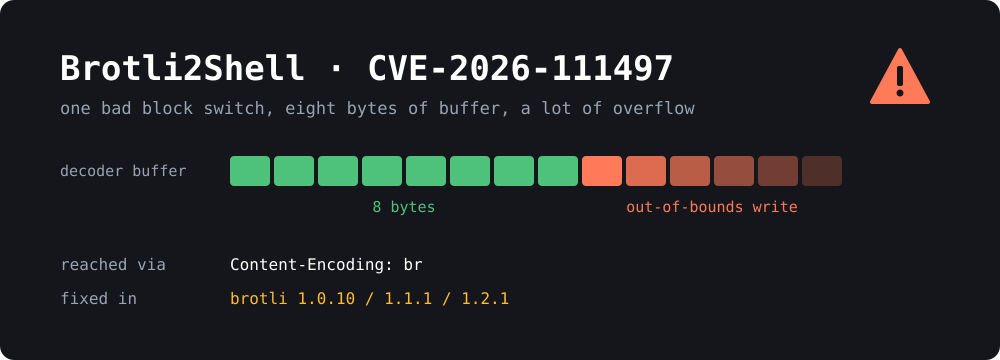

{: width="1000" height="360"}

On October 21, Node.js and Google shipped fixes for a bug in the **Brotli decompression library**, and the security news hasn't stopped since. Depending on who you read, it's called **Node2Shell**, **HTTP2Shell**, **Brotli2Shell** or **Broccoli2Shell**. All of them are the same bug: **CVE-2026-111497**.

Brotli is the compression format behind the `br` in `Content-Encoding: br`. Browsers, CDNs, web servers and HTTP libraries all use it, so a bug in the reference C decoder ends up inside a huge amount of software. CISA added the CVE to its [Known Exploited Vulnerabilities catalog](https://www.cisa.gov/known-exploited-vulnerabilities-catalog) on **October 27**, so this one isn't theoretical anymore.

This post explains what the bug does, who is actually exposed, and what to patch or switch off.

> **TL;DR**
> - Google's Brotli C decoder **1.0.3 to 1.2.0** can be made to **write out of bounds** with a crafted compressed stream. Fixed in **1.0.10, 1.1.1 and 1.2.1**.
> - You're exposed if your code **decompresses Brotli data from someone you don't trust**: HTTP responses from arbitrary URLs, `Content-Encoding: br` request bodies, or uploaded files.
> - **Patch:** Node.js **22.23.4 / 24.22.1 / 26.12.1**, Python `Brotli` **1.2.1** / `brotlicffi` **1.2.1.0**, Bun **1.4.4**, .NET **8.0.33 / 9.0.22 / 10.0.14**, plus your distro's `libbrotli` package.
> - **Then restart and rebuild.** A running process or a Docker image pinned to `node:24.22.0` stays vulnerable.
> - Can't patch yet? **Reject `Content-Encoding: br` at the edge** and turn off automatic response decompression.

## What is the bug?

The flaw is in `DecodeBlockTypeAndLength()` in `c/dec/decode.c`, the part of the decoder that handles **block switches**. A Brotli stream is split into blocks, and the stream tells the decoder when to switch from one block type to the next.

In the vulnerable versions, that function returns a simple yes/no. A "no" (`BROTLI_FALSE`) can mean either of two things:

1. **"This stream is broken"**, a permanent error, or
2. **"I need more input"**, a temporary condition that streaming decoders hit all the time.

The callers can't tell the two apart, and on the fast path the return value is thrown away entirely ([CWE-252](https://cwe.mitre.org/data/definitions/252.html), unchecked return value).

An attacker builds a stream that declares a single block type, uses up its length, and then forces a block switch that can never succeed. The Node.js advisory describes what happens next:

> An invalid block switch was reported as a temporary need for more input instead of a permanent format error, so the streaming decoder kept appending input bytes to an eight-byte internal buffer.

The decoder keeps copying attacker-controlled bytes into that **8-byte buffer** and runs past its end ([CWE-787](https://cwe.mitre.org/data/definitions/787.html), out-of-bounds write). The overflow overwrites nearby decoder state and other process memory with bytes the attacker chose. That's the starting point for turning a "decompression bug" into **remote code execution**.

The fix is small. The function now returns a proper error code, a new `BROTLI_DECODER_ERROR_FORMAT_BLOCK_SWITCH` (`-17`) is added, and decoding stops on a format error on both the safe and fast paths. Brotli 1.2.1 contains nothing else besides the version bump.

### The upstream fix was public for eight months

The fix was committed upstream on **February 27, 2026** ([`0ed4268`](https://github.com/google/brotli/commit/0ed4268a4401abcb4472096340477cf4af7d1a2b)). Nobody tagged a release, so almost nobody picked it up, until Node.js and Google cut releases on October 21. Projects that vendor their own copy of Brotli (and many do) are still catching up.

The bug was reported to Node.js by researchers using **OpenAI Codex Security**.

## Is it really remote code execution?

It depends on the target, and the security vendors don't fully agree:

- **Imperva** got code execution against the **official Node.js 24.22.0** Linux arm64 image, both through a malicious server response and through an Express 5 request body. It "did not succeed on every attempt", and the exploit hasn't been published.
- **ELLIO** reproduced code execution on the official x86-64 Node.js 24.22.0 build and recorded an exploitation attempt against its sensors.
- **Public PoCs** have been on GitHub since October 21-22. The ones that have been reviewed mostly work only under lab conditions or against deliberately weakened builds. Others argue the bug is realistically a **denial of service**.
- In other software it has been shown to cause crashes (ClickHouse via a single HTTP request), infinite loops (Apache Arrow) and instruction-pointer control (FFmpeg via JPEG XL, found by JFrog).

The scores reflect that spread: **9.2** (CVSS v4.0, Google), **9.8** (CVSS v3.1, GitHub) and **8.1** (CVSS v3.1, Microsoft, which classifies it as elevation of privilege for .NET).

My take: at minimum, any affected process can be crashed by one request. In the worst case it can be taken over. The CISA KEV listing means someone is already trying. Treat it as critical.

## Who is actually exposed?

Having `libbrotli` installed doesn't make you exploitable by itself. What matters is whether **something you run decompresses Brotli data that an attacker controls**. In practice there are three ways in.

### 1. Clients that decompress responses

If your code fetches URLs and something on the other end can be hostile, a malicious server can return a Brotli bomb with `Content-Encoding: br`.

- **Node.js `fetch()`** decodes Brotli responses automatically. There's no standard switch to turn this off.
- **Python:** `urllib3` (and therefore `requests`), `aiohttp` and `httpx[brotli]` advertise and decode `br` **whenever a Brotli package happens to be installed**, even if your code never imports it. Scrapy pulls it in, for example.
- **curl/libcurl** decodes only when asked to: `curl --compressed` or `CURLOPT_ACCEPT_ENCODING` in libcurl apps. On Debian 12 and Ubuntu 24.04, libcurl uses the system `libbrotli`.
- **.NET `HttpClient`** with automatic decompression enabled (off by default), and **PHP's cURL extension** on Windows builds.

Think webhooks, link previews, RSS fetchers, scrapers, "import from URL" features, AI agents browsing the web, and monitoring tools. Anything that fetches a URL a user can supply.

### 2. Servers that decompress request bodies

- **Express 5** (body-parser 2.x) decodes `br`, `gzip`, `deflate` and `zstd` request bodies **by default**. A plain `app.use(express.json())` is enough to be exposed. Express 4 returns `415` for Brotli bodies and isn't reachable this way.
- **ASP.NET Core** request decompression middleware (off by default).
- **Envoy** with the Brotli decompressor filter, and **Istio** if you enabled it through an `EnvoyFilter`.

A bare Node.js `http` server doesn't decode bodies. Default **nginx** and **Apache** don't decompress request bodies, and `mod_brotli` only compresses, so a typical reverse proxy in front of a static site is not the problem.

### 3. Anything that decodes Brotli inside files

Brotli shows up in places you might not expect: **Parquet** files, **JPEG XL** images (via libjxl), PDFs, archives, caches and message queues. If you process user uploads with something like FFmpeg, DuckDB, ClickHouse or 7-Zip forks, check whether their bundled Brotli has been updated. Several were still unpatched at the end of October. The community tracker at [broccoli2shell.com](https://broccoli2shell.com/) keeps a list.

**Not affected:** pure Java, JavaScript and C# ports, and the Rust `brotli-decompressor` crate, which returns an error. The Go port `andybalholm/brotli` had the same logic error but could only crash; it was fixed on October 23. .NET Framework (as opposed to .NET) is not affected.

## Fixed versions

| Component | Fixed in |
|---|---|
| Google Brotli (C library) | **1.0.10**, **1.1.1**, **1.2.1** |
| Node.js | **22.23.4**, **24.22.1**, **26.12.1** (18, 20, 23, 25 are EOL, no fix) |
| Bun | **1.4.4** |
| Python `Brotli` / `brotlicffi` | **1.2.1** / **1.2.1.0** |
| .NET | **8.0.33**, **9.0.22**, **10.0.14**, 11 RC3 (.NET 7: no fix). Also PowerShell 7.4-7.6 and Visual Studio updates |
| Envoy | **1.37.8**, **1.38.6**, **1.39.3**, **1.40.0** |
| Istio | **1.29.9**, **1.30.6**, **1.31.2** |
| Java `brotli4j` | **1.24.0** |
| PHP for Windows | **8.2.35-1**, **8.3.36-1**, **8.4.27-1**, **8.5.12-1** |
| Debian 12 / 13 (`libbrotli1`) | `1.0.9-2+deb12u1` / `1.1.0-2+deb13u1` |
| Alpine (`brotli-libs`) | `1.2.1-r0` (3.23+, edge), `1.1.1-r0` (3.21, 3.22) |
| Amazon Linux 2023 | `1.1.0-1.amzn2023.0.2` |

Distros **backport** the fix, so the version number on Debian or Amazon Linux won't say 1.2.1. Go by your distro's security tracker, not by the upstream version. Ubuntu has published fixes on its [CVE page](https://ubuntu.com/security/CVE-2026-111497). At the time of writing, Fedora stable, RHEL's regular packages and SUSE were still waiting. Check before you assume.

## How to check your systems

Here's a quick sweep to run on each box. It's safe and read-only.

**System library:**

```bash
dpkg -l | grep -i brotli        # Debian / Ubuntu
rpm -qa | grep -i brotli        # Fedora / RHEL / Amazon Linux
apk info -v | grep -i brotli    # Alpine

# Which running processes have libbrotli loaded right now?
sudo grep -l brotlidec /proc/*/maps 2>/dev/null
```

The last command matters most after you patch. Any PID it lists that started before the upgrade is still running the old library in memory.

**Node.js and Bun:**

```bash
node --version
node -p "process.versions.brotli"
npm ls express body-parser      # Express 5 / body-parser 2.x decode br bodies
bun --version

# Node version inside a container image
docker run --rm --entrypoint node <image> --version
```

**Python:**

```bash
pip show Brotli brotlicffi
pipdeptree -r -p Brotli         # who pulled it in?
grep -i brotli poetry.lock uv.lock requirements*.txt Pipfile.lock 2>/dev/null
```

**curl:**

```bash
curl -V | grep -i brotli         # is brotli in the Features line?
grep -rn -- "--compressed" ~/.curlrc ~/bin /etc/cron* 2>/dev/null
```

**Envoy / Istio:**

```bash
kubectl get envoyfilters -A -o yaml | grep -nE 'brotli\.decompressor'
```

## How to protect yourself

### 1. Patch, then restart everything

This is the real fix. Shared libraries only get replaced on disk, and running processes keep the old copy mapped.

```bash
# Debian / Ubuntu
sudo apt update && sudo apt install --only-upgrade libbrotli1
sudo needrestart          # or reboot

# Alpine
apk upgrade brotli-libs

# Python
pip install -U "Brotli>=1.2.1" "brotlicffi>=1.2.1.0"
```

For Node.js, move to **22.23.4, 24.22.1 or 26.12.1** (or newer). If you're on Node 18 or 20, which are EOL with no fix coming, this is the push to upgrade.

**Containers are where most people will get caught.** Node and Python ship their own Brotli, so updating the host does nothing for them. Bump base image tags (`node:24.22.0` → `node:24.22.1` or later), rebuild and redeploy. Floating tags like `node:24` only help if you actually rebuild.

### 2. Reject Brotli request bodies at the edge

Very few legitimate clients send Brotli-compressed **request** bodies. Blocking them at your reverse proxy cuts off the server-side attack completely, and you can leave the rule in place after patching.

**nginx:**

```nginx
# inside server {} or http {}
if ($http_content_encoding ~* "br") {
    return 415;
}
```

**Caddy:**

```caddy
@brotli_body header_regexp Content-Encoding (?i)br
respond @brotli_body 415
```

**Traefik / HAProxy / WAF:** match the `Content-Encoding` header case-insensitively, **including inside lists** like `gzip, br`. Cloudflare-style WAFs and Imperva and Vercel shipped managed rules on disclosure day.

In **Express 5** you can also refuse compressed bodies in the app:

```js
app.use(express.json({ inflate: false }))  // also rejects gzip with 415
```

### 3. Stop decoding Brotli responses you don't need

Removing `br` from `Accept-Encoding` **is not enough**. A malicious server can send Brotli anyway, and libraries like urllib3 pick the decoder based on the response's `Content-Encoding`, not on what you asked for. Turn off decoding instead:

- **Python:** if Brotli is only an optional extra, uninstall it: `pip uninstall Brotli brotlicffi`, and drop extras like `httpx[brotli]`. urllib3, requests and aiohttp fall back to gzip and deflate.
- **curl:** remove `--compressed` from scripts, aliases, CI jobs and `~/.curlrc`. In libcurl apps, leave `CURLOPT_ACCEPT_ENCODING` unset.
- **Envoy / Istio:** remove the Brotli decompressor filter until you've upgraded.
- **Node.js `fetch()`:** there's no clean off switch. Upgrade Node.

### 4. Be careful with uploaded files

If you run thumbnailers, media converters, or analytics on user uploads (JPEG XL, Parquet, archives), isolate those jobs: separate container, no network, low privileges. Watch the tracker for your tools' patches. This is good practice anyway, and it limits the damage from the next library bug too.

## Wrapping up

Brotli2Shell is a good reminder of how deep the dependency tree goes. One eight-byte buffer in a compression library ended up in Node.js, Python, .NET, service meshes, databases, image decoders and curl. For a typical homelab or small VPS the job is simple: **update `libbrotli` and your runtimes, rebuild your containers, restart services**, and add the one-line `Content-Encoding: br` block to your reverse proxy while you're at it.

## Sources

- [Tenable: Brotli2Shell FAQ](https://securityboulevard.com/2026/10/brotli2shell-frequently-asked-questions-for-google-brotli-decoder-vulnerability-cve-2026-111497/)
- [Node.js October 2026 security releases](https://nodejs.org/en/blog/vulnerability/october-2026-security-releases)
- [BleepingComputer: Critical HTTP2Shell Brotli vulnerability triggers emergency patches](https://www.bleepingcomputer.com/news/security/critical-http2shell-brotli-vulnerability-triggers-emergency-patches/)
- [BleepingComputer: CISA warns of hackers now exploiting critical Node2Shell flaw](https://bleepingcomputer.com/news/security/cisa-warns-of-hackers-now-exploiting-critical-node2shell-flaw)
- [Aikido: Python packages vulnerable to Node2Shell](https://www.aikido.dev/blog/python-packages-vulnerable-node2shell-brotli-cve-2026-111497)
- [Strobes: HTTP2Shell, Brotli RCE in Node.js and Python](https://strobes.co/blog/http2shell-brotli-rce-cve-2026-111497/)
- [SecurityWeek: Node2Shell Brotli flaw triggers patching across Microsoft, Node.js, Python packages](https://www.securityweek.com/node2shell-brotli-flaw-triggers-patching-across-microsoft-node-js-python-packages/)
- [Sophos: Node2Shell in active exploitation](https://www.sophos.com/blog/node2shell-cve-2026-111497-in-active-exploitation)
- [GitHub Advisory GHSA-9v8h-qqgm-4m35](https://github.com/advisories/GHSA-9v8h-qqgm-4m35)
