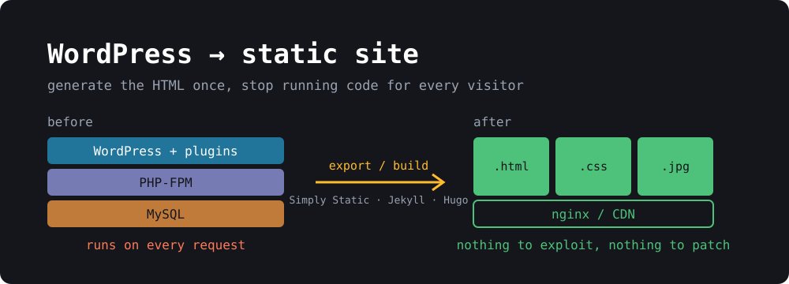

{: width="1000" height="360"}

This month's [PHP2Shell vulnerabilities]() were a good reminder of something a lot of us already knew: most WordPress sites don't need to run code on every page view. A blog, a portfolio, a docs site, a small business page. The content changes a few times a month, but the server boots PHP, opens a MySQL connection and runs a few dozen plugins for **every single visitor**.

A static site turns that around. You generate the HTML once, upload the files, and the web server just hands them out. No PHP, no database, no `wp-login.php` getting hammered by bots, no plugin updates at 2 AM. It's also faster and can be hosted for free.

This blog has been static for years (it's Jekyll on GitHub Pages; I wrote about [building a static site with Pelican]() back in 2018). Here's how to get a WordPress site there.

## Two ways to do it

| | **A. Keep WordPress, export HTML** | **B. Migrate to a static site generator** |
|---|---|---|
| You write in | the WordPress editor you know | Markdown files in a Git repo |
| WordPress keeps running | yes, but **privately** (localhost / VPN) | no, deleted after migration |
| PHP exposed to the internet | no | no |
| Effort | an afternoon | a weekend |
| Best for | non-technical editors, heavy use of Gutenberg/page builders | developers, people who like Git and Markdown |

Both get you the main win: **nothing on the public internet runs PHP**. Pick A if someone else edits the site and loves WordPress. Pick B if you're the only author and you're comfortable in a terminal.

## Before you start: things that won't work statically

Go through your site and list anything that needs a server at request time. These are the usual ones, each with a static replacement covered below:

- **Comments** → Giscus, Disqus, or just turn them off
- **Contact forms** → Formspree, Netlify Forms, or a tiny serverless function
- **Site search** → Pagefind (runs in the browser)
- **Logins, memberships, WooCommerce carts** → these genuinely need a backend. If they're core to the site, a static site isn't for you, or keep that part on WordPress on a subdomain.

Also take a backup. Export **Tools → Export → All content** (the WXR XML file) and copy `wp-content/uploads/`. Every route below starts from one or both.

## Option A: Keep WordPress private, publish static HTML

The idea: WordPress keeps running somewhere that only you can reach, and a plugin crawls it and writes plain HTML that you upload to static hosting.

### 1. Move WordPress off the public internet

The easiest way is to run it locally with Docker. Restore your database dump and `wp-content`, then:

```yaml
# docker-compose.yml
services:
  db:
    image: mariadb:11
    environment:
      MARIADB_DATABASE: wordpress
      MARIADB_USER: wp
      MARIADB_PASSWORD: wp
      MARIADB_RANDOM_ROOT_PASSWORD: "1"
    volumes:
      - ./db:/var/lib/mysql
      - ./dump.sql:/docker-entrypoint-initdb.d/dump.sql:ro
  wordpress:
    image: wordpress:php8.4-apache
    ports:
      - "127.0.0.1:8080:80"     # only reachable from this machine
    environment:
      WORDPRESS_DB_HOST: db
      WORDPRESS_DB_USER: wp
      WORDPRESS_DB_PASSWORD: wp
      WORDPRESS_DB_NAME: wordpress
    volumes:
      - ./wp-content:/var/www/html/wp-content
```

```bash
docker compose up -d
# point WordPress at the local URL (wp-cli ships in the wordpress:cli image)
docker run --rm --network container:$(docker compose ps -q wordpress) \
  --volumes-from $(docker compose ps -q wordpress) \
  -e WORDPRESS_DB_HOST=db -e WORDPRESS_DB_USER=wp -e WORDPRESS_DB_PASSWORD=wp -e WORDPRESS_DB_NAME=wordpress \
  wordpress:cli wp search-replace 'https://example.com' 'http://localhost:8080'
```

Binding to `127.0.0.1` is the important part. If editors are on other machines, put it behind a VPN like [WireGuard]() or Tailscale instead of opening a port.

### 2. Export with Simply Static

[Simply Static](https://wordpress.org/plugins/simply-static/) is the most popular and best maintained option. Install it from **Plugins → Add New**, then:

1. **Simply Static → Settings → General**: set *Replacing URLs* to **absolute URLs** and enter your real domain (`https://example.com`).
2. **Deployment**: choose **ZIP archive** or **Local directory** to start with. (The paid version can push straight to GitHub, S3 or Cloudflare.)
3. **Generate**. It crawls every page, post, archive, feed, image, CSS and JS file and rewrites the links.

[WP2Static](https://wp2static.com/) does the same job and is open source with deploy add-ons if you'd rather avoid a freemium plugin.

No-plugin fallback, which works surprisingly well for simple sites:

```bash
wget --mirror --convert-links --adjust-extension --page-requisites \
     --no-parent -e robots=off http://localhost:8080/
```

### 3. Check the output

Serve the folder locally and click around before you publish:

```bash
cd simply-static-output && python3 -m http.server 8000
```

Things that commonly break: images inserted with `srcset` from a CDN plugin, pages that only exist via JavaScript, pagination beyond what the crawler found, and the RSS feed (make sure `/feed/index.xml` or `/feed/` exists). Add any missing URLs under **Simply Static → Settings → Include**.

From now on your workflow is: edit in local WordPress → Generate → upload. Skip to [Hosting](#hosting-it-for-free).

## Option B: Migrate to Jekyll or Hugo

Here you move the content out of WordPress for good: posts become Markdown files, a generator builds HTML from them, and Git becomes your CMS.

### 1. Convert posts to Markdown

The tool I'd reach for is [wordpress-export-to-markdown](https://github.com/lonekorean/wordpress-export-to-markdown). It reads the WXR export, writes one Markdown file per post with front matter, and downloads the images:

```bash
npx wordpress-export-to-markdown
```

It asks a few questions interactively: path to the XML, output folder, whether to put each post in its own folder, whether to prefix files with the date, and whether to download images. For Jekyll, say **yes** to date prefixes and **no** to per-post folders so you get `2024-05-12-my-post.md` files that drop straight into `_posts/`.

Alternatives:

- **Jekyll:** the official [jekyll-import](https://import.jekyllrb.com/docs/wordpressdotcom/) gem reads the same XML (`JekyllImport::Importers::WordpressDotCom`) or connects directly to the MySQL database. It keeps HTML bodies instead of converting to Markdown, which is less pretty but more faithful.
- **Hugo:** [wp2hugo](https://github.com/ashishb/wp2hugo) is a single Go binary that converts the XML, keeps your URL structure and generates redirects.

Expect to clean things up. Gutenberg block comments (`<!-- wp:paragraph -->`), shortcodes like `[gallery]` or `[caption]`, and embeds from page builders won't convert cleanly. Grep for them:

```bash
grep -rlE '\[(gallery|caption|embed|contact-form)' _posts/ | head
grep -rl '<!-- wp:' _posts/ | wc -l
```

### 2. Pick a generator and a theme

- **[Jekyll](https://jekyllrb.com/)**: Ruby, runs natively on GitHub Pages, huge theme ecosystem. Good fit if you want zero build setup.
- **[Hugo](https://gohugo.io/)**: one Go binary, builds thousands of pages in seconds. Good fit for big sites.
- **[Astro](https://astro.build/)** / **[Eleventy](https://www.11ty.dev/)**: JavaScript, more flexible, more moving parts.

For Jekyll the basics are:

```bash
gem install --user-install jekyll bundler
jekyll new mysite && cd mysite
cp -r ../wp-markdown-output/*.md _posts/
cp -r ../wp-content/uploads assets/
bundle exec jekyll serve
```

### 3. Keep your URLs

This is the step people skip and then lose their search rankings over. Find your WordPress permalink setting (**Settings → Permalinks**) and reproduce it.

WordPress "Post name" (`/my-post/`) in Jekyll's `_config.yml`:

```yaml
permalink: /:title/
```

WordPress "Day and name" (`/2024/05/12/my-post/`):

```yaml
permalink: /:year/:month/:day/:title/
```

For anything that has to move, install `jekyll-redirect-from` and list the old URLs in the post's front matter:

```yaml
redirect_from:
  - /?p=123
  - /old-slug/
```

Don't forget the **feed**. WordPress serves it at `/feed/`, and feed readers won't follow you to `/feed.xml` on their own. Either set `feed: path: feed/index.xml` for `jekyll-feed`, or add a redirect at your host. Same for uploaded files: keep them under `/wp-content/uploads/` and old image links in other sites and Google Images keep working.

Then crawl the old site and the new build and diff the URL lists:

```bash
curl -s https://example.com/sitemap.xml | grep -oP '(?<=<loc>)[^<]+' | sed 's#https://example.com##' | sort > old.txt
find _site -name index.html | sed 's#_site##; s#index.html##' | sort > new.txt
comm -23 old.txt new.txt     # URLs that would 404
```

## Replacing the dynamic bits

**Comments.** Export existing comments if you care about them; wordpress-export-to-markdown doesn't. For new ones, [Giscus](https://giscus.app/) stores comments as GitHub Discussions and has no tracking. Disqus can import a WordPress XML file directly (this blog uses Disqus). Or just turn comments off; most small blogs get more spam than comments anyway.

**Forms.** Point the form's `action` at a form service and keep the HTML:

```html
<form action="https://formspree.io/f/your-id" method="POST">
  <input type="email" name="email" required>
  <textarea name="message" required></textarea>
  <button type="submit">Send</button>
</form>
```

Netlify (`<form netlify>`) and Cloudflare Pages Functions work too if you host there.

**Search.** [Pagefind](https://pagefind.app/) indexes the built HTML and ships a small JavaScript search UI. No server, no external service:

```bash
jekyll build
npx pagefind --site _site
```

Then add their `<div id="search"></div>` snippet to a search page.

## Hosting it for free

All of these serve static files from a CDN with free HTTPS and custom domains:

- **GitHub Pages**: push the repo, enable Pages, done. Jekyll builds natively; anything else via a GitHub Action.
- **Cloudflare Pages**: connect the repo, set the build command (`jekyll build`, `hugo`, `npx astro build`), output dir. Unlimited bandwidth.
- **Netlify**: same idea, plus built-in forms and redirects via a `_redirects` file.
- **Your own VPS**: if you want to keep self-hosting, nginx serving a folder is about as safe as a web server gets:

```nginx
server {
    server_name example.com;
    root /var/www/example.com;
    location / { try_files $uri $uri/ $uri.html =404; }
}
```

Sync it with `rsync -az --delete _site/ server:/var/www/example.com/` and you can `apt purge 'php*'` from that box.

## Cut over

1. Lower the DNS TTL a day ahead.
2. Deploy the static site and test it on the host's preview URL.
3. Point DNS at the new host.
4. Submit the new sitemap in Google Search Console and watch the **Pages → Not found (404)** report for a couple of weeks. Add redirects for anything that shows up.
5. With Option B, shut down the old WordPress server once traffic has moved. With Option A, make sure it's no longer reachable from the internet: `curl -I https://old-server-ip/wp-login.php` should time out.

## Wrapping up

The PHP2Shell bugs were in code that ran before WordPress even loaded, so no amount of plugin hygiene would have helped. A static site removes that whole class of problem: there's no interpreter to exploit, no database to dump and nothing to patch on the serving side. If you have a WordPress site that's mostly words and pictures, an afternoon with Simply Static or a weekend with Jekyll gets you a faster, cheaper site that you don't have to babysit.

## Sources

- [Simply Static plugin](https://wordpress.org/plugins/simply-static/)
- [WP2Static](https://wp2static.com/)
- [wordpress-export-to-markdown](https://github.com/lonekorean/wordpress-export-to-markdown)
- [jekyll-import: WordPress.com importer](https://import.jekyllrb.com/docs/wordpressdotcom/)
- [wp2hugo](https://github.com/ashishb/wp2hugo)
- [Jekyll permalinks](https://jekyllrb.com/docs/permalinks/)
- [Pagefind](https://pagefind.app/)
- [Giscus](https://giscus.app/)
