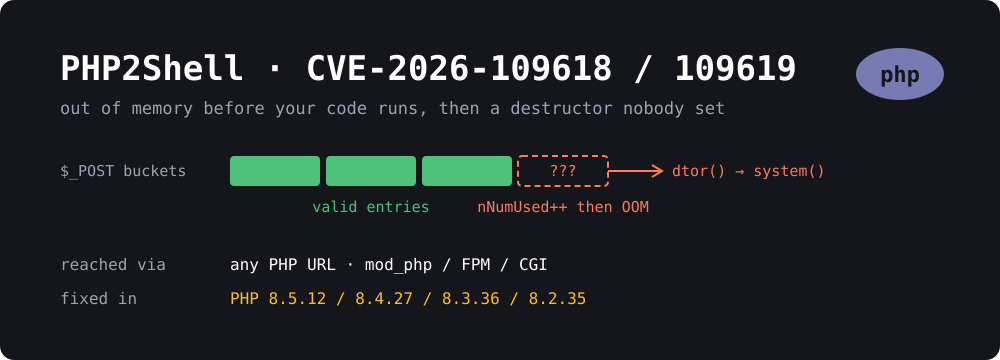

{: width="1000" height="360"}

October has been a bad month for web runtimes. A week after [Brotli2Shell]() hit Node.js and Python, PHP shipped emergency releases for **two critical bugs in the interpreter itself**. They're collectively called **PHP2Shell**: **CVE-2026-109618** and **CVE-2026-109619**, both rated **9.2 (CVSS v4.0)**.

What makes these nasty is that they aren't WordPress bugs, or Laravel bugs, or plugin bugs. They sit in the code PHP runs **before your application even starts**. Any PHP script reachable over HTTP is enough, even one that only prints `hello`. No login, no special route, and your app's input filtering never gets a chance to run.

Two days later PHP disclosed a third, narrower bug, **CVE-2026-115560**, which is **not fixed yet**.

This post covers what each bug does, who's exposed, and what to do on a typical VPS or homelab box.

## TL;DR

- **Upgrade PHP** to **8.5.12, 8.4.27, 8.3.36 or 8.2.35** (released October 21, 2026), or your distro's patched package. Then **restart PHP-FPM / Apache** so old workers die.
- **Every PHP version from 5.x to 8.5.11 is affected.** 7.4, 8.0 and 8.1 got source backports but no official release. Older branches get nothing upstream.
- **It's being exploited.** AWS saw attempts from **October 17**, four days before the patch. CISA added CVE-2026-109618 to the [KEV catalog](https://www.cisa.gov/known-exploited-vulnerabilities-catalog) on **October 26**.
- **Stopgap while you patch:** `session.upload_progress.enabled = 0` (and `fatal_error_backtraces = 0` on 8.5). It blocks the known path for CVE-2026-109619 and also covers CVE-2026-115560, but it **does not** stop CVE-2026-109618.
- **Updating WordPress does nothing here.** The fix is the PHP package on the server.

## The two PHP2Shell bugs

### CVE-2026-109618: out-of-memory leaves a half-built hash entry

PHP parses `$_POST`, `$_COOKIE` and uploads into internal hash tables before your code runs. [Datadog's analysis](https://securitylabs.datadoghq.com/articles/php2shell-critical-vulnerabilities-in-php/) walks through one path in `Zend/zend_hash.c`: the insert routine bumps the table's element counters **first**, and only then allocates the key.

```c
idx = ht->nNumUsed++;
ht->nNumOfElements++;
p->key = zend_string_init(...);   // <- this allocation blows memory_limit
```

If that allocation goes over `memory_limit`, PHP bails out with a fatal error. But the counters already claim there's a valid bucket in the table. At request shutdown PHP destroys `$_POST`, walks the table, and treats the uninitialized bucket as a real value, including calling its **destructor function pointer**.

An attacker who can shape that memory sets the "destructor" to `system()` and the argument to a shell command. The command runs as your web server user (`www-data` on Debian/Ubuntu).

What the attacker needs:

- A request sized so a single field **name** fits in the body but copying it exceeds `memory_limit`. The **default** memory limits are fine for this.
- A way around ASLR. Public write-ups use a memory leak through the `PHPSESSID` cookie, and brute-forcing just crashes workers.

That's it. It works on **mod_php, PHP-FPM, php-cgi, FrankenPHP and LiteSpeed**. PHP rates the risk highest for **Apache with mod_php**, where workers live long and the memory layout is predictable.

### CVE-2026-109619: stale per-worker state, use-after-free

The second bug is about state that outlives a request. PHP workers handle many requests in a row. Some worker-wide fields kept pointers into the **previous request's memory** after it was freed, so the next request on the same worker followed a dangling pointer.

Two confirmed paths:

- **Session upload progress.** After a fatal error, upload handling can leave session/decoder state behind, and the next upload reads it. Confirmed on **mod_php and PHP-FPM**. `session.upload_progress.enabled` is **on by default** and runs even if your app never calls `session_start()`.
- **Fatal error backtraces (PHP 8.5 only).** Backtrace state survives shutdown and gets read by a config diagnostic in a later request.

The attacker has to land consecutive requests on the same worker. A bigger worker pool makes that harder, but it doesn't remove the bug.

## Am I affected?

Almost certainly, if you run PHP on the web and haven't patched since October 21.

| Branch | Fixed in | Notes |
|---|---|---|
| 8.5 | **8.5.12** | also set `fatal_error_backtraces=0` if you can't patch yet |
| 8.4 | **8.4.27** | |
| 8.3 | **8.3.36** | |
| 8.2 | **8.2.35** | |
| 7.4 / 8.0 / 8.1 | source backports only | distro or Sury packages, no php.net release |
| 7.3 and older | **no fix** | upgrade, or take it off the internet |

**Distro version numbers lie (in a good way).** Debian and Ubuntu backport fixes without bumping the upstream version, so `php -v` showing `8.3.6` on Ubuntu 24.04 doesn't mean you're vulnerable. Check the package version instead. Examples from the advisories:

- **Ubuntu 24.04:** `8.3.6-0ubuntu0.24.04.13` or later ([USN-8948-1](https://ubuntu.com/security/notices))
- **Debian 12 bookworm:** `8.2.35-1~deb12u1` (DLA-4848-1)
- **Debian 13 trixie:** `8.4.27-1~deb13u1` (DSA-6574-1)
- **Ubuntu 20.04 / PHP 7.4:** fixed only through Ubuntu Pro ESM
- **Ondřej Surý's PPA / packages.sury.org:** patched builds for every branch down to **PHP 5.6**

```bash
# What's actually installed?
dpkg -l 'php*' | awk '/^ii/ {print $2, $3}' | grep -E 'php[0-9.]+-(fpm|cli|common)|libapache2-mod-php'
```

## How to patch

On Debian or Ubuntu:

```bash
sudo apt update
sudo apt install --only-upgrade 'php*'
```

Then **restart every PHP process**. This step matters more than usual: CVE-2026-109619 is about state living inside long-running workers, and an upgraded package does nothing for workers that are still running old code.

```bash
# PHP-FPM (one service per installed version)
sudo systemctl restart 'php*-fpm'

# Apache with mod_php
sudo systemctl restart apache2

# Confirm nothing old is still running
sudo lsof -n | grep -E 'php.*\(deleted\)' | head
```

**Docker:** pull the rebuilt official image (`php:8.4-fpm` etc.) and **recreate** the container, don't just restart it:

```bash
docker compose pull && docker compose up -d --force-recreate
```

If you build your own images from a pinned tag like `php:8.3.30-apache`, bump the tag. The WordPress, Nextcloud and Matomo images all inherit from the official PHP image, so pull those too.

**Shared hosting:** your host has to do it. Most big ones (WordPress.com, VIP, Pressable, SiteGround and others) announced they were patched within a day or two. If yours hasn't said anything, ask.

## Stopgaps if you can't patch today

PHP published these as **temporary** mitigations. watchTowr's position is that php.ini mitigations "should be understood to be ineffective", and Datadog says they "reduce exposure". So: buy yourself a day, then patch.

Put them in a file that loads **before** PHP parses the request (not `.user.ini`, not `ini_set()`), e.g. `/etc/php/8.3/fpm/conf.d/99-php2shell.ini`:

```ini
; CVE-2026-109619 and CVE-2026-115560
session.upload_progress.enabled = 0

; CVE-2026-109619, PHP 8.5 only
fatal_error_backtraces = 0
```

For **CVE-2026-109618** the upload progress setting does nothing. PHP's interim guidance is to remove PHP's own memory limit and let something outside PHP cap memory instead:

```ini
memory_limit = -1
```

That's only safe if you pair it with **request size limits in front of PHP** and a **container or cgroup memory limit**, otherwise one large request can eat the box. In nginx:

```nginx
client_max_body_size 20m;
client_body_timeout 15s;
```

Turning off upload progress breaks upload progress bars that use `$_SESSION`. Very few sites rely on it.

## Did someone already get in?

Exploitation started before the patch, so if you were exposed between **October 17** and the day you patched, it's worth a look. Things Datadog and watchTowr call out:

**In PHP / web server error logs:**

```
PHP Fatal error:  Allowed memory size of 16777216 bytes exhausted (tried to allocate 3500032 bytes) in Unknown on line 0
```

The key part is **`in Unknown on line 0`**: PHP died during request startup, before any script ran. Normal application OOMs name a file. Two to four of these on one worker can be the whole attack.

```
AH00052: child pid 12345 exit signal Segmentation fault (11)
```

That's a failed ASLR guess on Apache. A burst of these is suspicious. Note that a **successful** exploit returns **HTTP 200** and the worker keeps going, so don't rely on crashes alone.

**In access logs / request bodies:**

- multipart POSTs containing fields named `PHPSESSID` **and** `PHP_SESSION_UPLOAD_PROGRESS`
- hundreds of parts, or deeply nested names like `files[R00001][a][a][a]`
- a single urlencoded field name of several MB with nulls and control characters
- upload filenames containing `<?php` or `|O:`
- `Set-Cookie: PHPSESSID=` responses with very long or binary-looking values

```bash
# Start-up OOMs since the 17th
sudo journalctl --since 2026-10-17 | grep 'in Unknown on line 0'
sudo grep -h 'in Unknown on line 0' /var/log/php*-fpm.log /var/log/apache2/error.log* 2>/dev/null

# Shells started by the web server user
sudo ausearch -ua www-data -x /bin/sh -ts 10/17/2026 2>/dev/null | head
```

If you find a hit, assume the box is compromised. Check for new files in your web root (`find /var/www -name '*.php' -newermt 2026-10-17`), cron jobs for `www-data`, and unexpected outbound connections. Then rotate the database credentials in `wp-config.php` / `.env`, because those were readable by the process that got owned.

## CVE-2026-115560: the third one (not fixed yet)

On **October 23** PHP published an informational advisory for **CVE-2026-115560**, another session-related code execution bug. This one is much narrower. You're only exposed if **all three** are true:

1. `session.serialize_handler` is set to `php_binary` or `php_serialize`,
2. your application switches it to `php` with `ini_set()` before `session_start()`, and
3. `session.upload_progress.enabled` is on (the default).

Apps that never change the serializer at runtime aren't exposed through this path. PHP isn't doing an emergency release. The fix will land in the next regular release, and **the October 21 releases don't include it**. No exploitation had been reported as of October 26.

The mitigation is the same `session.upload_progress.enabled = 0` from above, so if you already applied it you're covered.

```bash
# Does anything in your code base switch the serializer?
grep -rn "serialize_handler" /var/www --include='*.php'
```

## Using this as an excuse

If you're running PHP just to serve a blog, a docs site or a brochure site, every one of these bugs is a reason to ask whether the server needs PHP at all. A site that's plain HTML files has no interpreter to exploit, no `memory_limit`, no session handler and no workers to restart.

I wrote up how to do that in **[How to Convert Your WordPress Site to a Static Site]()**, covering the "keep WordPress, export HTML" route as well as moving fully to Jekyll or Hugo.

## Wrapping up

PHP2Shell is about as bad as PHP bugs get: pre-auth, pre-application, default config, every SAPI, and exploited before the patch shipped. The fix is boring, though. **Upgrade the PHP package, restart every worker, recreate your containers**, and grep your logs for `in Unknown on line 0` back to October 17. Then set `session.upload_progress.enabled = 0` anyway. You probably don't use it, and it's been in the blast radius of two of these three CVEs.

## Sources

- [Datadog Security Labs: PHP2Shell, detection, analysis and remediation](https://securitylabs.datadoghq.com/articles/php2shell-critical-vulnerabilities-in-php/)
- [watchTowr: CVE-2026-109618 FAQ](https://watchtowr.com/intelligence/php-cve-2026-109618-faq/)
- [The Hacker News: PHP issues emergency patches for two critical PHP2Shell RCE flaws](https://thehackernews.com/2026/10/php-issues-emergency-patches-for-two.html)
- [The Hacker News: PHP warns of another unpatched RCE risk](https://thehackernews.com/2026/10/urgent-php-warns-of-another-unpatched.html)
- [Google Cloud: Responding to CVE-2026-109618 and CVE-2026-109619](https://cloud.google.com/blog/products/identity-security/responding-to-core-php-vulnerabilities-cve-2026-109618-cve-2026-109619)
- [oss-security: CVE-2026-115560 advisory](https://seclists.org/oss-sec/2026/q4/359)
- [Security Affairs: PHP warns of new code execution flaw days after PHP2Shell patches](https://securityaffairs.com/201595/security/php-warns-of-new-code-execution-flaw-days-after-php2shell-patches.html)
- [Sury.org ships Debian/Ubuntu updates for PHP 5.6 to 8.5](https://www.linuxcompatible.org/story/php2shell-patch-suryorg-ships-debian-ubuntu-updates-for-every-php-version-from-56-to-85/)
- [PHP2Shell and WordPress: is your site affected?](https://eseospace.com/blog/php2shell-wordpress/)
- [PHP security advisories archive](https://www.php.net/archive/2026.php)
