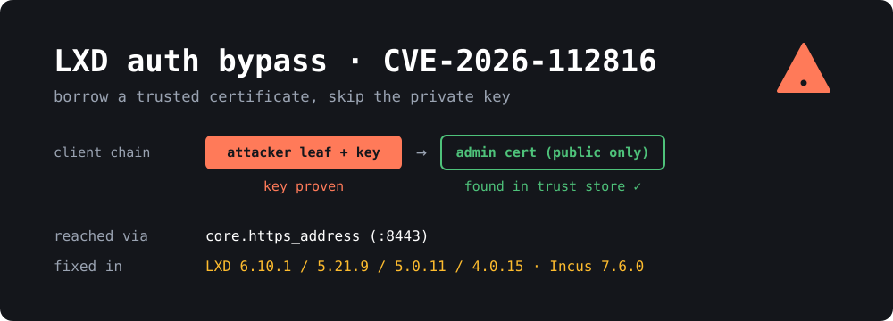

{: width="1000" height="360"}

If you run **LXD**, **Incus** or **MicroCloud** in your homelab, this is the one to patch this week. **CVE-2026-112816** is a **CVSS 10.0** authentication bypass in the HTTPS API that both projects share. Anyone who can reach that API and has the **public** certificate of one of your trusted clients can log in as that client. They don't need the private key.

Canonical published its advisory on **October 28-29**, the Incus project published [GHSA-xg75-xf37-cph9](https://github.com/lxc/incus/security/advisories/GHSA-xg75-xf37-cph9) on **October 29**, and the CVE record went out on **October 30**. Over the weekend, reports of a public proof of concept started going around, so it's getting attention.

> **TL;DR**
> - The LXD/Incus HTTPS API checked **every certificate in the client's chain** against the trust store, but TLS only proves the client owns the key for the **first** one. Add a trusted cert to the end of your chain and you're in.
> - **Fixed in:** LXD **6.10.1**, **5.21.9**, **5.0.11**, **4.0.15**, MicroCloud **3.4.1** / **2.1.5**, Incus **7.6.0**.
> - You're only reachable if the **network API is on** (`core.https_address` or `cluster.https_address` set). A default standalone LXD only listens on a local Unix socket.
> - **There's no config workaround.** Until you patch, firewall port **8443** so only your management hosts can reach it.
> - Fix: `sudo snap refresh lxd` (and `microcloud`), or upgrade the `incus` package. Then go through your trust list.

## What is the bug?

LXD and Incus authenticate remote clients with **mutual TLS**. When you run `lxc remote add` or `incus remote add`, your client's certificate goes into the server's trust store. After that, the server recognises you by the certificate you present during the TLS handshake.

A TLS client can send a **chain** of certificates, not just one. The handshake proves the client holds the private key for the **first** certificate, the leaf. Everything after the leaf is just data the client chose to send.

The Incus advisory puts it plainly:

> The HTTPS listener requests client certificates without verifying them, so the TLS handshake only proves the client holds the private key of the first certificate in the chain.

The listener used Go's `tls.RequestClientCert` mode, which asks for a client certificate but doesn't verify the chain. The authentication code then looped over **all** of `r.TLS.PeerCertificates` and accepted the request if **any** of them was in the trust store ([Ostorlab's write-up](https://blog.ostorlab.co/lxd-incus-mtls-authentication-bypass-cve-2026-112816.html) walks through the code).

So the attack is:

1. Generate any self-signed certificate and key.
2. Get the **public** certificate of a client the server trusts.
3. Send a chain of *your leaf, then the trusted cert*.
4. The handshake succeeds, because you own the leaf's key. Then the trust check finds the trusted cert further down the chain and treats you as that client.

If the trusted client is an admin, which in most homelabs means every trusted client, that gives full control of the server. That means creating privileged containers, mounting host paths and running commands in every instance. In practice that's **root on the host**.

The fix is small. Only the first, key-proven certificate (`PeerCertificates[0]`) is compared against the trust store now ([Incus commit `8381e54`](https://github.com/lxc/incus/commit/8381e54c3631c627d7ecdec03945bca14d0bd542), "Only trust the key-proven client certificate"). The bug came from the shared LXD code. Incus says it has been there "since the initial release", so treat **every** older version as affected, not just the versions listed in the CVE.

### How hard is it to get a trusted public certificate?

Certificates aren't secrets. They're designed to be shared, and they end up in a lot of places:

- **Your laptop.** `~/.config/lxc/client.crt` or `~/snap/lxd/common/config/client.crt` sits next to the key, but it also gets copied into Ansible repos, Terraform state, CI variables and dotfiles on GitHub.
- **Cluster members.** Every LXD/MicroCloud cluster member presents its certificate in normal TLS traffic. Canonical says an attacker who captures the certificate of a machine **joining a MicroCloud** can later authenticate as that member.
- **Other trusted servers.** For example, a backup box or a Proxmox-to-LXD migration host that was added as a remote.

Getting one isn't free, but it's much easier than stealing a private key, which is the whole point of the CVSS 10.0.

## Who is actually exposed?

You need **both** of these:

1. **The HTTPS API is reachable** by the attacker. A fresh `lxd init` on a single machine **doesn't** expose it. LXD only listens on `/var/snap/lxd/common/lxd/unix.socket` until you set `core.https_address` (the "Would you like the LXD server to be available over the network?" question in `lxd init`). Clusters always have it on, and so does any setup you manage remotely with `lxc remote` or the LXD UI.
2. **The attacker can get a trusted certificate**, as described above.

Higher risk:

- An LXD/Incus API bound to `0.0.0.0:8443` or `[::]:8443` on a VPS or a dedicated server with a public IP. This setup is more common than it should be.
- **MicroCloud** and LXD clusters on a flat LAN, where any compromised device (an IoT gadget, a container that escaped, a guest laptop) can reach the API.
- The LXD UI exposed through a port forward.

Lower risk:

- A single LXD host with no network listener, used only through `lxc` on the box itself.
- An API bound to a WireGuard or Tailscale address that only your own devices can reach. Patch anyway.

**Not affected:** plain LXC (`lxc-start` and friends, no daemon), Docker and Podman, and Ubuntu's **deb** `lxd` package. Ubuntu marks focal and older as not affected, and the deb package doesn't exist from jammy onward. On 22.04+ the `lxd` command comes from the **snap** (or from the `lxd-installer` stub that installs the snap), so check `snap list`, not `dpkg`.

## Fixed versions

| Product | Track / branch | Fixed in |
|---|---|---|
| LXD | `6/stable` | **6.10.1** |
| LXD | `5.21/stable` (LTS) | **5.21.9** |
| LXD | `5.0/stable` (LTS) | **5.0.11** |
| LXD | `4.0/stable` (LTS) | **4.0.15** |
| MicroCloud | `3/stable` | **3.4.1** |
| MicroCloud | `2/stable` | **2.1.5** |
| Incus | 7.x | **7.6.0** |

The CVE record lists LXD 6.9 as affected but doesn't mention 6.10.0. Assume 6.10.0 is affected too and move to 6.10.1.

**Incus LTS (6.0.x)** is the odd one out. At the time of writing I couldn't find a fixed 6.0.x or 7.0.x LTS release, and Debian 13 and Ubuntu's archive both ship Incus from those branches. If that's you, watch the [Incus forum](https://discuss.linuxcontainers.org/) and your distro's security tracker, and firewall the API in the meantime. The Zabbly packages (`stable` repo) have 7.6.0.

## How to check your systems

All read-only and safe to run.

**1. What version are you on?**

```bash
snap list lxd microcloud     # snap installs (most Ubuntu users)
lxc version                  # client and server versions

incus version                # Incus
dpkg -l incus 2>/dev/null    # Incus from Debian/Ubuntu/Zabbly packages
```

**2. Is the network API on?**

```bash
lxc config get core.https_address
lxc config get cluster.https_address

incus config get core.https_address
incus config get cluster.https_address

# What's actually listening?
sudo ss -ltnp | grep -E 'lxd|incus|microcloud|:8443'
```

An empty `core.https_address` **doesn't** rule out the cluster listener, so check both. If `ss` shows `0.0.0.0:8443` or `*:8443`, find out who can reach that port from outside:

```bash
# from another machine
nc -vz your-server 8443
```

**3. Who do you trust?**

```bash
lxc config trust list
lxc cluster list             # if clustered

incus config trust list
```

Every entry there is a certificate an attacker could borrow. Look for old laptops, decommissioned servers, former admins, test remotes you added once and forgot, and expired entries you never cleaned up.

## How to protect yourself

### 1. Patch

**LXD and MicroCloud (snap):**

```bash
sudo snap refresh lxd
sudo snap refresh microcloud      # if you use it
snap list lxd microcloud          # confirm the version
```

Snaps refresh themselves, so a lot of machines may already be patched. **Don't assume.** Canonical rolled the fixes out from `candidate` to `stable` gradually, and if you set `snap refresh --hold`, you're stuck on the old version until you refresh by hand. If `snap list` still shows an old version, check the channel with `snap info lxd` and wait for the fixed build to reach your track. Don't jump tracks on a production cluster.

On a **cluster**, refresh every member. LXD won't let cluster members run mixed versions for long, and the API on an unpatched member is still vulnerable.

**Incus:**

```bash
# Zabbly / Debian / Ubuntu packages
sudo apt update && sudo apt install --only-upgrade incus incus-client
incus version
```

Restarting the daemon doesn't stop running instances, so this is a low-drama upgrade.

### 2. Firewall the API until you've patched

There's **no config workaround**. Restricting who can reach port 8443 is the only stopgap. It's also how the API should be set up anyway.

**ufw:**

```bash
sudo ufw allow from 192.168.10.0/24 to any port 8443 proto tcp   # your admin network
sudo ufw deny 8443/tcp
```

**nftables:**

```nft
table inet lxd_api {
  chain input {
    type filter hook input priority -10; policy accept;
    tcp dport 8443 ip saddr { 192.168.10.0/24, 10.8.0.0/24 } accept
    tcp dport 8443 drop
  }
}
```

The `-10` priority makes the rule run before LXD's own nftables rules. Better yet, bind the API to a private address only:

```bash
lxc config set core.https_address 10.8.0.1:8443   # your WireGuard/VPN IP
```

Don't need remote access at all? Turn the listener off:

```bash
lxc config unset core.https_address
```

(Not on a cluster. Cluster members need `cluster.https_address` to talk to each other. Firewall them to the cluster network instead.)

### 3. Clean up your trust store

The attack needs a trusted certificate, so fewer trusted certificates means fewer ways in:

```bash
lxc config trust list
lxc config trust remove <fingerprint>     # anything you don't recognise or need
```

If your LXD version supports it, give automation clients **restricted** certificates limited to the projects they need (`lxc config trust add --restricted --projects=...`). A borrowed restricted cert does far less damage than a full admin one.

### 4. Check whether anyone got in

There are no public IOCs. If your API was reachable from the internet or an untrusted network, look for:

```bash
lxc operation list
lxc list --all-projects
lxc warning list
sudo journalctl -u snap.lxd.daemon --since "2026-10-20"
```

Look for instances, profiles, storage volumes or devices you didn't create, especially containers with `security.privileged=true` or disk devices mounting `/` from the host. Check for new trust entries and new cluster members. Also look at the source IPs of API connections in your firewall logs. One trusted cert showing up from two unrelated addresses is a red flag. One caveat from Ostorlab: an attacker impersonating a client **doesn't** need to change your trust store, so an unchanged trust list doesn't prove nothing happened.

## About the proof of concept

As of today, the status is murky. Some vendor posts say a public PoC and a lab reproduction appeared on November 2. One repository indexed as a "PoC" turned out to be a version checker and update script. Neither CISA nor the vendors have reported exploitation in the wild, and the CVE isn't in CISA's KEV catalog.

Honestly, it doesn't matter much. The bug is simple to understand, the fix commit is public, and anyone who knows Go's `crypto/tls` can write an exploit in an afternoon. Assume working exploits exist.

## Wrapping up

The pattern here is a classic one: **asking for a client certificate is not the same as verifying it**. The handshake proved ownership of one key, and the code trusted a whole list of certificates. The fix is one line, but the impact was full host compromise.

For most homelabs the to-do list is short:

1. `snap refresh lxd` / upgrade Incus, and confirm the version.
2. Make sure port **8443** isn't reachable from anywhere you don't control.
3. Remove trust entries you don't need.

If your LXD API has been on a public IP "just for convenience", this is a good time to put it behind WireGuard for good. I covered a [WireGuard setup on MikroTik]() earlier if you need a starting point.

## Sources

- [Incus advisory GHSA-xg75-xf37-cph9](https://github.com/lxc/incus/security/advisories/GHSA-xg75-xf37-cph9)
- [Ubuntu CVE tracker: CVE-2026-112816](https://ubuntu.com/security/CVE-2026-112816)
- [CVE record: CVE-2026-112816](https://www.cve.org/CVERecord?id=CVE-2026-112816)
- [Ostorlab: LXD and Incus mTLS authentication bypass](https://blog.ostorlab.co/lxd-incus-mtls-authentication-bypass-cve-2026-112816.html)
- [Lilting: authentication bypass via public certificate chains](https://lilting.ch/en/articles/lxd-cve-2026-112816-client-certificate-chain)
- [SOC Prime: CVE-2026-112816 analysis](https://socprime.com/blog/cve-2026-112816-analysis/)
- [The Hacker News: Critical LXD and MicroCloud flaw](https://thehackernews.com/2026/11/critical-lxd-and-microcloud-flaw-cvss.html)
- [Incus 7.6 release announcement](https://discuss.linuxcontainers.org/t/incus-7-6-has-been-released/27462)
- [LXD 5.21.9 LTS release announcement](https://discourse.ubuntu.com/t/lxd-5-21-9-lts-has-been-released/90565)
