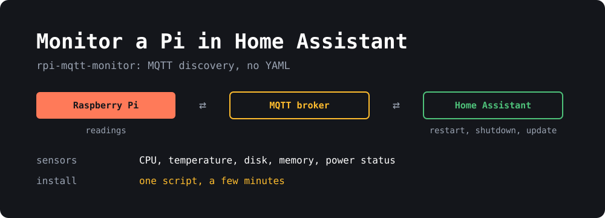
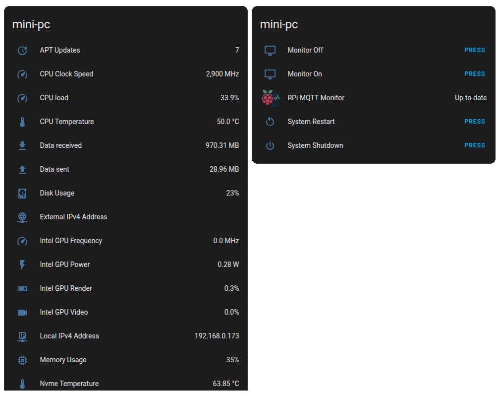

{: width="1000" height="360"}

Raspberry Pis tend to fail quietly. The SD card fills up, a weak power supply causes random problems, or a case with poor airflow slows everything down, and you don't notice until something stops working. If you already run Home Assistant, it's the obvious place to watch for all of that.

I wrote [rpi-mqtt-monitor](https://github.com/hjelev/rpi-mqtt-monitor) for this. It's a small Python script that reads your system's health and publishes it over MQTT. Home Assistant creates the device and its sensors on its own, so there's no YAML to write. This guide covers the setup, the sensors worth turning on, and alerts that are actually useful.

> **TL;DR**
> - You need **Home Assistant** with the MQTT integration and an **MQTT broker** such as Mosquitto.
> - Install with the one-line script and choose **systemd service** when asked. The buttons in Home Assistant don't work under cron.
> - Sensors appear automatically. Turn on the extras with `rpi-mqtt-monitor --config`.
> - **On a Pi, turn on `rpi_power_status`.** It tells you about under-voltage and throttling.
> - It also runs on other Linux machines, including x86 mini PCs, with Intel, NVIDIA and AMD GPU sensors.

## What you get

Each machine appears as a single device in Home Assistant, with its readings and controls grouped together:

{: width="1011" height="796"}

*This one is on a mini PC, which is why it shows Intel GPU sensors. I've hidden the public IP address.*

**On by default:** CPU load, CPU temperature, disk usage, memory usage, uptime, network traffic, and a check for updates to the script itself.

**Off by default, but worth a look:**

| Config key | What it shows |
|---|---|
| `rpi_power_status` | Under-voltage and throttling (Pi only) |
| `rpi5_fan_speed` | Fan speed (Pi 5 with the stock fan) |
| `sys_clock_speed` | Current CPU clock speed |
| `voltage` | CPU voltage |
| `swap` | Swap usage |
| `ssd_health` | SMART status, wear, power-on hours and data written |
| `drive_temps` | HDD and SSD temperatures |
| `wifi_signal` / `wifi_signal_dbm` | WiFi signal quality or strength |
| `apt_updates` | Number of APT updates available (experimental) |
| `used_space_paths` | Disk usage for extra drives or paths |
| `ext_sensors` | DS18B20 and SHT21 temperature and humidity sensors |

The [README](https://github.com/hjelev/rpi-mqtt-monitor#what-gets-monitored) has the full list.

## What you need

1. **A machine to monitor.** Despite the name, it works on other Linux machines too, not just a Raspberry Pi.
2. **An MQTT broker.** If you don't have one, follow my [Mosquitto setup guide](). The Home Assistant Mosquitto add-on works as well.
3. **Home Assistant with the MQTT integration** connected to that broker. Check this before you start, because discovery depends on it.

I'd create a separate MQTT user for this, because the password gets stored on the Pi. With Mosquitto, leave out `-c`, since that would overwrite your password file:

```bash
sudo mosquitto_passwd /etc/mosquitto/passwordfile rpi-monitor
sudo systemctl restart mosquitto
```

## Install it

The installer clones the repo into your current folder, so go to wherever you want it to live:

```bash
bash <(curl -s https://raw.githubusercontent.com/hjelev/rpi-mqtt-monitor/master/remote_install.sh)
```

You don't have to take my word for what that script does, so feel free to read [remote_install.sh](https://github.com/hjelev/rpi-mqtt-monitor/blob/master/remote_install.sh) and [install.sh](https://github.com/hjelev/rpi-mqtt-monitor/blob/master/install.sh) first. It installs what's missing, creates a Python virtual environment and asks you a series of questions:

- **MQTT host, user and password.** The password is visible as you type it.
- **TLS and WebSockets.** Answer no to both for a plain local broker.
- **Port, topic prefix and UNS structure.** The defaults are fine, so just press Enter.
- **Display control and detected hardware.** It offers extras such as GPU or SSD sensors if it finds the hardware, and can turn on IP address sensors.
- **Cron or systemd service.** Choose **service**.

### Service or cron?

Use the **service** unless you have a reason not to. Only the service can receive commands from Home Assistant, so that's what makes the restart, shutdown, update and custom script buttons work. Cron just publishes readings on a schedule, and it can't see root-only readings without extra setup.

The trade-off is that **the service runs as root**, because some of its readings and controls need it. Your MQTT password is also stored in plain text in `src/config.py`, so a dedicated MQTT user is a good idea.

The default interval is 120 seconds. For temperature and disk usage that's plenty, and I wouldn't go much lower.

## Check that it's working

Print the current readings on the Pi:

```bash
rpi-mqtt-monitor --display
```

Check the service:

```bash
systemctl status rpi-mqtt-monitor
journalctl -u rpi-mqtt-monitor -f
```

Then watch the messages arrive at your broker, from any machine with `mosquitto-clients`:

```bash
mosquitto_sub -h your-broker -u your-user -P 'your-password' -t 'rpi-MQTT-monitor/#' -v
```

You should see lines like this, with your hostname in the topic:

```text
rpi-MQTT-monitor/raspberrypi/cpu_temp 48.3
rpi-MQTT-monitor/raspberrypi/memory 23
```

Finally, in Home Assistant, go to **Settings → Devices & services → MQTT → Devices**. Your Pi should be listed under its hostname, with all of its sensors. There's nothing to add to `configuration.yaml`.

## Turn on more sensors

Open the built-in configurator:

```bash
rpi-mqtt-monitor --config
```

Move with the arrow keys and press **Enter** to change a value. Press **s** to save and **q** to quit. Some complex settings, such as lists, have to be edited directly in `src/config.py`. Restart the service so the changes apply:

```bash
sudo systemctl restart rpi-mqtt-monitor
```

On a Pi, I'd start with these:

- **`rpi_power_status`:** this reads `vcgencmd get_throttled` and reports `OK`, `Under-voltage`, `Soft temperature limit`, `ARM frequency capped` or `Throttled`. Under-voltage causes all sorts of strange behaviour that looks like something else, so this one sensor can save you hours.
- **`ssd_health`:** if you boot from NVMe or USB SSD, this shows wear and SMART status. The installer offers to set it up when it finds an SSD. It needs `smartmontools` and root.
- **`rpi5_fan_speed`:** a Pi 5 running hot with the fan stopped means the fan has failed.
- **`used_space_paths`:** add this if you have a separate data drive, since the main disk sensor only watches `/` by default.

## Alerts that are actually useful

A dashboard only helps when you look at it, so the real value is in getting told when something's wrong. Here are three automations to start with.

Entity IDs depend on your device name. Check yours on the device page, and replace `raspberrypi` here and `notify.mobile_app_your_phone` with your own.

**The Pi is running hot.** Raspberry Pis slow themselves down as they approach 85°C, so this warns you before that happens. The five-minute delay stops short spikes from setting it off:

```yaml
alias: Raspberry Pi running hot
triggers:
  - trigger: numeric_state
    entity_id: sensor.raspberrypi_cpu_temperature
    above: 75
    for:
      minutes: 5
actions:
  - action: notify.mobile_app_your_phone
    data:
      message: "Raspberry Pi is at {{ states('sensor.raspberrypi_cpu_temperature') }}°C"
```

**The power supply isn't keeping up:**

```yaml
alias: Raspberry Pi power problem
triggers:
  - trigger: state
    entity_id: sensor.raspberrypi_rpi_power_status
    to: "Under-voltage"
actions:
  - action: notify.mobile_app_your_phone
    data:
      message: "Raspberry Pi reports under-voltage. Check the power supply and cable."
```

**The Pi went offline.** With the service, the script publishes a status that switches to disconnected if its connection to the broker drops:

```yaml
alias: Raspberry Pi offline
triggers:
  - trigger: state
    entity_id: binary_sensor.raspberrypi_status
    to: "off"
    for:
      minutes: 5
actions:
  - action: notify.mobile_app_your_phone
    data:
      message: "Raspberry Pi has been offline for 5 minutes."
```

Disk usage is worth adding too. Copy the temperature automation, point it at the disk usage sensor, and set the limit to 90.

## Buttons and custom scripts

With the service running, you get **System Restart** and **System Shutdown** buttons, plus an update entity that shows when a new version is out and installs it from Home Assistant.

You can also add your own buttons that run scripts on the Pi. In `src/config.py`:

```python
custom_scripts = [
    ["/home/pi/scripts/backup.sh", "mdi:backup-restore", "run_backup"],
]
```

Each entry is the script path, an icon and a unique ID. The script needs to be executable and have a shebang line, since it runs directly without a shell. It's killed after a timeout you can set with `custom_script_timeout`. Remember that the service runs as root, so **these scripts do too**.

### Keep your broker locked down

These buttons work by listening for commands on MQTT, which means that anyone who can publish to your broker could restart or shut down the Pi. That's fine on a broker with passwords, but not on one that allows anonymous access. Follow the password steps in my [Mosquitto guide](), and don't expose the broker to the internet. If you don't want the buttons at all, you can turn them off by setting `restart_button`, `shutdown_button` and `update` to `False`.

## Monitoring several machines

Install the script on each one. They'll each appear as their own device, named after the hostname.

**Watch out for duplicate hostnames.** Topics and sensor IDs are built from the hostname, so two Pis both left on the default `raspberrypi` will collide. Give each one its own name, either with `sudo hostnamectl set-hostname` or by setting this in `src/config.py`:

```python
ha_device_name = 'garage-pi'
```

## Troubleshooting

**Nothing appears in Home Assistant.** Run the `mosquitto_sub` command above. If there are no messages, the problem is on the Pi, so check the journal and your credentials in `src/config.py`. If messages are arriving, check that the MQTT integration in Home Assistant is connected to the same broker and that `discovery_messages` is `True`.

**The CPU temperature is wrong or missing.** This mostly happens on non-Pi boards, because the sensor's name varies. Run `rpi-mqtt-monitor --config`, select `cpu_thermal_zone` and pick from the sensors it finds.

**Buttons do nothing.** You're probably running under cron, which can't receive commands. Re-run `install.sh` from the project folder and choose the service.

**A sensor shows 0 when it can't be read.** Set `use_availability = True`, and it'll show as unavailable in Home Assistant instead.

**You don't want to run a broker.** Set `hass_host` and `hass_token`, then use the `--hass_api` flag to send readings straight to the Home Assistant API.

## Updating and removing it

```bash
rpi-mqtt-monitor --update      # or use the update entity in Home Assistant
rpi-mqtt-monitor --uninstall
```

## Wrapping up

The whole setup takes a few minutes, and most of the value comes from just a few things: temperature, disk space, power status, and an alert for each. Set those up first, and add the rest if you find you want them.

If you're shopping for hardware to run this on, I also wrote about [which Raspberry Pi to buy now that prices have gone up]().

The project is on [GitHub](https://github.com/hjelev/rpi-mqtt-monitor). If something doesn't work on your board or you'd like a new sensor, please [open an issue](https://github.com/hjelev/rpi-mqtt-monitor/issues).
