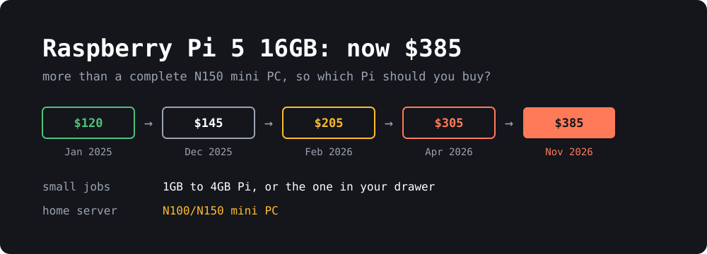

{: width="1000" height="360"}

On **November 2**, Raspberry Pi raised the price of the **16GB Pi 5** by another $80, to **$385**. It launched at **$120** in January 2025. The bare board now costs more than a complete N150 mini PC with memory, an SSD, a case and a power supply.

That doesn't mean the Pi is a bad buy now. The cheaper models have gone up far less, and for a lot of projects they're still the right choice. You just need to be more careful about which one you pick.

> **TL;DR**
> - **Don't buy the 16GB Pi 5** unless you specifically need that much memory on a Pi. Above about $175, a mini PC is usually the better deal.
> - **Small jobs** like Pi-hole, MQTT, or audio: use an old Pi if you have one, otherwise a **1GB or 2GB** board.
> - **GPIO, HATs, cameras or the lowest power use:** a **2GB or 4GB Pi 5**. A mini PC can't replace these.
> - **Docker stacks, Jellyfin or a small home server:** an **N100/N150 mini PC**, or a used office mini PC.
> - Raspberry Pi says it hopes to roll prices back when memory gets cheaper, but gives no date.

## Why the price keeps going up

It's the memory. In [the announcement](https://www.raspberrypi.com/news/price-rises-for-some-16gb-raspberry-pi-products/), Eben Upton blames "a lack of alternative supply for 16GB DRAM, compounded by other ongoing component shortages". The company says it has tried to avoid "blanket increases across the entire product line", so the highest-memory products take the biggest hits.

Here's how the 16GB Pi 5 got here:

| Date | Price | Change |
|---|---|---|
| January 2025 (launch) | $120 | |
| December 1, 2025 | $145 | +$25 |
| February 2, 2026 | $205 | +$60 |
| April 1, 2026 | $305 | +$100 |
| November 2, 2026 | **$385** | +$80 |

The 16GB Compute Module 5 variants went up $40 at the same time. The Pi 500+ stayed at $410.

The February figure is calculated from the announced increase, as reported by [XenoSpectrum](https://xenospectrum.com/en/raspberry-pi-16gb-dram-price-increase-385-usd/). I didn't find it on an official page.

## What every Pi costs right now

These are US list prices. They come from [CNX Software](https://www.cnx-software.com/2026/04/01/raspberry-pi-4-3gb-launched-for-83-75-further-price-increases-announced-across-the-board-for-4gb-ram-hardware/), [ComputingForGeeks](https://computingforgeeks.com/raspberry-pi-5-vs-n150-mini-pc/) and the [PiShop](https://www.pishop.us/product-category/raspberry-pi/raspberry-pi-5/raspberry-pi-5-boards/) listings.

| RAM | Pi 5 | Pi 4 |
|---|---|---|
| 1GB | $45 | $35 |
| 2GB | $77.50 | $67.50 |
| 3GB | | $83.75 |
| 4GB | $110 | $100 |
| 8GB | $175 | $165 |
| 16GB | **$385** | |

Other models:

- **Pi Zero 2 W:** $17.25 at PiShop.
- **Pi 500 (8GB):** $180 for the unit alone. That's an April price, so check before you buy.
- **Pi 500+ (16GB, 256GB SSD):** [from $410](https://www.raspberrypi.com/products/raspberry-pi-500-plus/).
- **Pi 400:** $60, according to [MakeUseOf](https://www.makeuseof.com/raspberry-pi-priced-out-of-its-own-mission/) in September.

List price isn't always what you'll pay. When I checked, PiShop showed the 1GB and 4GB Pi 5 and the Zero 2 W as out of stock. Adafruit had the 4GB Pi 5 at $130, and [Amazon had the 8GB at $199.90](https://raspberry.tips/en/smart-home/home-assistant-hardware-2026-raspberry-pi-5-or-n100-mini-pc). Raspberry Pi also warns about "bad actors" selling at inflated prices, so start with its approved resellers.

Two details stand out:

- **Going from 8GB to 16GB costs $210.** That's more than the 8GB board itself.
- **The Pi 500+ is only $25 more than the bare 16GB board**, and it includes a keyboard and case and a 256GB SSD. If you want a 16GB Pi as a desktop, buy that instead.

## A full build against a mini PC

The board price leaves out a lot. To compare fairly, I added what you need for a home server: the official 27W power supply ($12.95), Active Cooler ($10.95), M.2 HAT+ ($12) and the official 512GB NVMe SSD ($120). Those are ComputingForGeeks' October prices, and there's no case included.

| Machine | CPU | RAM | Storage | Total |
|---|---|---|---|---|
| Pi 5 2GB build | Arm Cortex-A76 | 2GB | 512GB NVMe | **$233.40** |
| Pi 5 4GB build | Arm Cortex-A76 | 4GB | 512GB NVMe | **$265.90** |
| Pi 5 8GB build | Arm Cortex-A76 | 8GB | 512GB NVMe | **$330.90** |
| Pi 5 16GB build | Arm Cortex-A76 | 16GB | 512GB NVMe | **$540.90** |
| Beelink Mini S13 | Intel N150 | 12GB | 512GB SSD | **$329** |
| Beelink Mini S13 | Intel N150 | 16GB | SSD included | **$349** |

The Beelink prices are from Amazon as of October 13, via ComputingForGeeks, and stock was limited on the 16GB model. A cheaper SSD will bring the Pi totals down: the same article lists a 512GB Patriot drive at $85.99.

Mini PCs aren't immune to the memory shortage either. A Mini S13 sold for about [$169 in August 2025](https://www.starryhope.com/minipcs/dram-price-spike-mini-pc-raspberry-pi-2026/), although that may not be the same configuration. Mini PC prices move quickly at the moment, so check them before you decide.

### Performance and power

| | Pi 5 (8GB) | Intel N150 |
|---|---|---|
| Geekbench 6 single-core | 904 | 1,294 |
| Geekbench 6 multi-core | 2,164 | 3,169 |
| Idle power | 2.8 W | 9.3 W |
| Full load power | 9.7 W | 25 W |

These are Jeff Geerling's numbers as collected by ComputingForGeeks, and the N150 is a GMKtec G3 Plus. Other N150 machines measured between about 7 and 11 W at idle.

So the N150 is roughly 45% faster, and it uses about three times the power at idle. On a machine that's always on, that difference of about 6.5 W comes to around **$10 a year** at $0.18/kWh. It's real, but it won't pay for a more expensive Pi any time soon.

## Which one should you buy?

### Small always-on jobs: use what you have

A DNS filter, a [Mosquitto MQTT broker]() or a [multi-room audio player]() doesn't need much. If an old Pi 3 or 4 is sitting in a drawer, this is the time to use it.

If you have to buy something, get the **Pi 5 1GB** or **Pi 4 1GB or 2GB**. The Zero 2 W is the cheapest option for very light jobs if you can find one in stock.

### GPIO, HATs and cameras: a small Pi 5

This is what the Pi is really for, and a mini PC can't do it. Sensors, relays, camera modules and HATs all need a Pi, and these projects rarely need a lot of memory. A **2GB or 4GB Pi 5** is plenty for most of them, and it's the lowest power option too.

### Home Assistant: either works

A **4GB Pi 5** handles a typical Home Assistant setup well, especially on NVMe rather than an SD card. Go for a mini PC if you plan to run a lot of add-ons or local voice processing. A Pi also has an advantage if you want to wire sensors directly to it.

### Docker stacks and home servers: a mini PC

Once you're running a pile of containers, memory and x86 compatibility matter more than GPIO. An **N100 or N150** gets you more speed and more RAM for the money. Intel's Quick Sync hardware video engine also makes it the better choice for Jellyfin or Plex transcoding, and you don't have to look for Arm builds of everything.

A used office mini PC, such as a ThinkCentre Tiny or OptiPlex Micro, is worth checking too. They were going for [$50 to $100 in January](https://www.starryhope.com/minipcs/dram-price-spike-mini-pc-raspberry-pi-2026/), though that price may be out of date. They use more power, but you may get a lot more CPU for the money.

### A Pi desktop: the Pi 500 or 500+

The **Pi 500** has 8GB of memory and costs about the same as the bare 8GB board, so it's a good deal if you want a keyboard computer. The **Pi 500+** is the one 16GB Pi that still looks reasonable.

### When the 16GB Pi 5 still makes sense

Not often, but there are a few cases: you need a lot of memory *and* the Pi's GPIO or HAT support, your existing software or case depends on a Pi 5, or you're developing for Arm and want to match the target hardware. The [16GB Compute Module 5 starts at $375](https://www.cnx-software.com/2026/11/03/when-will-this-stop-the-raspberry-pi-5-16gb-sbc-now-sells-for-385/), but it also needs a carrier board, so it won't save you money.

For running local AI models, a 16GB Pi 5 is hard to justify at this price, since the CPU limits you long before the memory does.

### Should you just wait?

If you don't need it now, yes. Raspberry Pi calls the memory situation "difficult but ultimately temporary" and says it looks forward to rolling back the increases when memory costs fall. That's a hope, not a promise, and there's no timeline. If you have a project to build now, buy the smallest model that does the job, because memory is where the extra cost is.

## Wrapping up

The Pi's job has changed a bit. It used to be the cheap default for almost any small computer project, but above about $175 it's now competing directly with complete x86 machines.

It's still a great fit below that price, especially if you need GPIO or care about low power use. For a general-purpose home server, I'd look at a mini PC first.

Whichever one you buy, you'll want to keep an eye on its temperature and disk space. I wrote a small tool for that, and [this guide shows how to monitor a Pi in Home Assistant](). It works on x86 mini PCs as well.

*Prices are as of November 5, 2026, and they've been changing often. Check before you buy.*

## Sources

- [Raspberry Pi: price rises for some 16GB products](https://www.raspberrypi.com/news/price-rises-for-some-16gb-raspberry-pi-products/)
- [Raspberry Pi 500+ product page](https://www.raspberrypi.com/products/raspberry-pi-500-plus/)
- [CNX Software: Pi 5 16GB now sells for $385](https://www.cnx-software.com/2026/11/03/when-will-this-stop-the-raspberry-pi-5-16gb-sbc-now-sells-for-385/)
- [CNX Software: April 2026 price increases and the Pi 4 3GB](https://www.cnx-software.com/2026/04/01/raspberry-pi-4-3gb-launched-for-83-75-further-price-increases-announced-across-the-board-for-4gb-ram-hardware/)
- [Circuit Digest: more than three times the launch price](https://circuitdigest.com/news/raspberry-pi-5-16gb-now-costs-385-more-than-three-times-its-120-launch-price)
- [XenoSpectrum: 16GB price history](https://xenospectrum.com/en/raspberry-pi-16gb-dram-price-increase-385-usd/)
- [ComputingForGeeks: Raspberry Pi 5 vs N150 mini PC](https://computingforgeeks.com/raspberry-pi-5-vs-n150-mini-pc/)
- [raspberry.tips: Home Assistant hardware, Pi 5 or N100](https://raspberry.tips/en/smart-home/home-assistant-hardware-2026-raspberry-pi-5-or-n100-mini-pc)
- [Starry Hope: DRAM prices, mini PCs and the Raspberry Pi](https://www.starryhope.com/minipcs/dram-price-spike-mini-pc-raspberry-pi-2026/)
- [MakeUseOf: the Raspberry Pi priced out of its own mission](https://www.makeuseof.com/raspberry-pi-priced-out-of-its-own-mission/)
- [PiShop: Raspberry Pi 5 boards](https://www.pishop.us/product-category/raspberry-pi/raspberry-pi-5/raspberry-pi-5-boards/)
