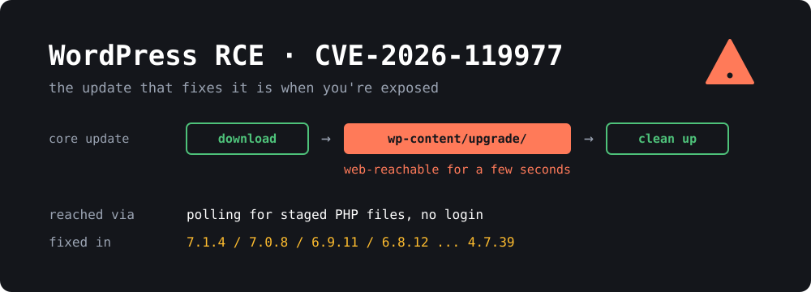

{: width="1000" height="360"}

If you run **WordPress**, check your version today. **CVE-2026-119977** is a race condition in the core updater that can give an unauthenticated attacker code execution on your server, and it only opens **while a core update is running**. So the update that protects you can also be the moment you're exposed, which affects the order you should do things in.

WordPress shipped the fix in **7.1.4** on **October 28**. CISA added the CVE to its Known Exploited Vulnerabilities catalog on **November 3** and gave US federal agencies until **Friday, November 6** to deal with it.

> **TL;DR**
> - During a core update, WordPress unpacks the new release into a staging folder under `wp-content/upgrade`. On many servers that folder can be reached over HTTP for a few seconds, and attackers are polling for it.
> - **Fixed in:** WordPress **7.1.4**, **7.0.8**, **6.9.11**, **6.8.12** and older branches down to **4.7.39**. **4.6 and older get no fix.**
> - **If you aren't patched yet:** block `/wp-content/upgrade/` in your web server **first**, then update.
> - **If you're already patched:** still check your logs. The update that got you there went through the vulnerable window.
> - Reports count thousands of blocked attempts per day, but I found no public report of a confirmed compromise yet.

## What is the bug?

The official announcement describes it in one line:

> A weakness in the WordPress upgrade process which can lead to remote code execution during the upgrade window, reported by Umut Bayram.

The rest of the detail comes from security vendors and the press, not from WordPress. [BleepingComputer](https://bleepingcomputer.com/news/security/cisa-flags-wordpress-rce-flaw-as-actively-exploited-in-attacks) blames "predictable, web-accessible staging paths used during full-package core upgrades". [Tech Insider's analysis](https://tech-insider.org/wordpress-cve-2026-119977-cisa-kev-7-1-4-deadline-nov-6-2026) fills in the steps:

1. A core update unpacks the new release into a staging area under `wp-content/upgrade`. That copy includes `setup-config.php`, the installer script.
2. On many server setups, that folder answers HTTP requests, and PHP files in it run like any others.
3. A logged-out visitor who requests the staged installer at the right moment can push it toward PHP code execution before WordPress cleans up.

This is a **time-of-check to time-of-use (TOCTOU)** race. It's reported as **CVSS 8.1** and rated as high complexity, because the attacker has to hit a window that normally lasts only a few seconds. One stray request almost never lands in it, so attackers have to keep polling.

That difficulty is real, but it's less comforting than it sounds. Polling is cheap, and after a security release, a lot of sites run their core update around the same time.

Reportedly, the fix randomizes the staging folder's name, adds an index guard and stops unsafe promotion of staged configuration data. The changed files in the release include `wp-admin/includes/class-wp-upgrader.php` and `wp-admin/includes/update-core.php`, which fits.

### How sure is the CVE number?

WordPress's own release notes don't list any CVE IDs. They describe "a race condition during core updates", and the link to CVE-2026-119977 comes from BleepingComputer and Tech Insider. The [Canadian Centre for Cyber Security](https://www.cyber.gc.ca/en/alerts-advisories/wordpress-security-advisory-av26-1117) ties the CVE to WordPress Core before 7.1.4 and points to the 7.1.4 release. I think the match is solid, but I couldn't read the CVE or NVD records directly, so treat the CVSS score as reported rather than confirmed.

## Who is actually exposed?

All of these have to be true during a core update:

1. **Your site is on a vulnerable version** and is running a core update.
2. **The staging folder can be reached over HTTP**, and PHP runs there.
3. **The attacker's request lands inside the window.**

Higher risk:

- Sites that **haven't updated yet**, because the next update, automatic or manual, opens the window.
- Sites on plain "PHP runs everywhere under the web root" configurations.
- **Sites that updated in the last week**. They went through the window once, possibly with attackers already polling, so check the logs.

Lower risk:

- Servers that already deny requests to `wp-content/upgrade`, or that refuse to run PHP anywhere under `wp-content`.
- Sites whose updates are built and deployed from outside, for example a container image or Git deploy, where the live server never unpacks an update. This depends on your setup, so check it.

**BleepingComputer describes this as affecting full-package upgrades.** I wouldn't assume a smaller update is safe, because the block in the next section costs almost nothing.

**About the attack numbers:** they vary a lot and they're all *blocked* requests, not successful hacks. BleepingComputer reports Wordfence blocking **13,095** attacks in 24 hours. Tech Insider cites **62,969** in 24 hours around October 30 and more than **12,600** per day as of November 4, with two of the largest sources polling small groups of sites for about 14.5 hours. It also says neither Wordfence nor The Hacker News has stated a confirmed successful compromise. CISA hasn't published details of the attacks it's seeing. Its catalog listing still means you should treat exploitation as real.

## Fixed versions

| Branch | Fixed in |
|---|---|
| 7.1 | **7.1.4** |
| 7.0 | **7.0.8** |
| 6.9 | **6.9.11** |
| 6.8 | **6.8.12** |
| Older, down to 4.7 | Latest release on your branch (4.7 is **4.7.39**) |
| 4.6 and older | **No fix** |

Only the newest version of WordPress is actively supported, and the older branches get these fixes as a courtesy. Moving to **7.1.4** is the better choice if your plugins and theme allow it.

The [7.1.4 documentation](https://wordpress.org/documentation/wordpress-version/version-7-1-4/) lists **22** fixes in total, and older branches are affected by fewer of them (4.7 by just 2). It doesn't say which branches this particular bug reaches. Wordfence's advisory URL names 4.7.0 through 7.1.3, and the Canadian advisory just says "prior to 7.1.4". Treat anything older than the fixed version on your branch as affected.

The same release also fixes several stored XSS bugs, and a bug that let unauthenticated users read unpublished customizer changesets. So it's worth installing even if the race doesn't worry you.

## How to check your systems

All read-only and safe to run. Run the `wp` commands from your WordPress folder.

**1. What version are you on?**

```bash
# with WP-CLI
sudo -u www-data wp core version
sudo -u www-data wp core check-update

# without WP-CLI, find every install on the box
sudo find /var/www -path '*/wp-includes/version.php' -exec grep -H '^\$wp_version' {} \;
```

**2. Are automatic updates turned off?**

```bash
grep -E "AUTOMATIC_UPDATER_DISABLED|WP_AUTO_UPDATE_CORE|DISALLOW_FILE_MODS" wp-config.php
```

Any of these can hold back or stop automatic core updates, depending on the value. Even with auto-updates on, background updates can fail silently, so go by the version number, not the setting.

**3. Can the staging folder be reached?**

```bash
curl -sI https://example.com/wp-content/upgrade/ | head -n 1
```

A `403` means it's blocked. A `200` or a directory listing means requests get through. A `404` doesn't tell you much, because the folder may just be empty or missing right now, so add the block below anyway.

## How to protect yourself

### 1. If you aren't patched, block the staging folder first

An unpatched site goes through the vulnerable window **during its update**, so close it before you start. WordPress writes these files to disk, so the block shouldn't get in the way of the update itself. Still, check that the update finishes.

**nginx**, in your `server` block:

```nginx
location ^~ /wp-content/upgrade/ {
    deny all;
    return 403;
}
```

The `^~` makes this win over your `location ~ \.php$` block, so the order in the file doesn't matter.

```bash
sudo nginx -t && sudo systemctl reload nginx
```

**Apache**, in the virtual host:

```apache
<Directory "/var/www/html/wp-content/upgrade">
    Require all denied
</Directory>
```

```bash
sudo apache2ctl configtest && sudo systemctl reload apache2
```

Don't put an `.htaccess` file inside `wp-content/upgrade`. WordPress recreates that folder, so the file may not survive.

**Shared hosting** where you can't edit the server config? Add this to the `.htaccess` in your WordPress root, above the `# BEGIN WordPress` block:

```apache
RewriteEngine On
RewriteRule ^wp-content/upgrade/ - [F,L]
```

Test all of these with the `curl` command above. You should get a `403`. This reduces the risk but doesn't replace the patch, because the other 21 fixes still matter. You can leave the block in place afterwards, since nothing should need to load that folder over the web.

### 2. Patch

```bash
sudo -u www-data wp core update --minor
sudo -u www-data wp core version
sudo -u www-data wp core verify-checksums
```

`--minor` stays on your current branch, which is the low-risk way to pick up the fix today. Without WP-CLI, go to **Dashboard → Updates**. Do the update during a quiet period and take a backup first, as you would for any update.

On a **managed host**, don't assume the host already handled it. Check the version number, and if you're relying on the host's protection, get that confirmed in writing.

### 3. Don't count on a plugin firewall alone

Security plugins normally load with WordPress, but a request sent straight to a staged PHP file may never load the plugin. Reports say Wordfence needs **Extended Protection** or similar early loading to catch those requests, and that the free tier doesn't get the firewall rule until **November 27**. Blocking at the web server avoids both problems.

### 4. Check whether anyone got in

No IP addresses or file hashes have been published that I could find, so you're looking for behaviour. Do this even if you're already on a fixed version.

**Requests to PHP files in the staging folder:**

```bash
# nginx (for Apache, use /var/log/apache2/access.log*)
sudo zgrep -hE 'wp-content/upgrade/.*\.php' /var/log/nginx/access.log* | sort | uniq -c | sort -rn | head -n 20

# only the ones that returned 200
sudo zgrep -hE 'wp-content/upgrade/.*\.php' /var/log/nginx/access.log* | awk '$9 == 200'
```

Lots of `403` and `404` responses just mean you were probed, like everyone else. A **`200`**, especially near the time of a core update, is the one to investigate. The `awk` filter assumes the default combined log format, where the status is the ninth field.

**Changes to the install:**

```bash
sudo -u www-data wp core verify-checksums
sudo -u www-data wp plugin verify-checksums --all
sudo -u www-data wp user list --role=administrator
sudo find wp-content/upgrade wp-content/uploads -name '*.php'
sudo find . -name '*.php' -newermt '2026-10-28' -not -path './wp-content/cache/*'
```

Look for administrators you didn't create, plugins you don't recognise and PHP files where they don't belong. `wp-content/uploads` should normally have no PHP at all, though a few plugins do put harmless files there. The last command will also list legitimate files from recent updates, so compare against what you actually installed. Plugin checksums only work for plugins from wordpress.org, and premium ones will show up as errors.

If you find something real, don't just delete the file and move on. Assume the attacker read `wp-config.php`, so rebuild from a clean copy and a backup from before the intrusion, and change your database password, WordPress salts and admin passwords.

## Wrapping up

The unusual part of this bug is the timing. Most vulnerabilities are there all the time, but this one only exists for a few seconds during a routine maintenance job. That's also why it's easy to miss: a patched site can look fine even if something happened on the way to the patch.

For most sites the to-do list is short:

1. Block `/wp-content/upgrade/` at the web server.
2. Update to **7.1.4**, or the latest release on your branch, and confirm the version.
3. Check your logs for `200` responses on PHP files in that folder, then check your admin accounts.

This comes right after [PHP2Shell](), which hit the PHP layer underneath WordPress, so you may be patching both. If your site is mostly content and you're tired of this, I wrote a guide to [converting WordPress to a static site](). With no PHP on the live server, this kind of bug has nothing to run.

## Sources

- [WordPress 7.1.4 release announcement](https://wordpress.org/news/2026/10/wordpress-7-1-4/)
- [WordPress 7.1.4 documentation](https://wordpress.org/documentation/wordpress-version/version-7-1-4/)
- [WordPress releases archive](https://wordpress.org/download/releases/)
- [Canadian Centre for Cyber Security: advisory AV26-1117](https://www.cyber.gc.ca/en/alerts-advisories/wordpress-security-advisory-av26-1117)
- [BleepingComputer: CISA flags WordPress RCE flaw as actively exploited](https://bleepingcomputer.com/news/security/cisa-flags-wordpress-rce-flaw-as-actively-exploited-in-attacks)
- [Tech Insider: WordPress CVE-2026-119977 analysis](https://tech-insider.org/wordpress-cve-2026-119977-cisa-kev-7-1-4-deadline-nov-6-2026)
- [CISA Known Exploited Vulnerabilities catalog](https://www.cisa.gov/known-exploited-vulnerabilities-catalog)
