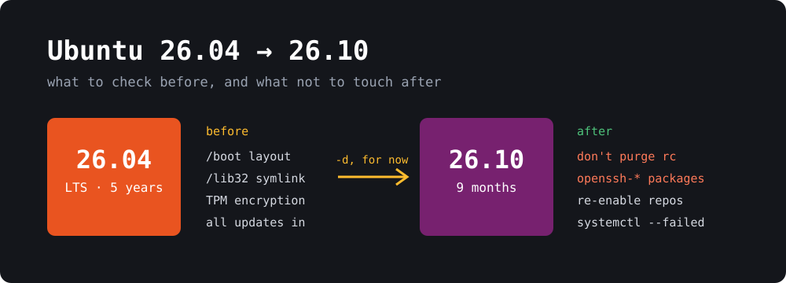

{: width="1000" height="360"}

**Ubuntu 26.10 "Stonking Stingray"** came out on October 15, but if you run `sudo do-release-upgrade` on 26.04 today, you probably won't get it. Nothing is wrong with your system. As of **November 7**, Ubuntu's normal upgrade feed still ends at 26.04.1 LTS.

You can still upgrade, and I did on my own mini PC on October 30. Most guides I read were written before the latest fixes shipped, so here's where things stand today, plus one cleanup command that could cost you SSH access afterwards.

> **TL;DR**
> - **Staying on 26.04 LTS is the right call for most machines.** It gets 5 years of standard support. 26.10 gets 9 months, until July 2027.
> - **The normal upgrade path isn't open yet.** Until it is, the only route on the command line is `sudo do-release-upgrade -d`, which Ubuntu doesn't recommend for production.
> - **Don't upgrade if** your disk uses TPM-backed encryption, or if `/boot` is encrypted, on Btrfs, XFS or ZFS, or on RAID-5/6.
> - **The `/lib32` upgrade failure now has a fix.** Install all 26.04 updates first.
> - **After upgrading, don't purge leftover `openssh-*` packages** in the `rc` state. Their old removal scripts can delete your SSH host keys and config.

## Why doesn't do-release-upgrade offer 26.10?

Two separate things can hide it.

**1. An LTS only looks for the next LTS by default.** `/etc/update-manager/release-upgrades` usually says `Prompt=lts` on 26.04, so interim releases are ignored until you change it to `Prompt=normal`.

**2. Ubuntu hasn't added 26.10 to the normal feed.** Even with `Prompt=normal`, there's nothing to offer yet. You can check the feed yourself:

```bash
curl -s https://changelogs.ubuntu.com/meta-release | grep -E '^(Dist|Version|Supported):' | tail -3
```

Today the last block still says `Dist: resolute`, which is 26.04. Once it says `Dist: stonking`, plain `sudo do-release-upgrade` should offer 26.10.

[Ubuntu's desktop guide](https://ubuntu.com/desktop/docs/en/latest/how-to/upgrade-ubuntu-desktop/) says interim upgrades "become available a few days after the official release date", and it's now been more than three weeks. Ubuntu hasn't said why in anything I could find. My guess is the upgrader fixes that are still in progress, which I cover below, but that's only a guess.

## Should you upgrade at all?

| | **26.04 LTS** | **26.10** |
|---|---|---|
| **Standard support** | 5 years | 9 months, until July 2027 |
| **Next required upgrade** | None for years | To 27.04 before support ends |
| **Kernel** | Older, but with long-term support | Linux 7.3 |
| **Desktop** | Older GNOME | GNOME 51 |
| **Good for** | Servers, work machines, anything you don't want to babysit | Newer hardware, and people who enjoy new software |

26.10 also finishes the move to Rust-based coreutils (now including `cp`, `mv` and `rm`), switches APT signature checks to Sequoia PGP, moves to OpenSSL 4 and MySQL 9.7, and adds [Myna](https://canonical.com/blog/canonical-releases-ubuntu-26-10-stonking-stingray), an opt-in speech-to-text tool that uses local models.

My rule: if you can't name a feature or a hardware fix you need from 26.10, stay on the LTS.

If you're on **24.04**, you can't jump straight to 26.10. Go to 26.04 first.

## Check these before you upgrade

Run these on 26.04:

```bash
# Is /boot on a configuration that's being phased out?
findmnt -nvo SOURCE,FSTYPE -T /boot
lsblk -s -o NAME,TYPE,FSTYPE "$(findmnt -nvo SOURCE -T /boot)"

# Is a multilib symlink dangling?
for d in /lib32 /libo32 /libx32; do
  if [ -L "$d" ] && [ ! -e "$d" ]; then echo "$d is dangling"; fi
done
```

### TPM-backed disk encryption: stop

If you chose hardware-backed encryption in the installer, you can't upgrade yet. The [release notes](https://documentation.ubuntu.com/release-notes/26.10/) say these systems can't go from 26.04 to 26.10 at release, and that Ubuntu expects to enable this during 26.10's lifecycle. Don't try to get around the block.

On those systems, also don't run `update-grub` by hand on either release. [Bug #2157702](https://bugs.launchpad.net/bugs/2157702) describes it overwriting the snapd-managed boot config, leaving a machine that won't boot and with no known way to recover it. As of today the fix is still in progress.

### Unusual /boot setups: stay on 26.04

This one is easy to miss, because 26.10 itself still works. The [release notes](https://documentation.ubuntu.com/release-notes/26.10/) say a future release will drop bootloader support for "encrypted `/boot`, RAID-5/6, Apple partition tables, and file systems such as Btrfs, HFS+, XFS, and ZFS".

The risk is a dead end. [Bug #2170211](https://bugs.launchpad.net/bugs/2170211) explains that these machines could leave an LTS for a release with only 9 months of support, then find they can't upgrade any further. Ubuntu plans to have the upgrader block them, but the 26.10 version of that fix was still being tested on November 6, so **today's upgrader may not stop you**.

Check the output of the commands above. If the filesystem isn't `ext4`, or if you see `crypt` or `raid5`/`raid6`, stay on 26.04. Ubuntu's developers were also still clarifying whether LVM under `/boot` counts, so I'd hold off on that too.

### MySQL: migrate old accounts first

`mysql_native_password` has been removed, and the release notes say the upgrader will block you until accounts using it are migrated:

```sql
SELECT user, host FROM mysql.user WHERE plugin = 'mysql_native_password';
ALTER USER 'user'@'host' IDENTIFIED WITH caching_sha2_password BY 'password';
```

### Other things that can break

- **Your own init scripts:** `systemd-sysv-generator` is gone, so scripts in `/etc/init.d` no longer become services. Write a systemd unit for anything you still rely on.
- **PKCS#11 engines:** OpenSSL 4 has no engine support, so configs that use the `pkcs11` engine must move to the provider.

## How to upgrade

**1. Back up your data, and `/etc/ssh` too.** That archive contains private host keys, so store it somewhere safe.

**2. Install every 26.04 update and reboot:**

```bash
sudo apt update
sudo apt full-upgrade
sudo reboot
```

This step now matters more. It pulls in `base-files` **14ubuntu6.3**, released on November 4, which fixes [the `/lib32` failure](https://bugs.launchpad.net/bugs/2131303). See [the error below](#if-it-stops-on-lib32-is-a-dangling-symbolic-link) if you still hit it.

**3. Allow interim releases:**

```bash
sudo sed -i 's/^Prompt=.*/Prompt=normal/' /etc/update-manager/release-upgrades
```

**4. Start the upgrade.** Check the feed first. If it lists `stonking`, use the normal command:

```bash
sudo do-release-upgrade
```

If it doesn't, you have to use `-d`, or `update-manager --devel-release` on a desktop:

```bash
sudo do-release-upgrade -d
```

Be clear about what `-d` means. It reads the development feed, and [Ubuntu's server guide](https://ubuntu.com/server/docs/how-to/software/upgrade-your-release/) says it's "not recommended for production environments". If a machine matters, wait for the normal path. Either way, **read the summary before you confirm**. It should name Stonking Stingray, and if it mentions 27.04, stop.

**5. Answer the prompts.** The upgrader may list "foreign" packages. Mine flagged third-party apps plus `bzip2`, `libbz2-1.0` and `libx11-6`, and [ComputingForGeeks' test run](https://computingforgeeks.com/upgrade-ubuntu-26-04-to-26-10/) saw much the same list. Ubuntu's advice is that you can try to proceed, and if the upgrade fails, remove those packages and try again.

**Upgrading over SSH?** Stay in the session. In that same test, `sshd` was down for about three minutes mid-upgrade and refused new logins. The upgrader re-launches itself inside `screen`, so if your connection drops you should be able to get back to it with this:

```bash
sudo screen -r ubuntu-release-upgrade-screen-window
```

The whole run took about 30 minutes on my mini PC, going by the timestamps in `/var/log/dist-upgrade/main.log`.

## After the upgrade

### Don't purge leftover OpenSSH packages

26.10 splits OpenSSH into plain and GSSAPI/Kerberos variants. If the upgrader finds GSSAPI options in your config, it switches you to the `-gssapi` packages and leaves the old ones behind in the `rc` state ("removed, config remains"). My log shows it happening:

```
found GSSAPI/Kerberos option in /etc/ssh/ssh_config: GSSAPIAuthentication yes
GSSAPI usage detected, switching openssh-client to openssh-client-gssapi
```

So I have this leftover too. Check for yours:

```bash
dpkg -l | awk '$1=="rc" && $2 ~ /^openssh/ {print $2, $3}'
```

**Leave those entries alone.** That means no `apt purge` on them, and no `apt purge '~c'` or similar "clean up all rc packages" one-liners.

[Launchpad marks bug #2169738 as fixed](https://bugs.launchpad.net/bugs/2169738), and 26.10's `openssh` package does include the fix. But the fix lives in the *new* package's removal script. A purge of an `rc` package runs the script already on your disk, and that's the old one from 26.04.

I compared them. The 26.04 `openssh-server` script (`10.2p1-2ubuntu3.8`) has no check for the GSSAPI variant, and on purge it runs:

```sh
rm -f /etc/ssh/ssh_host_rsa_key /etc/ssh/ssh_host_rsa_key.pub
rm -f /etc/ssh/ssh_host_ecdsa_key /etc/ssh/ssh_host_ecdsa_key.pub
rm -f /etc/ssh/ssh_host_ed25519_key /etc/ssh/ssh_host_ed25519_key.pub
rm -f "/etc/ssh/sshd_config$ext"    # in a loop, along with the .ucf-* copies
```

The `openssh-client` script removes `/etc/ssh/moduli`, the system-wide `ssh_known_hosts` files and the `ssh` group. The 26.10 script, by contrast, starts with a guard that prints `openssh-server-gssapi is installed; doing nothing.` and exits.

This part is my own reading of the scripts. I haven't run the purge on a real server. The [release notes](https://documentation.ubuntu.com/release-notes/26.10/) reach the same conclusion, though: don't purge, because "remote access may be lost". An `rc` entry does no harm, so just leave it.

If you've already purged one, try reinstalling the variant you have, regenerate the host keys, then test the config before you restart anything. [ComputingForGeeks used the same reinstall](https://computingforgeeks.com/upgrade-ubuntu-26-04-to-26-10/) on the plain `openssh-server` package to restore `moduli`. I haven't tested it on the `-gssapi` variant, so restore `sshd_config` from your backup if it's still missing:

```bash
sudo apt install --reinstall -o Dpkg::Options::=--force-confmiss openssh-server-gssapi
sudo ssh-keygen -A
sudo sshd -t
```

Clients will then warn that the host key changed, which is expected in this one case. Run this from a console rather than over SSH if you can.

### Turn your third-party repositories back on

The upgrader disables third-party repositories, and nothing warns you later that they're still off. Eight days after my upgrade, three of mine still were, including Docker, so `docker-ce` wasn't getting updates. Find yours:

```bash
grep -l "Enabled: no" /etc/apt/sources.list.d/*.sources
```

Docker publishes a `stonking` suite, so re-enabling it takes one command:

```bash
sudo sed -i -e 's/^Suites: .*/Suites: stonking/' -e '/^Enabled: no$/d' /etc/apt/sources.list.d/docker.sources
sudo apt update
```

For anything else, first check that it actually publishes for 26.10. Some PPAs won't yet, and those will return a 404 on `apt update`. Leave those disabled, or remove them.

### Confirm everything came up

```bash
lsb_release -ds
uname -r
systemctl --failed
```

If you run GNOME extensions, like the ones in [my Ubuntu setup](), expect to check them too, since a new GNOME version can leave some disabled until they're updated.

## If it stops on "/lib32 is a dangling symbolic link"

The full error reads:

```
The base-files package cannot be installed because
/lib32 is a dangling symbolic link.
```

This comes from a leftover link pointing to a `/usr/lib32` that no longer exists, often after removing the last 32-bit package. It's worth taking seriously: [the bug report](https://bugs.launchpad.net/bugs/2131303) says it left some systems unbootable.

The fix shipped on November 4: `base-files` **14ubuntu6.3** on 26.04 and **14.2ubuntu2.1** on 26.10. Each one removes the dangling link and prints a message saying so. If you're on 26.04 with the fixed version already installed and the link is still there, reinstalling runs that cleanup:

```bash
dpkg-query -W base-files
sudo apt update
sudo apt install --reinstall base-files
```

You'll see older posts recommending `sudo rm /lib32`. The official fix does the same thing, but only after checking that the link really is dangling. Prefer the package. Never delete `/lib32` if it resolves to a real directory, and never touch `/bin`, `/lib`, `/sbin` or `/lib64`.

The upgrader's own part of this fix is still in progress for 26.04 and 26.10, which is another reason to run the check before you start. If a machine loses power partway through an upgrade, Ubuntu's recovery commands are:

```bash
sudo dpkg --configure -a
sudo apt --fix-broken install
```

## Bottom line

If you just want a stable machine, stay on **26.04 LTS** and don't think about this again. If you do want 26.10, the safest move is to wait until `stonking` shows up in the normal feed. If you won't wait, run the checks, install every update first, and accept that you're on `-d`.

The status here is from November 7 and will change, so check the [release notes](https://documentation.ubuntu.com/release-notes/26.10/) and the linked bugs before you start.
