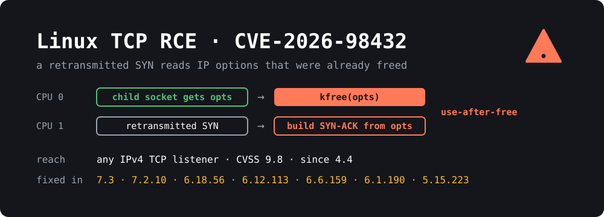
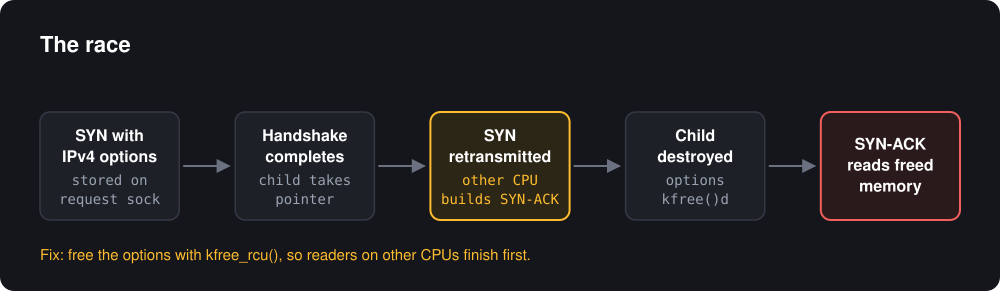
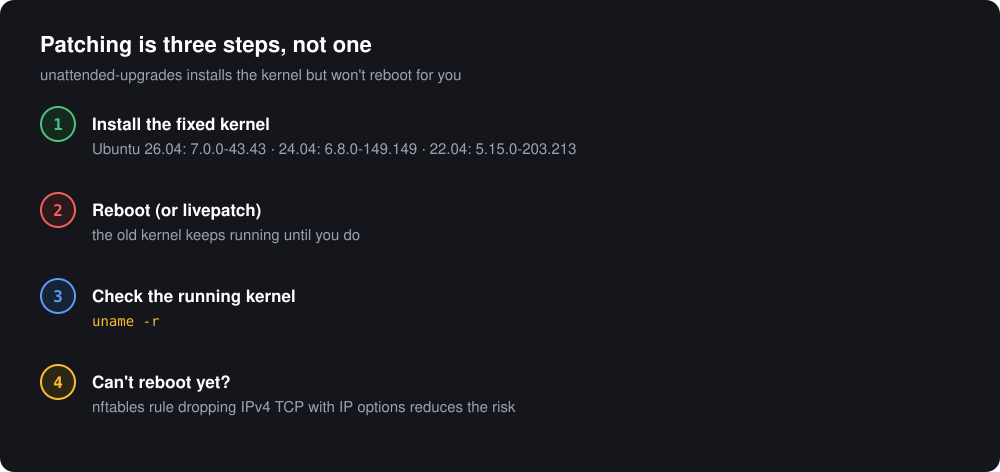

{: width="1000" height="360"}

Most kernel CVEs are local privilege escalations you can triage at leisure. **CVE-2026-98432** is not one of those. It's a **use-after-free in the IPv4 TCP handshake**, rated **CVSS 9.8**, reachable by anyone who can send packets to a listening TCP port, and the buggy code has been in the kernel since **Linux 4.4**. That's ten years of kernels, from your VPS to your Raspberry Pi.

The CVE was published on **October 15**, but it only really took off at the end of October. Anthropic published research showing a working remote-root chain on **October 27**, Red Hat raised its score to 9.8 and shipped fixes on **November 1**, and on **November 3** Marcus Hutchins reported what looked like internet-wide scanning related to it. The distro fixes have now landed in the normal update channels, so this is the week to make sure your machines are actually running them.

> **TL;DR**
> - A race between a new TCP connection and a **retransmitted SYN** lets the kernel read IPv4 options from memory that has already been freed. Remote, no authentication, CVSS **9.8**.
> - **Fixed upstream in:** 7.3, 7.2.10, 6.18.56, 6.12.113, 6.6.159, 6.1.190, 5.15.223, 5.10.272.
> - **Ubuntu:** fixed for 22.04, 24.04, 26.04 and 26.10. 20.04, 18.04 and 16.04 are still in progress.
> - **Installing the update is not enough. You have to reboot** (or livepatch) into the new kernel.
> - No confirmed exploitation in the wild, and it's not in CISA's KEV catalog. There *is* reported scanning, and a lab exploit exists.
> - Stopgap: an nftables rule that drops IPv4 TCP packets carrying IP options. It reduces risk but doesn't fully close the hole.

## What is the bug?

When a client connects to a TCP server, the kernel doesn't create a full socket straight away. It first keeps a lightweight **request socket** for the half-open connection. If the client's SYN carried **IPv4 options** (things like Record Route or Timestamp, which almost nothing legitimate uses today), those options are stored with the request.

When the handshake completes, `tcp_v4_syn_recv_sock()` creates the real **child socket** and hands it the stored options. It hands over the pointer instead of making a copy. Ubuntu's tracker summarises the commit that fixed it:

> ipv4: free inet_opt and ireq_opt after an RCU grace period

The race goes like this:

1. A client sends a SYN with IPv4 options. The kernel stores them on the request socket.
2. The handshake completes and the child socket takes over the options pointer.
3. Meanwhile, the client **retransmits the SYN**. On another CPU, `tcp_check_req()` builds a fresh SYN-ACK and reads the options in `ip_options_build()`.
4. If the child socket gets destroyed in between, `inet_sock_destruct()` frees the options with a plain `kfree()`. The SYN-ACK code is now reading freed memory.

{: width="1000" height="291"}

The root cause goes back to a 2015 change (`079096f103fa`, "tcp/dccp: install syn_recv requests into ehash table") that made request handling lockless. The fix is to free the options with `kfree_rcu()`, so anyone still reading them under RCU finishes before the memory goes away. It went into mainline as `e3f33b0a1d89` during 7.3-rc7.

There's a second, related path. When **request socket migration** is enabled (`net.ipv4.tcp_migrate_req=1`, or a `BPF_SK_REUSEPORT_SELECT_OR_MIGRATE` program), `tcp_v4_reqsk_destructor()` had the same plain-`kfree()` problem. Migration is **off by default**, so most machines are only exposed through the first path.

**IPv6 is not affected** by the main race, because `tcp_v6_syn_recv_sock()` copies the options properly. A smaller IPv6 issue in the migration path (CALIPSO options) is being fixed in a separate patch.

### Is it really remote code execution?

On paper a use-after-free gives you memory corruption, and turning that into code execution is the hard part. Red Hat's description is the conservative one: an unauthenticated remote attacker can cause "kernel memory corruption or an immediate system crash".

What pushed it to 9.8 is the Anthropic write-up. Their researchers (the bug is credited to Xinyang Ge) built a two-stage chain against a server with an **MPTCP** listener. It took about 48 minutes to leak a kernel pointer, then about 5 more minutes to run commands as root. They called it a lab test and haven't published the code.

Two things worth being clear about:

- **MPTCP is not required for the bug.** It was the setting their exploit used. Red Hat says explicitly that having MPTCP enabled is not a precondition, and that turning MPTCP off is **not** a mitigation.
- A reliable crash is much easier than code execution. Even if nobody ever weaponises the RCE, "anyone can panic your server with a few packets" is reason enough to patch.

## Who is exposed?

Short version: **any Linux machine running an unpatched kernel from 4.4 onwards with a TCP port reachable over IPv4**. That's web servers, SSH, reverse proxies, game servers, your Home Assistant box if it's port-forwarded, and so on.

Higher risk:

- Anything with a **public IPv4 address** and open TCP ports, especially VPSes and dedicated servers.
- Servers with **MPTCP listeners**. That's the setup that's been demonstrated. Go programs built with **Go 1.24 or newer** open MPTCP listeners by default where the kernel supports it, so plenty of Go-based self-hosted services qualify without anyone choosing it. Hutchins counted about **2.1 million** MPTCP-reachable servers on port 443 in a scan on October 30.
- **Long-uptime boxes**: the NAS that's been up for 300 days, the forgotten VPS, the Pi under the TV. They have the update installed and the vulnerable kernel still running.

Lower risk:

- Machines with no reachable TCP listeners, or only reachable through a VPN or overlay network you control. Patch anyway. Every device on your LAN can reach them.
- IPv6-only services. The main race is IPv4 only.

**Containers don't help here.** Docker, Podman, LXC and Kubernetes pods all share the host kernel. A patched container image means nothing if the host kernel isn't patched. VMs are different: each guest runs its own kernel and needs its own update and reboot.

## Fixed versions

### Upstream kernels

| Branch | Fixed in |
|---|---|
| 7.3 | **7.3** |
| 7.2 | **7.2.10** |
| 6.18 (LTS) | **6.18.56** |
| 6.12 (LTS) | **6.12.113** |
| 6.6 (LTS) | **6.6.159** |
| 6.1 (LTS) | **6.1.190** |
| 5.15 (LTS) | **5.15.223** |
| 5.10 (LTS) | **5.10.272** |

These matter if you build your own kernels, or run Arch, Fedora, Gentoo or another distro that tracks stable releases closely. The kernel team's advice is to move to the latest stable release rather than cherry-pick the fix.

### Ubuntu (`linux` generic kernel)

| Release | Status | Fixed version |
|---|---|---|
| 26.10 stonking | Fixed | **7.3.0-10.10** |
| 26.04 LTS resolute | Fixed | **7.0.0-43.43** (USN-9018-1) |
| 24.04 LTS noble | Fixed | **6.8.0-149.149** (USN-9022-1) |
| 22.04 LTS jammy | Fixed | **5.15.0-203.213** (USN-9027-1) |
| 20.04 LTS focal | Work in progress | 5.4.0-247.267 (ESM) |
| 18.04 LTS bionic | Work in progress | 4.15.0-263.275 (ESM) |
| 16.04 LTS xenial | Work in progress | 4.4.0-293.327 (ESM) |
| 14.04 LTS trusty | Not affected | - |

Early reports said the Ubuntu fixes were only in the `-proposed` pocket. That was true at the start of November but is out of date now: the fixes for 22.04 and newer were published to `-updates`/`-security` around November 10.

Ubuntu ships a lot of kernel **flavours**, and their status differs. Most cloud kernels (`linux-aws`, `linux-azure`, `linux-gcp`, `linux-oracle`) and `linux-raspi` are fixed on 22.04 and newer. The HWE kernels on 22.04 and 24.04 were the last to arrive, and a few flavours (some NVIDIA kernels, `linux-riscv` on 26.04, most kernels on 20.04 and older) were still listed as vulnerable on Ubuntu's tracker when I checked. Check the [Ubuntu CVE page](https://ubuntu.com/security/CVE-2026-98432) for your exact flavour.

### Other distros

| Distro | Fixed in |
|---|---|
| Debian 13 trixie | `linux` **6.12.113-1** (DSA-6568-1) |
| Debian 12 bookworm | `linux` **6.1.190-1** (DLA-4841-1), `linux-6.12` **6.12.113-1~deb12u1** (DLA-4850-1) |
| RHEL 10.3 | kernel-6.12.0-264.14.1.el10_3 (RHSA-2026:98608) |
| RHEL 10.2 | kernel-6.12.0-211.72.1.el10_2 (RHSA-2026:93413) |
| RHEL 9.8 | kernel-5.14.0-687.64.1.el9_8 (RHSA-2026:93412) |
| RHEL 8.10 | kernel-4.18.0-553.182.1.el8_10 (RHSA-2026:93414) |
| RHEL 7 | Not affected |

Oracle Linux (UEK 7-10), Amazon Linux 2 and 2023 and most supported SUSE releases have fixes out too. The RHEL rebuilds (Rocky, Alma) follow Red Hat's errata. If you're on Raspberry Pi OS, it's Debian-based. Run `sudo apt full-upgrade` and check that the `raspi` kernel version moves.

## How to check your systems

All read-only and safe to run.

**1. Which kernel are you *running*?**

```bash
uname -r
cat /etc/os-release | grep PRETTY_NAME
```

Compare `uname -r` against the tables above. On Ubuntu, `uname -r` shows something like `6.8.0-149-generic`. The `-149` is the ABI number, and the fixed package version is `6.8.0-149.149`.

**2. Is a newer kernel installed but not running?**

This is the one that catches people.

```bash
# Debian / Ubuntu
dpkg -l 'linux-image-*' | awk '/^ii/{print $2, $3}'
ls /var/run/reboot-required 2>/dev/null && cat /var/run/reboot-required.pkgs

# RHEL / Fedora / Rocky / Alma
rpm -q kernel --last | head -3
sudo dnf needs-restarting -r
```

If the newest installed kernel is fixed but `uname -r` shows an older one, **you're still vulnerable**. You just haven't rebooted.

**3. Do you have MPTCP listeners?**

```bash
sysctl net.mptcp.enabled
sudo ss -Mlnp
```

This shows which services match the demonstrated exploit setup. It's useful for deciding what to reboot first, but **an empty list doesn't mean you're safe**. The bug is in plain TCP.

**4. Is request migration on?**

```bash
sysctl net.ipv4.tcp_migrate_req
```

It should be `0`, the default. If something set it to `1`, you're also exposed through the second path.

For what it's worth, my own desktop is on Ubuntu 26.10 and already runs `7.3.0-10-generic`, the fixed build. It got there through a normal upgrade and reboot, without me doing anything special. The machines to worry about are the ones that don't get rebooted.

{: width="1000" height="472"}

## How to patch

### Ubuntu and Debian

```bash
sudo apt update
sudo apt full-upgrade        # pulls in the new linux-image meta package
sudo reboot
```

Use `full-upgrade` (or `dist-upgrade`), not plain `upgrade`. A new kernel ABI means new package names, and plain `apt upgrade` can hold them back. After the reboot, run `uname -r` again and confirm.

**Livepatch**: if you use Ubuntu Pro with Livepatch, check `canonical-livepatch status --verbose` for this CVE. A livepatch buys time on machines you can't reboot immediately, but plan the real reboot anyway.

### RHEL, Rocky, Alma, Fedora

```bash
sudo dnf upgrade --refresh kernel*
sudo reboot
```

### Unattended upgrades won't reboot for you

If you use `unattended-upgrades`, it has very likely installed the fixed kernel already. It does **not** reboot unless you set `Unattended-Upgrade::Automatic-Reboot "true";` in `/etc/apt/apt.conf.d/50unattended-upgrades`. That's how you end up with a fully "updated" server still running a kernel from August.

## Stopgap: drop TCP packets with IP options

If you really can't reboot yet, Red Hat (RHSB-2026-016) and Ubuntu both document an nftables rule that drops incoming IPv4 TCP packets carrying IP options. An IPv4 header without options is exactly 5 words (20 bytes), so `hdrlength > 5` means "has options":

```bash
sudo tee /etc/cve-2026-98432.nft >/dev/null <<'EOF'
table inet cve_2026_98432 {
  chain input {
    type filter hook input priority -310; policy accept;
    ip protocol tcp ip hdrlength > 5 counter drop
  }
}
EOF

sudo nft -f /etc/cve-2026-98432.nft
sudo nft list table inet cve_2026_98432     # the counter shows what it dropped
```

Before relying on it, know its limits:

- Both vendors say it **reduces the risk but does not fully prevent exploitation**.
- It only covers the host's `input` hook. Traffic forwarded to containers or VMs with their own network stacks goes through `forward` instead. On a Docker or Kubernetes host you'd need a matching rule there too.
- It doesn't survive a reboot unless you include the file from `/etc/nftables.conf`. Then again, if you're rebooting, boot into the fixed kernel and you don't need it.
- It breaks anything that legitimately depends on IPv4 options. In practice that's close to nothing on the modern internet, but watch the counter.

To remove it after patching:

```bash
sudo nft delete table inet cve_2026_98432
```

**Things that are *not* mitigations:** turning off MPTCP (`net.mptcp.enabled=0`) doesn't fix the bug and doesn't even close MPTCP sockets that are already open. Keeping `tcp_migrate_req=0` closes the secondary path only.

## Is it being exploited?

As of today, the status is:

- **No confirmed exploitation in the wild.** No vendor, CERT or the kernel CVE team has reported any.
- **Not in CISA's KEV catalog.**
- **Scanning has been reported.** On November 3, Marcus Hutchins posted that he'd seen what looked like a threat actor scanning the internet for MPTCP on port 443 since November 2, from residential proxies and VPN exit nodes. He suspects it's related to this CVE. That's one researcher's observation, and scanning isn't exploitation, but it's the kind of early signal I take seriously.
- **Public PoC code** exists for crashing the kernel (denial of service). There's no public RCE exploit, and Anthropic hasn't released theirs.

Same reasoning as with every bug like this: the fix is public, the write-ups explain the race in detail, and a remote kernel crash is already bad enough. Assume someone is working on a reliable exploit.

## Wrapping up

The bug itself is a classic: a pointer handed to a new owner without a copy, and a reader on another CPU who didn't get the memo. The fix is a couple of `kfree()` calls turned into `kfree_rcu()`. But it sat in the TCP handshake for ten years, and it's reachable from the network.

For most homelabs and servers the to-do list is short:

1. `apt full-upgrade` / `dnf upgrade` on everything.
2. **Reboot**, and confirm with `uname -r`.
3. Find the boxes that never reboot (NAS, Pis, the old VPS) and do them too.
4. If something truly can't reboot this week, add the nftables rule and put it on the list for next week.

If you're running Ubuntu 26.04 and thinking about moving up anyway, 26.10 already ships the fixed 7.3.0-10 kernel. I wrote up the [26.04 to 26.10 upgrade]() last week. It's not required for this fix, though: 26.04's 7.0.0-43 kernel is patched too.

## Sources

- [Ubuntu CVE tracker: CVE-2026-98432](https://ubuntu.com/security/CVE-2026-98432)
- [Debian security tracker: CVE-2026-98432](https://security-tracker.debian.org/tracker/CVE-2026-98432)
- [Mainline fix commit e3f33b0a1d89](https://git.kernel.org/linus/e3f33b0a1d89d738e2b913dab519226eaf76e15b)
- [Red Hat: CVE-2026-98432](https://access.redhat.com/security/cve/CVE-2026-98432)
- [Red Hat security bulletin RHSB-2026-016](https://access.redhat.com/security/vulnerabilities/RHSB-2026-016)
- [Anthropic: Discovering vulnerabilities with Claude](https://www.anthropic.com/research/discovering-vulnerabilities-with-claude)
- [Rescana: Linux kernel TCP CVE-2026-98432](https://www.rescana.com/post/linux-kernel-tcp-cve-2026-98432-use-after-free-prepare-now)
- [SOC Prime: CVE-2026-98432 analysis](https://socprime.com/blog/cve-2026-98432-critical-linux-kernel-tcp-flaw-enables-remote-code-execution/)
- [Cyber Security News: scanning in the wild](https://cybersecuritynews.com/linux-kernel-rce-flaw-ubuntu-fixes/)
- [DEV: how to patch CVE-2026-98432](https://dev.to/kunalvohra/linux-kernel-tcp-vulnerability-cve-2026-98432-november-2026-what-it-is-and-how-to-patch-your-53fg)
