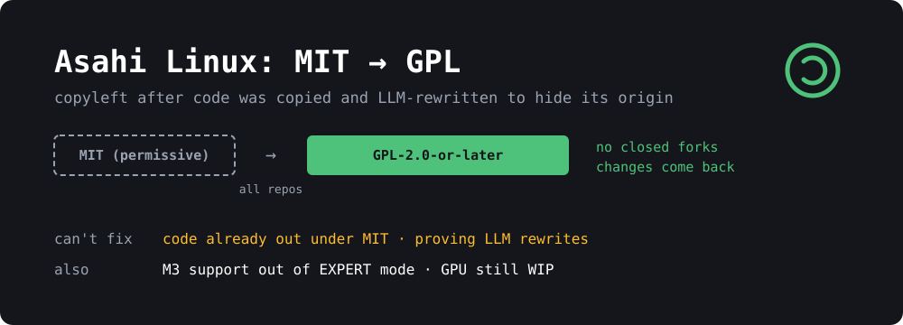

{: width="1000" height="360"}

Asahi Linux, the project that made Linux actually usable on Apple Silicon Macs, is changing its license. In the [Linux 7.3 progress report](https://asahilinux.org/2026/11/progress-report-7-3/) (November 7, written by James Calligeros), the team announced they've decided to:

> "begin the process of transitioning all of our repositories to the GNU General Public License version 2 or later."

And, more bluntly:

> "Going forward all Asahi Linux code will be licenced under strong copyleft licences only."

License changes usually make for boring news. This one isn't, because of *why* they're doing it: people were taking Asahi's unfinished code, running it through LLMs to hide where it came from, and using it to build competing, monetised projects. MIT allowed all of that.

> **TL;DR**
> - Asahi Linux is moving **all** its repositories from **MIT** to **GPL-2.0-or-later**. The transition has started, it isn't finished.
> - Reason: code was "lifted straight out of" developers' personal forks, published without attribution, or "lazily rewritten with LLM assistance to obfuscate its origin", by people trying to replace the project and monetise it.
> - The GPL doesn't make copying illegal. It makes **closed, proprietary forks** illegal, and it gives the project something to enforce.
> - It **can't** take back code already released under MIT, and it doesn't really solve the LLM-rewrite problem. More on that below.
> - Same report: **M3 Mac support is now generally available**, no EXPERT flag needed. The GPU still isn't accelerated.

## What actually happened

The progress report doesn't name names, so neither can I. Here's what it does say:

> "Some time ago, we were made aware of multiple attempts to exploit our permissive licensing to hijack our work, with a direct view to replacing the project and aggressively monetising Linux on Apple Silicon."

And the part that made this a story:

> "In some extreme cases, in-development feature code was being lifted straight out of our personal forks and published without attribution or lazily rewritten with LLM assistance to obfuscate its origin."

Those are really two separate practices:

1. **Plain copying without attribution.** Taking work-in-progress code from a developer's public fork on GitHub, before it was even merged into Asahi, and shipping it as your own. MIT asks for exactly one thing in return, keeping the copyright notice, and even that was skipped.
2. **LLM laundering.** Feeding the code to an LLM and asking it to "rewrite" it, so the result doesn't look like a copy anymore. Same logic, same reverse-engineered hardware knowledge, different variable names and structure.

The team's view on MIT is short:

> "The MIT licence explicitly allows this, and has no carveouts to protect against bad faith actors."

To be fair, the first case was never allowed even under MIT, since dropping the attribution breaks the license. But MIT gives you almost nothing to work with: someone who keeps a one-line notice in a file nobody reads is fully compliant, and can keep every change they make closed.

The report also mentions "the insatiable appetite of frontier AI labs for high-quality training data" as part of the background. It doesn't say an AI lab was involved in any of these incidents. It's more a general point that permissively licensed code ends up everywhere.

### Why this hurts Asahi in particular

Most of Asahi's value isn't lines of code. It's **reverse engineering**: years of work figuring out how Apple's undocumented GPU, display controller, audio and power management actually behave. The code is just how that knowledge gets written down.

That's exactly what an LLM rewrite takes. You don't have to understand how the M3's display controller works if you can take someone's working driver and have a model rephrase it. The hard part has already been done.

It's also a small team. Founder Hector Martin stepped down in early 2025, and the project has been run by the remaining developers since then. A well-funded company forking their work, closing it and selling "Linux for your Mac" would be a serious threat to a project like that.

## What the GPL actually changes

It helps to be precise here, because "they switched to the GPL to stop copying" isn't quite right.

| | MIT | GPL-2.0-or-later |
|---|---|---|
| Copy, modify, redistribute | ✅ | ✅ |
| Use commercially, sell it | ✅ | ✅ |
| Keep your changes closed | ✅ | ❌ (if you distribute it) |
| Ship it inside a proprietary product | ✅ | ❌ |
| What you owe the original authors | A copyright notice | Notice **and** your source code, under the same license |

So the GPL doesn't stop anyone from forking Asahi, or from making money with it. What it stops is the specific move the team describes: take the community's work, add a few improvements, close the source and sell it as a replacement. Under the GPL, anyone shipping a derived version has to publish their changes under the GPL, which Asahi can then pull back in. The fork stops being a one-way street.

"Or later" matters too. It means the code can be used under GPLv3 as well, which lines up with the Linux kernel (GPLv2-only, where Asahi's kernel drivers live anyway) and leaves room for future versions.

The report compares this to **WINE**, which made the same move in 2002, from MIT to the LGPL, after commercial forks kept taking its work without giving anything back. Twenty-four years later, WINE is still around and still open.

## What the GPL can't fix

This is where it gets uncomfortable, and where I think the LLM part of the story is more interesting than the license part.

**Code already released under MIT stays MIT.** A license change only applies going forward. Anyone who copied a version that was published under MIT can keep using that version under MIT, forever. The GPL protects the work Asahi does from now on, not the work they've already done.

**The GPL only helps if you can prove copying.** The GPL is a copyright license. To enforce it you have to show that someone's code is *derived from* yours. With a straight copy that's easy. With an LLM rewrite, where the structure and names have changed but the logic is the same, it's much harder. Is it a derived work? Or did the model just "learn" how the hardware works and write an independent implementation? Courts haven't given a clear answer to that yet, and anyone laundering code is betting they won't.

**Unmerged code in personal forks is a gap.** The incidents involved code taken from developers' *personal forks*, before it was merged. Whatever license applies there depends on what's in that fork. Switching the main repositories to the GPL closes that gap only if the forks follow.

So the GPL isn't a fix for LLM laundering. It's the strongest tool a small open-source project has right now: it makes the obvious abuse illegal, makes it riskier to get caught, and gives the project grounds to send a takedown. But a sufficiently careful launderer is still hard to catch.

### The bigger picture

I've written about [vibe coding vs spec-driven development]() and [OpenCode vs Claude Code](), and I use AI coding tools every day. So I want to be careful not to make this a "LLMs bad" post. Rewriting code with an LLM is a normal, useful thing to do with *your own* code.

But the Asahi case shows a real shift in what permissive licenses mean. MIT and BSD were written for a world where copying someone's work and hiding it still took effort, and the social cost of getting caught kept most people honest. When "rewrite this so it doesn't look copied" is a single prompt, that effort is gone. I expect more projects that hold hard-won, reverse-engineered knowledge (drivers, firmware, file format parsers, emulators) to follow Asahi to copyleft.

Whether you think that's good probably depends on which side of the old MIT-vs-GPL argument you were already on. Permissive licenses exist so that anyone, companies included, can use the code with no strings attached. Some of those people just turned out to want more than the license was ever meant to give.

## Also in the same report: M3 is generally available

The licensing news overshadowed it, but the 7.3 report also had good news for M3 owners:

> "M3 support is now generally available without the EXPERT flag!"

M3 support first arrived in September behind the installer's `EXPERT` flag. Early adopters reported almost no issues, so it's now available to everyone. According to the report:

- M3 is **mostly at feature parity with M1 and M2**.
- **Display controller (DCP)** support brings working sleep, better performance and battery life, and a usable notch area on supported MacBooks.
- The **GPU is the big exception**. The team has the M3 GPU initialised and drawing a triangle in m1n1, but there's no acceleration yet. Expect software rendering for now.
- **M4 Pro/Max and M5** only boot to a text console (TTY) so far.
- **Thunderbolt** works for USB3 and Thunderbolt networking, but not PCIe or DisplayPort tunnelling.

New m1n1 and kernel updates were due "in the coming days" after the report. If you're on an M3 and were waiting for it to be official, the usual installer gets you there:

```bash
curl https://alx.sh | sh
```

As always with this installer, read what it's going to do before you agree to anything. It resizes your macOS partition.

## Wrapping up

Asahi switching to the GPL isn't really about licenses. It's about a small team doing years of hard reverse engineering, then watching others take that work, run it through an LLM and try to sell it back as a replacement. The GPL won't stop a determined copier, and it can't undo what's already out under MIT, but it turns "aggressively monetising" their work into something they can actually fight.

If you maintain an open-source project built on hard-to-get knowledge, it's worth asking yourself the same question they did: is MIT still protecting what you actually care about?

## Sources

- [Asahi Linux: Progress Report: Linux 7.3](https://asahilinux.org/2026/11/progress-report-7-3/)
- [Asahi Linux blog](https://asahilinux.org/blog/)
- [Linuxiac: Asahi Linux Moves from MIT to GPL Licensing, Expands M3 Support](https://linuxiac.com/asahi-linux-moves-from-mit-to-gpl-licensing-expands-m3-support/)
- [Linuxiac Weekly Wrap-Up: Week 46, 2026](https://linuxiac.com/linuxiac-weekly-wrap-up-week-46-2026-november-9-15/)
