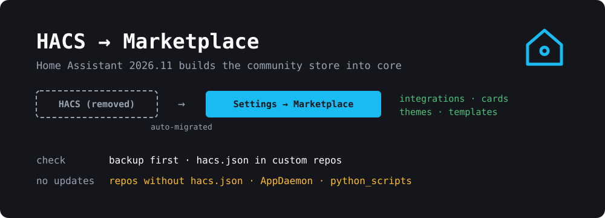

{: width="1000" height="360"}

For years, the first thing almost everyone did after installing Home Assistant was install **HACS**. It's how you got the custom integrations, dashboard cards and themes that aren't in core: Mushroom cards, Bubble Card, Alexa Media Player, half the integrations for cheap Chinese devices.

With **Home Assistant 2026.11** (released November 4) that's over, in a good way. HACS is now built into Home Assistant as the **Marketplace**, under **Settings → Marketplace**. There's nothing to install, it works on every installation type including plain Docker, and existing HACS setups are migrated automatically on the first start after the update.

For most people this really is a non-event. But there are a few things worth checking before you click Update, and a few things that quietly stop working afterwards.

> **TL;DR**
> - HACS is replaced by the built-in **Marketplace** (Settings → Marketplace). Migration is **automatic** on first start.
> - Everything you installed stays installed and keeps getting updates. Custom repositories carry over.
> - A repo **without a `hacs.json`** stays installed, but the Marketplace **can't update it**.
> - **AppDaemon apps and Python scripts** stay where they are but get **no more updates**.
> - The standalone HACS installer refuses to run on 2026.11+, and the old HACS gets no new releases.
> - **Take a backup first.** The only supported rollback is restoring one.

## What the Marketplace is

Same idea as HACS, now part of Home Assistant itself and maintained by the Home Assistant project. It covers **integrations, dashboard cards, themes and templates**.

What's different from HACS in day-to-day use:

- **Installing an integration doesn't need a restart.** You click Install and land straight in its setup flow. Updates still need a restart for now.
- **Updates show up in Settings → Updates**, next to Core and OS updates. Each installed project gets its own update entity. After an update, a repair tells you when a restart is needed and can do it for you.
- **No GitHub account needed** to browse, install or update from the community catalog. You only need to connect GitHub (via device sign-in, so no password in HA) to add **custom repositories**. The connection only reads public information and can't see your private repos.
- **Browse and Installed** lists can be grouped by status, type or source, and filters are kept in the URL so you can share a view. You can select several installed items and uninstall them at once.
- Project pages show the README, download count, GitHub stars and the minimum Home Assistant version.

The release notes also make a point of saying: "Everything in the Marketplace is free, and that will not change."

### The risk notice

The first time you open the Marketplace, it shows a notice. Everything in it is community-made and "not tested, audited, or supported by the Home Assistant project", and it runs inside your Home Assistant with the same access as everything else. You can browse without accepting, but **nothing can be installed or updated until you tick "I understand the risks and agree"**. That includes updates triggered from automations.

This isn't new risk. HACS integrations always ran with full access to your instance. It's just finally written down where people will see it. If you have an automation that auto-installs Marketplace updates, it'll quietly do nothing until someone opens the Marketplace and accepts.

## What the migration actually does

From the [Marketplace docs](https://www.home-assistant.io/integrations/marketplace/), on the first start after updating:

- **The HACS integration is removed, together with its files.** You don't need to uninstall it yourself.
- **Installed items stay installed** and keep receiving updates. Custom repositories and update entities carry over, with their names, areas and labels.
- **Dashboard resources move to `/local/community/`.** Old `/hacsfiles/` paths still work. If you define dashboard resources in YAML, you get a repair asking you to update them.
- **Links and buttons made for HACS** (like the "Open in HACS" badges in READMEs) now open the repository in the Marketplace. Bookmarks to `/hacs` redirect too.
- **AppDaemon apps and Python scripts stay installed but get no more updates.** A repair lists them. The Marketplace doesn't cover these categories.

The files stay in the usual places: integrations in `custom_components/`, cards in `www/community/`, themes in `themes/`, templates in `custom_templates/`. On Home Assistant OS that's all under `/config`.

## Before you update: a checklist

**1. Take a full backup.**

Settings → System → Backups → Back up now. The docs are blunt about rollback: don't try to downgrade with "Install another version", restore a backup instead. If something goes wrong, the backup is your only clean way back.

**2. Update your HACS stuff while it's still HACS.**

This tip comes from [raspberry.tips](https://raspberry.tips/en/smart-home/home-assistant-2026-11-whats-new): update every pending integration and card in HACS *before* updating Core. You'll migrate with current versions, and if one of them breaks you'll know it wasn't the migration.

**3. Check your custom repositories for `hacs.json`.**

This is the one real gotcha. The Marketplace requires custom repos to be a public GitHub repository with a `hacs.json` file describing them, plus the standard folder layout for their type. Per the docs, a repo without `hacs.json` **"stays installed, but the Marketplace cannot update it."**

Open HACS → three dots → Custom repositories and go through the list. For each repo, check on GitHub whether there's a `hacs.json` in the root. Anything in the default HACS catalog is fine, and so are most well-maintained repos. It's the old forks and one-person projects you added years ago that are at risk.

**4. Check your integrations support 2026.11.**

2026.11 is a big release with a naming overhaul and a long list of breaking changes. Some custom integrations needed their own update afterwards. SonoffLAN was one that got reported. If you depend on a custom integration, look at its GitHub issues for "2026.11" before you update.

**5. Look for anything that talks to HACS directly.**

Most people can skip this. But if you have:

- templates using `integration_entities('hacs')` (they now return nothing, use `'marketplace'` instead),
- scripts or custom tools calling `hacs/...` WebSocket commands (now "unknown command"; the replacement `marketplace/` commands use a different format),
- custom integrations that read `.storage/hacs.*` or `hass.data["hacs"]` (gone),

...they'll stop working after the update.

For the first one, the fix looks like this:


```yaml
# before
{{ integration_entities('hacs') | select('match', 'update.') | list }}

# after
{{ integration_entities('marketplace') | select('match', 'update.') | list }}
```


## After the update

Open **Settings → Marketplace**, accept the notice, and check **Installed**. Everything you had should be there. Then look at **Settings → Repairs**. That's where the migration reports anything it couldn't handle: AppDaemon apps and Python scripts that won't update anymore, YAML dashboard resources, repos it can't update.

A couple of other things to know:

- **Repos removed from the catalog.** The catalog sometimes drops a repository, for example when its author stops maintaining it. Whatever you installed keeps working but gets no more updates, and you get a repair. Repos flagged as **critical** (think: known-malicious or dangerously broken) are uninstalled automatically, and Home Assistant restarts.
- **Update checks.** The community catalog is checked every 6 hours. Custom repos are checked every 48 hours, and only with a GitHub connection.
- **Pre-releases** are off by default. There's a per-repo "Pre-release" switch if you want betas of a specific card.
- **You can disable the Marketplace** under Settings → Devices & services → Marketplace → three dots → Disable. Deleting the entry doesn't work, it comes back.

## What if I just stay on 2026.10?

HACS keeps working on older versions, but it **won't get any new releases**. And the HACS installer refuses to run on 2026.11 and newer, with the message "HACS does not work on Home Assistant 2026.11 and newer." Staying behind on Home Assistant to keep HACS isn't a plan, it's just postponing the migration while missing security and bug fixes. The migration is automatic and painless for most setups. Do it.

## The other 2026.11 gotchas

Not Marketplace-related, but they bit people who updated last week:

- **"Invalid client id" on remote access.** If you reach Home Assistant through a reverse proxy, public IP or a non-local address, the browser address now has to match what HA sees. Add your proxy to `trusted_proxies` in the `http:` config, or use your domain name.
- **Entity naming changes.** Cards without an explicit name now show "device name + entity name". Some dashboards look different until you tidy up names.
- **Z-Wave JS** needs zwave-js-server 3.11.0+ (Z-Wave JS app 1.9.0+, Z-Wave JS UI 11.24.2+). **Uptime Kuma** below 2.0.0 is no longer supported. The legacy **Telegram** notify platform is gone.
- **Older tablets.** The frontend now needs Chrome 67, Safari 15.4 or Firefox 98. If your wall panel is an old iPad Air 1 or iPad mini 2/3, it won't load the dashboard anymore.

The patch releases so far, **2026.11.1** (November 9) and **2026.11.2** (November 16), are mostly integration fixes. Neither changes how the Marketplace migration works, so there's no reason to wait for them. Just update straight to the latest.

## Wrapping up

HACS was always the slightly awkward part of setting up Home Assistant: a GitHub token, a separate installer, a sidebar entry that felt bolted on. Having it in core, with update entities, no-restart installs and an honest risk notice, is how it should have worked from the start.

The short version:

1. Back up.
2. Update everything in HACS one last time.
3. Check your custom repos for `hacs.json`.
4. Update to 2026.11 and look at Repairs.

If you're running Home Assistant on a Pi, I wrote about [monitoring a Raspberry Pi in Home Assistant with MQTT]() last week. And if you're still deciding which Pi to run it on, there's my [Raspberry Pi buying guide after the price rise]().

## Sources

- [Home Assistant 2026.11 release notes](https://www.home-assistant.io/blog/2026/11/04/release-202611/)
- [Home Assistant docs: Marketplace integration](https://www.home-assistant.io/integrations/marketplace/)
- [raspberry.tips: Home Assistant 2026.11, what's new](https://raspberry.tips/en/smart-home/home-assistant-2026-11-whats-new)
- [techzeitgeist: what HACS users should check before updating (German)](https://www.techzeitgeist.de/home-assistant-2026-11-was-hacs-nutzer-vor-dem-update-pruefen/)
- [smarthomeassistent: Home Assistant 2026.11.1 (German)](https://www.smarthomeassistent.de/home-assistant-2026-11-1/)
