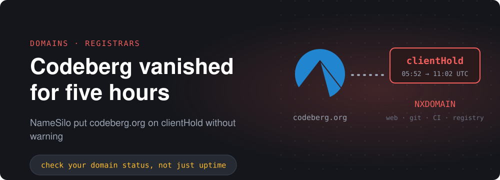
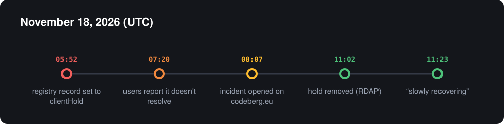
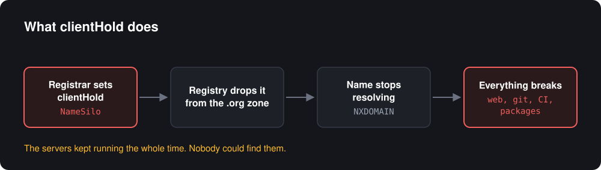
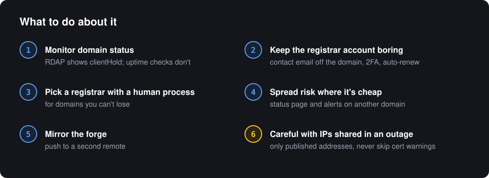

{: width="1000" height="360"}

This morning [Codeberg](https://codeberg.org), the non-profit Git host behind Forgejo, Zig, GNU Guix, Libreboot and a lot of other projects, disappeared from the internet. The servers were fine and nobody hacked anything. Its domain registrar, NameSilo, put `codeberg.org` on **clientHold**, and DNS for the domain stopped working.

Things are back now. But the outage shows a weak spot that almost every self-hosted service has, and that most of us never think about: the company you pay $15 a year for your domain can switch your whole service off, and it doesn't have to tell you first.

> **TL;DR**
> - On **November 18, 2026**, the `.org` registry record for codeberg.org was set to **clientHold** at about **05:52 UTC**. The domain stopped resolving, so the website, Git over HTTPS and SSH, CI, the package registry and the docs were all unreachable.
> - Codeberg says it got **no warning**, the domain hadn't expired and there were no suspicious logins. NameSilo confirmed the suspension and passed the case to its **abuse team**.
> - The hold was lifted around **11:02 UTC**. As of this evening the domain resolves normally and only the usual transfer lock is left.
> - **NameSilo hasn't said why.** The cause is still unknown.
> - The lesson for the rest of us: a registrar is a single point of failure. Monitor your domain status, keep your contact details verified, mirror your repos, and don't assume a backup domain can be switched on in an hour.

## What happened

Here's the timeline as best I can piece it together (times in UTC):

| Time | What happened |
|---|---|
| ~05:52 | The registry record for codeberg.org changes to **client hold** ([PrivacyAffairs](https://www.privacyaffairs.com/codeberg-domain-outage/), from the public registry record) |
| ~07:20 | Users start reporting that codeberg.org doesn't resolve |
| 07:46 | Forgejo postpones its planned security release "due to urgent issues with Codeberg" |
| 08:07 | Codeberg opens an incident on its status page, which runs on `codeberg.eu` |
| 08:13 | Codeberg [posts on Mastodon](https://social.anoxinon.de/@codebergstatus/117636437840688845) that the domain has disappeared |
| later | NameSilo [confirms the suspension](https://social.anoxinon.de/@codebergstatus/117636595327014447) and forwards the case to its abuse team |
| 11:02 | The RDAP record's "last changed" timestamp, most likely the moment the hold was removed |
| 11:23 | Codeberg [posts](https://social.anoxinon.de/@codebergstatus/117637187711177698) that the domain "is slowly recovering" |

{: width="1000" height="248"}

That's roughly **five hours** with no DNS, plus however long it took for the change to reach resolvers that had cached the failure.

According to Codeberg, the domain "entirely disappeared" from its NameSilo account. It hadn't expired (it's paid up until **July 2028**), it hadn't been transferred, and the account showed no suspicious logins. Codeberg also says it got no warning before the suspension.

### What clientHold actually means

Every domain has one or more [EPP status codes](https://icann.org/epp). Most of the time you'll only see harmless ones like `clientTransferProhibited` (the normal lock that stops someone from stealing your domain with a transfer).

**`clientHold`** is different. It tells the registry to **stop publishing the domain in DNS**. The domain is still yours and the registration is still valid, but as far as the internet is concerned it doesn't exist. Every hostname under it, every MX record, every TXT record, all gone.

The "client" part means the **registrar** set it, not the registry (that would be `serverHold`). It's the registrar's off switch, and registrars use it for things like:

- **Unverified contact details.** ICANN rules require registrants to confirm their contact email. NameSilo's own [help page on clientHold](https://www.namesilo.com/blog/en/domain-name-search/how-to-fix-the-clienthold-domain-status-code) says a domain can be put on hold if that isn't done within 15 days.
- **Abuse reports.** Someone reports the domain for spam, phishing or malware, and the registrar suspends it "pending investigation".
- **Unpaid or disputed payments.**

Codeberg's case went to the abuse team, which points to the second one. But neither NameSilo nor Codeberg has said what the actual trigger was, so I won't guess.

{: width="1000" height="283"}

### What broke

With no DNS, nearly everything under `codeberg.org` stopped working:

- the website, the issue trackers and pull requests
- `git clone`, `git pull` and `git push`, over both HTTPS and SSH
- Codeberg's CI
- the container and package registry
- the docs, the forum and the Weblate translation service

The knock-on effects reached far beyond Codeberg's own users. Anything that **pulls from codeberg.org at build time** failed: Go modules hosted there, Git dependencies, container images, distro package builds that fetch source tarballs. If your CI pipeline cloned a dependency from Codeberg this morning, it went red, and it was nothing to do with your code.

**Codeberg Pages** on `codeberg.page` kept working, because it's a separate domain. That detail matters later.

### The Forgejo security release got caught in the middle

The worst timing was Forgejo's. A security release was planned for today, and Forgejo [said it couldn't go ahead](https://floss.social/@forgejo/117636334439245475) because of the Codeberg problems. According to PrivacyAffairs, the patches had already been **briefly public** as part of the release process. So the fix was visible, but the release wasn't out.

Forgejo hasn't said what the vulnerability is or which versions are affected. If you run your own Forgejo, keep an eye on their announcements over the next few days and update as soon as the release lands. I'm not repeating any specific mitigation here, since nothing official has been published that I could check.

## Why didn't they just switch to codeberg.eu?

Codeberg already owns `codeberg.eu` (its status page runs there), so this was the obvious question. Codeberg [decided against it](https://social.anoxinon.de/@codebergstatus/117636704185632849). According to [heise](https://www.heise.de/en/news/GitHub-alternative-Codeberg-loses-domain-and-goes-offline-11529269.html) and [Linuxiac](https://linuxiac.com/codeberg-domain-suspended-by-namesilo-disrupting-open-source-projects/), the reasons were:

- Forgejo is set up for **one domain**. Serving it under a second one isn't a config change you make in a few minutes.
- **TLS certificates**, **2FA** (WebAuthn keys are tied to the domain they were registered on) and **OAuth** integrations all depend on the hostname.
- Every user would have to **change their Git remotes**, and every `go.mod`, CI config and README link would still point at codeberg.org.
- Once the real domain came back, the temporary one would have to be wound down again.

It would have taken more than a few hours, and the domain might have come back by then anyway. Which it did.

I think that's the right call, and it's a useful reality check: **a backup domain is not a quick failover** unless your app was built for it from the start. For a static site you can point a second domain at the same server in five minutes. For anything with logins, it's a project.

## The bigger issue: your registrar is a single point of failure

I run a handful of services at home, plus this blog, and I'll admit I'd never given my registrar much thought. I picked it on price and the UI, and that's it. Codeberg isn't a hobby project, it's a registered non-profit with paying members, and it still got switched off without a single email.

There have been similar cases before. Heise points out that Italian activist host Autistici/Inventati lost access to its domain in September. And registrar-level suspensions after abuse reports, sometimes false or automated, are a known problem. The registrar has to act fast on real phishing domains, and the side effect is that a legitimate service can go down on the strength of one complaint.

You can't remove that risk completely. You can make it less likely and make it hurt less.

{: width="1000" height="364"}

### 1. Monitor your domain's status, not just your site

Uptime monitors check whether your site answers. They'll tell you the domain is down, but not why. RDAP, the modern replacement for WHOIS, tells you the domain's status directly:

```bash
curl -sL https://rdap.org/domain/codeberg.org | jq -r '.status[]'
```

Right now that prints:

```
client transfer prohibited
```

This morning it would have shown `client hold`. The same record also tells you when it expires and when it last changed:

```bash
curl -sL https://rdap.org/domain/codeberg.org \
  | jq -r '.events[] | "\(.eventAction) \(.eventDate)"'
```

```
expiration 2028-07-05T08:54:30.473Z
registration 2018-07-05T08:54:30.473Z
last changed 2026-11-18T11:02:51.801Z
last update of RDAP database 2026-11-18T20:34:07.016Z
```

Here's a small script you can run from cron that checks your domains for a hold status and warns if any expire within 30 days. It prints nothing and exits 0 when everything's fine, so it plays nicely with cron's mail-on-output or any monitoring tool that checks exit codes:

```bash
#!/usr/bin/env bash
# domain-hold-check.sh: warn if a domain is on hold or expires soon (RDAP via rdap.org)
set -euo pipefail
WARN_DAYS=30
rc=0
for d in "$@"; do
  json=$(curl -sfL -m 20 "https://rdap.org/domain/$d") || { echo "$d: RDAP lookup failed"; rc=1; continue; }
  status=$(jq -r '.status[]?' <<<"$json")
  if grep -qiE 'hold|redemption|pending delete' <<<"$status"; then
    echo "$d: PROBLEM status: $(paste -sd, <<<"$status")"; rc=1
  fi
  exp=$(jq -r '.events[]? | select(.eventAction=="expiration") | .eventDate' <<<"$json")
  if [[ -n $exp ]]; then
    days=$(( ($(date -d "$exp" +%s) - $(date +%s)) / 86400 ))
    (( days < WARN_DAYS )) && { echo "$d: expires in $days days ($exp)"; rc=1; }
  fi
done
exit $rc
```

```bash
# every hour
0 * * * * /usr/local/bin/domain-hold-check.sh example.com example.org
```

It needs `curl` and `jq`, and `date -d` is GNU-specific, so on macOS use `gdate` from coreutils. Don't run it every minute; rdap.org is a free service that redirects to the registry's RDAP server, and hourly is plenty.

If you use [Home Assistant to monitor your Pis]() or something like Uptime Kuma, it's easy to wire the exit code into a notification instead.

### 2. Keep your registrar account boring and up to date

Most clientHolds you'll ever see in real life aren't abuse cases. They're a contact email nobody reads.

- Use a **contact email that isn't on the domain itself**. If `admin@example.com` is your registrar contact and example.com goes on hold, the registrar's "please fix this" email never arrives.
- **Answer the ICANN verification email** whenever you change registrant details or transfer a domain. You have 15 days.
- Turn on **2FA** on the registrar account and keep **auto-renew** on with a card that won't expire next month.
- Know where your registrar's **abuse contact** and support channel are *before* you need them. Codeberg was waiting on an abuse team for hours.

### 3. Put critical domains with a registrar that has a human process

This is the hard one, because you can't really test it in advance. Some things to look at:

- Does the registrar promise **notice before suspension** for abuse reports, except in clear-cut cases like active phishing?
- Is there a **real support channel**, not just a ticket form with a 72-hour SLA?
- For a project the size of Codeberg, a registrar that offers **registry lock** (changes need out-of-band verification at the registry) and a named account contact is worth paying more for.

I'd expect Codeberg to move registrars once the transfer lock allows it, but they haven't said so, and NameSilo hasn't explained anything yet, so that's just my guess.

### 4. Spread the risk across domains where it's cheap

Codeberg's status page lived on `codeberg.eu` and Pages lived on `codeberg.page`, and both kept working. That's the cheap version of domain redundancy, and it's worth copying:

- Host your **status page** on a different domain, ideally with a different registrar. Otherwise you can't tell users what's going on.
- Keep **outgoing notifications** (monitoring alerts, your own email) off the domain they're monitoring.
- Have your **docs** say where to go if the main domain is down.

### 5. If you depend on a forge, mirror it

For the projects that host *on* Codeberg, or any single forge, the fix is boring and old: have more than one copy.

Git can push to several remotes in one go:

```bash
git remote set-url --add --push origin git@codeberg.org:me/project.git
git remote set-url --add --push origin git@github.com:me/project.git
git push   # now goes to both
```

You need to add the original URL as a push URL as well, because the first `--add --push` replaces the default one. Check with `git remote -v`.

For dependencies, the safety nets already exist:

- **Go:** modules fetched through `proxy.golang.org` (the default) are cached, so versions that someone has already downloaded through the proxy keep working even when the origin is down. Running `go mod vendor` for critical builds removes the dependency completely.
- **CI:** cache or vendor dependencies instead of cloning them on every run.
- **Your own Forgejo or Gitea:** a self-hosted pull mirror of the repos you rely on is a few clicks. See my [self-hosting posts](/category/selfhosting/) for the rest of that rabbit hole.

### 6. Don't trust random IPs during an outage

During the outage, people on Mastodon shared the server's IP address (`217.197.84.140`, which is what codeberg.org resolves to again now) as a way in. That worked, but it's a habit to be careful with. In a DNS outage it's easy to get people to accept a different IP, a TLS warning or a changed SSH host key, and that's exactly what an attacker would want.

If you do pin an address in `/etc/hosts` during an outage, use one the service itself has published, **never click through a certificate warning**, and check SSH fingerprints against [Codeberg's published ones](https://docs.codeberg.org/security/ssh-fingerprint/) rather than typing "yes". And remove the entry afterwards.

## What we still don't know

- **Why NameSilo did it.** No public statement from NameSilo so far. Heise asked NameSilo, Codeberg and the `.org` registry (PIR) for comment.
- **Whether it's settled.** The domain is back, but nothing I've read says the abuse case is formally closed.
- **Speculation.** Red Hat's Jan Wildeboer [wondered](https://social.wildeboer.net/@jwildeboer/117636743933691425) whether a company had a problem with a repository hosted on Codeberg, and heise mentions other possibilities, including Codeberg's history with DDoS and spam attacks. Heise also reports that the `/r/codeberg` subreddit was banned around the same time. None of it is confirmed, so treat it as speculation.

I'll update this post if NameSilo or Codeberg publishes an explanation.

## Wrapping up

Codeberg's servers were fine the whole time. What took it down for five hours was a status flag at a registrar, set without a warning and, so far, without an explanation. That should make anyone running a service on their own domain a little uncomfortable, because the same flag exists on yours.

You can't fully protect yourself from a registrar that decides to act first and ask later. But you can notice within the hour instead of when users start emailing, keep your status page somewhere else, and make sure your code and your dependencies live in more than one place. That's what made today a bad morning for Codeberg instead of a lost week.

## Sources

- [Codeberg status on Mastodon: domain disappeared](https://social.anoxinon.de/@codebergstatus/117636437840688845)
- [Codeberg status: suspension confirmed, case forwarded to abuse team](https://social.anoxinon.de/@codebergstatus/117636595327014447)
- [Codeberg status: decision not to enable codeberg.eu](https://social.anoxinon.de/@codebergstatus/117636704185632849)
- [Codeberg status: domain slowly recovering](https://social.anoxinon.de/@codebergstatus/117637187711177698)
- [heise: GitHub alternative Codeberg loses domain and goes offline](https://www.heise.de/en/news/GitHub-alternative-Codeberg-loses-domain-and-goes-offline-11529269.html)
- [heise (German, with update): Codeberg verliert Domain und ist nicht erreichbar](https://heise.de/news/GitHub-Alternative-Codeberg-verliert-Domain-und-ist-nicht-erreichbar-11529143.html)
- [Linuxiac: Codeberg Domain Suspended by NameSilo, Disrupting Open-Source Projects](https://linuxiac.com/codeberg-domain-suspended-by-namesilo-disrupting-open-source-projects/)
- [PrivacyAffairs: Codeberg.org Down: Domain on Hold, Forgejo Security Fix Delayed](https://www.privacyaffairs.com/codeberg-domain-outage/)
- [Forgejo on Mastodon: security release postponed](https://floss.social/@forgejo/117636334439245475)
- [NameSilo: How to fix the clientHold domain status code](https://www.namesilo.com/blog/en/domain-name-search/how-to-fix-the-clienthold-domain-status-code)
- [ICANN: EPP status codes](https://icann.org/epp)
