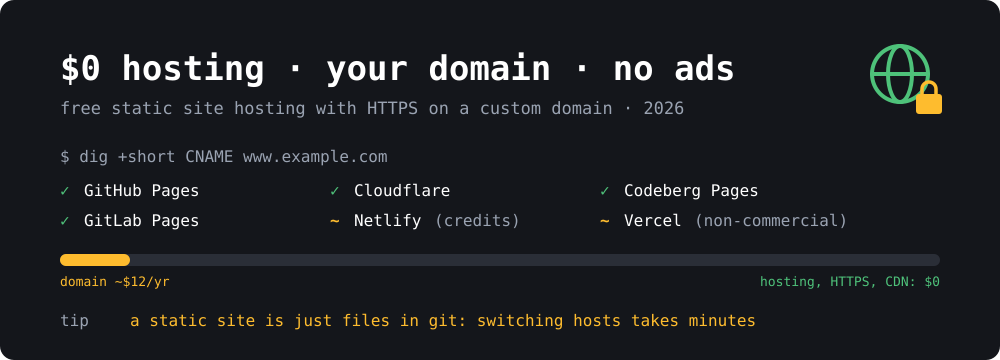
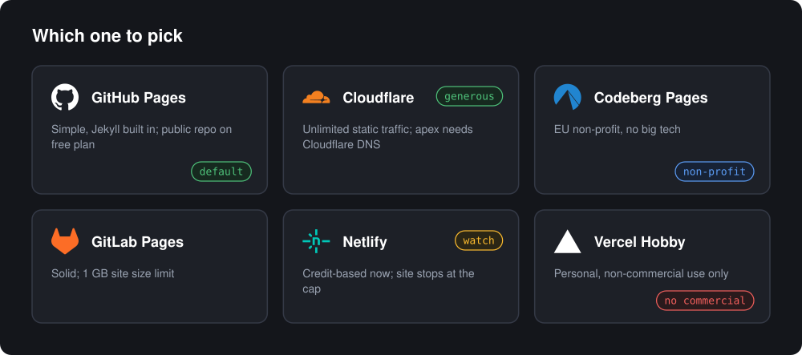
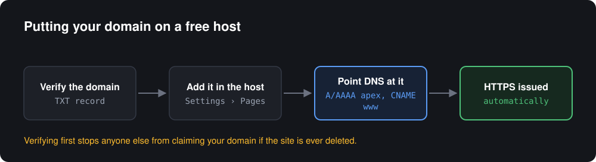

{: width="1000" height="360"}

You don't need to pay for hosting to run a personal site, a project page, docs or a blog. If the site is **static**, meaning plain HTML, CSS, JavaScript and images, several big providers will host it for free. They'll serve it over HTTPS on **your own domain**, they won't inject ads or banners, and they won't put "Powered by X" in your footer.

This blog is one of them: it's Jekyll on GitHub Pages, and the only thing I pay for is the domain.

Below are the services that pass three tests: **$0 hosting**, **custom domain with free HTTPS**, and **no ads or forced branding**. After that comes a short list of services that look free but fail one of the tests.

> **TL;DR**
> - **Best default:** [GitHub Pages](#github-pages). Free, simple, and Jekyll builds out of the box.
> - **Most generous:** [Cloudflare](#cloudflare-pages--workers). Static traffic is unlimited, but apex domains need Cloudflare DNS.
> - **Non-profit, no big tech:** [Codeberg Pages](#codeberg-pages). Free, EU-based, run by a non-profit.
> - **Also solid:** [GitLab Pages](#gitlab-pages) and [Netlify](#netlify). Netlify's free plan now runs on credits, so keep an eye on it.
> - **Personal projects only:** [Vercel](#vercel-hobby). The Hobby plan doesn't allow commercial use.
> - The **domain** still costs about $10–15 a year. Everything else can be free.

{: width="1000" height="424"}

## What "static" means (and why it's free)

A static host does one thing: it stores files and sends them to browsers. There's no PHP, no database and no server process running your code. That's cheap to run at scale, which is why providers can give it away. It's also why it's so safe: there's nothing to patch and nothing to hack except your git account.

Static covers a lot more than you might think:

- Blogs and personal sites built with a generator like [Jekyll](https://jekyllrb.com/), [Hugo](https://gohugo.io/), [Eleventy](https://www.11ty.dev/) or [Astro](https://astro.build/) (I wrote about [Pelican]() years ago)
- Project docs (MkDocs, Docusaurus, Sphinx)
- Single-page apps (React, Vue, Svelte) that talk to an external API
- A [WordPress site exported to HTML]()

Contact forms, comments and search can be added with third-party services or a small serverless function. If you need a real backend with a database, you need a different kind of hosting.

## The comparison

| Service | Custom domain + HTTPS | Traffic limit | Builds | Commercial use | Catch |
|---|---|---|---|---|---|
| [GitHub Pages](#github-pages) | yes | 100 GB/month (soft) | 10/hour (soft), unlimited with Actions | not for e-commerce or SaaS | repo must be public on the free plan |
| [Cloudflare](#cloudflare-pages--workers) | yes | **unlimited** static requests | 500/month (Pages) | yes | apex domain needs Cloudflare as DNS |
| [Codeberg Pages](#codeberg-pages) | yes | no published limit | build it yourself or use Forgejo Actions | free/open projects encouraged | smaller infrastructure, recent migration |
| [GitLab Pages](#gitlab-pages) | yes | not published | CI minutes on free plan | yes | 1 GB site size |
| [Netlify](#netlify) | yes | paid from 300 credits/month | paid from the same credits | yes | hard cap: the site stops when credits run out |
| [Vercel](#vercel-hobby) | yes | 100 GB/month | included | **no** | personal, non-commercial use only |

Limits change. The numbers above are what the providers and current coverage say as of November 2026, so check the linked docs before you plan a big launch.

## GitHub Pages

[GitHub Pages](https://pages.github.com/) is the easiest place to start, especially if your code already lives on GitHub.

**What you get:**
- Free hosting from any **public** repo. Private repos need a paid plan.
- Free HTTPS through Let's Encrypt on your custom domain, renewed automatically.
- Jekyll builds natively. Hugo, Astro and anything else can build through a GitHub Actions workflow.
- A soft limit of 100 GB of bandwidth a month and a 1 GB site size ([limits](https://docs.github.com/en/pages/getting-started-with-github-pages/github-pages-limits)). A personal blog won't get close.

**The catch:** GitHub's terms say Pages isn't meant for running an online business, an e-commerce shop or a SaaS. A portfolio, a blog, docs or a landing page for a free project is fine.

### Deploying any static site generator with Actions

In the repo, go to **Settings → Pages** and set **Source** to **GitHub Actions**. Then add `.github/workflows/pages.yml`. This example builds a Hugo site, so swap the build step for your generator:

```yaml
name: Deploy to GitHub Pages
on:
  push:
    branches: [main]
  workflow_dispatch:

permissions:
  contents: read
  pages: write
  id-token: write

concurrency:
  group: pages
  cancel-in-progress: true

jobs:
  build:
    runs-on: ubuntu-latest
    steps:
      - uses: actions/checkout@v4
      - name: Build
        run: |
          sudo snap install hugo
          hugo --minify          # output goes to ./public
      - uses: actions/upload-pages-artifact@v3
        with:
          path: ./public

  deploy:
    needs: build
    runs-on: ubuntu-latest
    environment:
      name: github-pages
      url: ${{ steps.deployment.outputs.page_url }}
    steps:
      - id: deployment
        uses: actions/deploy-pages@v4
```

For plain HTML, skip the build step and point `path:` at the folder with your `index.html`.

### Custom domain on GitHub Pages

1. **Verify your domain** first, under your account's **Settings → Pages → Add a domain**. GitHub gives you a TXT record to add. This stops anyone else from claiming your domain if you ever delete the repo.
2. In the repo, go to **Settings → Pages → Custom domain**, enter the domain and save.
3. Add DNS records at your DNS provider.

{: width="1000" height="273"}

For an **apex** domain (`example.com`):

```
example.com.      A     185.199.108.153
example.com.      A     185.199.109.153
example.com.      A     185.199.110.153
example.com.      A     185.199.111.153
example.com.      AAAA  2606:50c0:8000::153
example.com.      AAAA  2606:50c0:8001::153
example.com.      AAAA  2606:50c0:8002::153
example.com.      AAAA  2606:50c0:8003::153
www.example.com.  CNAME yourusername.github.io.
```

For a **subdomain** (`blog.example.com`), one CNAME to `yourusername.github.io` is enough.

4. Wait for the certificate (usually a few minutes, sometimes up to an hour), then tick **Enforce HTTPS**.

Check that DNS is right before you blame GitHub:

```bash
dig +short example.com A
dig +short www.example.com CNAME
```

## Cloudflare Pages / Workers

Cloudflare has the most generous free tier of the lot. Requests for static files are **free and unlimited** on the free plan ([pricing](https://developers.cloudflare.com/pages/functions/pricing/)), and your site is served from Cloudflare's global network.

**What you get:**
- Unlimited static traffic and bandwidth.
- 500 builds a month on Pages, each up to 20 minutes.
- Connect a GitHub or GitLab repo and it builds on every push, with preview URLs for branches and pull requests.
- Commercial use is fine.
- Optional serverless functions (100,000 requests a day free) for forms or small APIs.

**Pages or Workers?** Cloudflare now points new projects to **Workers with static assets** rather than Pages. For a static site the experience is nearly the same, and Pages still works. If you start fresh, follow whatever the dashboard offers under **Workers & Pages → Create**.

**The catch:** to use an **apex** domain (`example.com`), the domain's DNS must be on Cloudflare, meaning you change your nameservers to theirs. A **subdomain** (`blog.example.com`) can stay at your current DNS provider with a CNAME to `yourproject.pages.dev`. Moving DNS to Cloudflare is free and usually painless, but it is one more piece of your setup in one company's hands.

Deploying from the command line is one command:

```bash
npx wrangler pages deploy ./public --project-name my-site
```

Then add the domain under **your project → Custom domains**.

## Codeberg Pages

[Codeberg](https://codeberg.org) is a German non-profit that runs a Forgejo-based Git host, and [Codeberg Pages](https://docs.codeberg.org/codeberg-pages/) is its free static hosting. If you'd rather not depend on Microsoft, Cloudflare or a VC-funded company, this is the one to pick. It's free, it has no ads, and the money comes from donations and members.

Codeberg Pages recently moved to a new backend called [git-pages](https://git-pages.org/). Many tutorials still describe the old `.domains` file, which **is no longer needed**. The current setup:

1. Create a **public** repo. For a user site, name it `pages`. Put your built HTML on a branch named `pages`.
2. In the repo, go to **Settings → Webhooks → Add webhook**, choose the **git-pages** type, and set the Site URL to `https://yourusername.codeberg.page/` (or to your custom domain).
3. Push. The webhook tells the pages server to deploy.

For a **custom domain**, add DNS records ([docs](https://docs.codeberg.org/codeberg-pages/using-custom-domain/)):

```
; subdomain
www.example.com.                       CNAME  codeberg.page.
_git-pages-repository.www.example.com. TXT    "https://codeberg.org/yourusername/pages.git"

; apex: ALIAS/flattened CNAME to codeberg.page if your DNS supports it, otherwise:
example.com.                           A      217.197.84.141
example.com.                           AAAA   2a0a:4580:103f:c0de::2
_git-pages-repository.example.com.     TXT    "https://codeberg.org/yourusername/pages.git"
```

The TXT record proves the domain belongs to that repo. The word `repository` in the record name is literal, not a placeholder. Then add a separate webhook for each hostname. Codeberg warns that the A/AAAA addresses may change, so use ALIAS if you can.

Codeberg doesn't build your site for you by default. Either commit the built HTML to the `pages` branch, or set up Forgejo Actions to build and deploy it.

**The catch:** Codeberg is small and runs on donations, so expect the occasional rough edge. It was [unreachable for about five hours this very morning]() when its registrar put its domain on hold. But notice that sites on **your own domain** don't depend on `codeberg.org` resolving, only on Codeberg's servers. That's one more argument for bringing your own domain wherever you host.

## GitLab Pages

[GitLab Pages](https://docs.gitlab.com/user/project/pages/) works like GitHub Pages with GitLab CI doing the build.

**What you get:**
- Free hosting on GitLab.com, with custom domains and automatic Let's Encrypt certificates.
- Up to 1 GB per site, and up to 150 custom domains per site.
- Any generator, because you write the CI job.
- Private repos can publish public sites.

A minimal `.gitlab-ci.yml` for plain HTML in a `public/` folder:

```yaml
pages:
  stage: deploy
  script:
    - echo "nothing to build"
  artifacts:
    paths:
      - public
  rules:
    - if: $CI_COMMIT_BRANCH == $CI_DEFAULT_BRANCH
```

Add the domain under **Deploy → Pages → New domain**. GitLab gives you a TXT verification record (`_gitlab-pages-verification-code.example.com`). Point a subdomain with a CNAME to `yourusername.gitlab.io`, or point an apex with an A record to `35.185.44.232`.

**The catch:** builds use the free plan's monthly CI minutes, and new accounts may need to verify an identity before CI runs. A static site build takes seconds, so this rarely matters.

## Netlify

[Netlify](https://www.netlify.com/) made this whole category popular, and it's still nice to use. You get Git-based deploys, preview URLs, a `_redirects` file and built-in form handling.

**What changed:** since late 2025 the free plan runs on **credits**: 300 a month, and you can't buy more without upgrading. Bandwidth, builds and functions all take credits. Third-party breakdowns put bandwidth at about 20 credits per GB and a production deploy at about 15 credits, so a site that deploys a lot or gets a traffic spike can hit the cap. When you run out, the site **stops** until the next month. You won't get a surprise bill, but your site goes down.

**Good for:** small sites that don't deploy dozens of times a month, especially if you want Netlify Forms. **Not good for:** anything that might go viral.

## Vercel (Hobby)

[Vercel](https://vercel.com/) has a free **Hobby** plan with custom domains, HTTPS, Git deploys and about 100 GB of bandwidth a month. It's the natural home for Next.js.

**The catch:** Vercel's [fair use guidelines](https://vercel.com/docs/limits/fair-use-guidelines) limit Hobby to **non-commercial, personal use**. A personal blog is fine. A site for your business, a client, or anything with ads or affiliate links is not. If that rules you out, pick Cloudflare or GitHub Pages instead.

## Free, but not quite

These come up in every "free hosting" list, but each fails at least one of the three tests:

- **Neocities.** Lovely community, free sites, no ads. But custom domains need the paid Supporter plan.
- **Surge.sh.** Free deploys and custom domains, but HTTPS on a custom domain needs the paid plan.
- **Firebase Hosting (Spark plan).** Free with custom domains and HTTPS, but the free transfer allowance is only about **360 MB a day**. One busy afternoon can use it up.
- **Render static sites.** Free and pleasant, but the free bandwidth allowance is unclear and reportedly shared across your whole account. Check the dashboard before relying on it.
- **Free website builders** (Wix, Weebly, WordPress.com free and similar). They either show their own ads and banners or don't allow a custom domain without paying. Usually both.
- **"Free" PHP hosting** with cPanel. These usually make their money from ads, upsells or your data, and tend to disappear. Not worth it.

## Which one should you pick?

- **You just want a blog or a homepage:** GitHub Pages. If you use Jekyll there's nothing to configure.
- **You expect real traffic, or it's for a business:** Cloudflare.
- **You prefer non-profit, European, open-source infrastructure:** Codeberg Pages.
- **Your code is already on GitLab:** GitLab Pages.
- **You need forms without writing code:** Netlify, and watch your credits.

Whichever you choose, the most valuable thing about static hosting is that **it's portable**. Your site is just a folder of files in git. If a provider changes its free plan, has an outage or shuts down, you can push the same files somewhere else and change a few DNS records. Moving takes half an hour. Keep that option open:

- **Own your domain**, and register it with a registrar you trust (and [monitor its status]()). The domain is your actual address. The host is just where it points today.
- **Keep the build in your repo**, not in a provider's dashboard settings. A `Makefile` or a workflow file moves with you.
- **Use a short DNS TTL** (300 seconds) before you migrate, so a move takes effect within minutes.
- **Mirror the repo** to a second forge. Pushing to two remotes costs nothing.

## Wrap-up

For a static site, paying for hosting is optional now. Pick one of the services above, point your domain at it, and the only bill left is the domain renewal. No ads, no "made with" badge, and HTTPS included.
