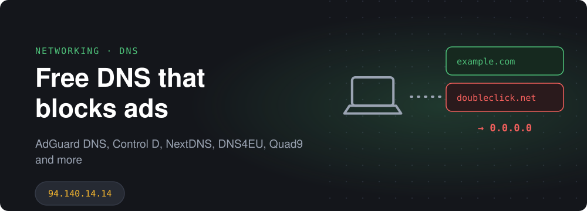

{: width="1000" height="360"}

Changing one setting, your DNS server, blocks most ads and trackers on every device behind it, including smart TVs, phone apps and other things you can't install an ad blocker on. You don't need to install software, sign up or pay.

I wrote about [DNS filtering]() back in 2019, and the landscape has changed a lot since then. **dns0.eu shut down** in October 2025. **Mullvad closed its public DNS** on 2 November 2026. The EU launched its own resolver, **DNS4EU**, which has an ad-blocking profile. So here's a fresh list.

Every IP address in this post was tested on **19 November 2026**: I asked each server for `doubleclick.net` (a Google ad domain) and checked whether it came back blocked.

> **TL;DR**
> - **Just block ads, no account:** [AdGuard DNS](#adguard-dns) `94.140.14.14` / `94.140.15.15`
> - **More control, still no account:** [Control D free](#control-d-free-dns). Separate resolvers for ads, social media and family.
> - **Your own blocklists and logs, free:** [NextDNS](#nextdns), up to 300,000 queries a month.
> - **EU-run:** [DNS4EU](#dns4eu) "no ads" profile `86.54.11.13`
> - **Malware only, non-profit:** [Quad9](#quad9) `9.9.9.9` (doesn't block ads)
> - **No filtering, just fast DNS:** [Cloudflare, Google, Quad9 unfiltered](#the-big-unfiltered-resolvers)
> - **Full control at home:** self-host [AdGuard Home or Pi-hole](#self-hosting-adguard-home-or-pi-hole)

## How DNS filtering works

Before your browser or an app loads anything, it asks a DNS server for the address of each domain, such as `example.com` or `ads.tracker.net`. A filtering DNS server checks every name against a blocklist. If the domain is a known ad, tracking or malware domain, it answers with `0.0.0.0` (or "doesn't exist"). The connection never happens, so the ad never downloads.

```console
$ dig +short @94.140.14.14 doubleclick.net      # AdGuard DNS
0.0.0.0
$ dig +short @94.140.14.140 doubleclick.net     # AdGuard, unfiltered
172.217.16.142
```

**What it can't do:**
- **It can't block ads served from the same domain as the content.** YouTube ads, Facebook and Instagram sponsored posts, and Twitch ads come from the same servers as the videos and posts. Use a browser extension like uBlock Origin for those.
- **It doesn't hide empty ad boxes.** The page layout stays the same. You just see blank space where the ad was.
- **Apps can ignore it.** Chrome, Firefox and many apps can use their own built-in DNS over HTTPS. Some smart TVs and IoT devices also hardcode `8.8.8.8`. See [Making it stick](#making-it-stick) below.
- **Whoever runs the DNS server sees every domain you visit.** Pick a provider you trust more than your ISP.

## The comparison

| Provider | Blocks ads | Blocks malware | Family filter | Account needed | Limit | Based in |
|---|---|---|---|---|---|---|
| [AdGuard DNS](#adguard-dns) | yes | yes | yes | no | none | Cyprus |
| [Control D free](#control-d-free-dns) | yes | yes | yes | no | none | Canada |
| [NextDNS](#nextdns) | yes, custom lists | yes | yes | yes | 300k queries/month | USA |
| [DNS4EU](#dns4eu) | yes ("no ads" profile) | yes | yes | no | none | EU (Czechia) |
| [Quad9](#quad9) | **no** | yes | no | no | none | Switzerland |
| [Cloudflare for Families](#cloudflare-for-families) | **no** | yes | yes | no | none | USA |
| [CleanBrowsing](#cleanbrowsing-and-opendns) | **no** | yes | yes | no | none | USA |

## AdGuard DNS

[AdGuard DNS](https://adguard-dns.io/en/public-dns.html) is the easiest option. Change two numbers and ads are gone. It blocks ads, trackers and phishing or malware domains using AdGuard's own filter lists, which are among the best maintained.

| Profile | IPv4 | IPv6 | DoH / DoT hostname |
|---|---|---|---|
| **Default** (ads + trackers + malware) | `94.140.14.14`, `94.140.15.15` | `2a10:50c0::ad1:ff`, `2a10:50c0::ad2:ff` | `dns.adguard-dns.com` |
| **Family** (+ adult content, Safe Search) | `94.140.14.15`, `94.140.15.16` | `2a10:50c0::bad1:ff`, `2a10:50c0::bad2:ff` | `family.adguard-dns.com` |
| Non-filtering | `94.140.14.140`, `94.140.14.141` | `2a10:50c0::1:ff`, `2a10:50c0::2:ff` | `unfiltered.adguard-dns.com` |

- DoH: `https://dns.adguard-dns.com/dns-query`
- DoT: `tls://dns.adguard-dns.com`
- DoQ (DNS over QUIC): `quic://dns.adguard-dns.com`

If you want your own blocklists, allow-lists or query logs, AdGuard also has **private** DNS with a free **Starter** plan. You create an account, get personal resolver addresses and manage everything from a dashboard. The free plan has caps on queries and devices, so check the [plan table](https://adguard-dns.io/en/license.html) for the current numbers. If you'd rather not create an account, the public servers above are enough.

## Control D free DNS

[Control D](https://controld.com/free-dns) is made by the team behind Windscribe VPN. Its paid product is a fully customizable resolver, but it also runs a set of **free, no-account resolvers**, each with a different level of filtering:

| Resolver | Blocks | IPv4 | DoH |
|---|---|---|---|
| Unfiltered | nothing | `76.76.2.0`, `76.76.10.0` | `https://freedns.controld.com/p0` |
| Malware | malware, phishing | `76.76.2.1`, `76.76.10.1` | `https://freedns.controld.com/p1` |
| **Ads & Tracking** | malware + ads + trackers | `76.76.2.2`, `76.76.10.2` | `https://freedns.controld.com/p2` |
| Social | above + Facebook, TikTok, etc. | `76.76.2.3`, `76.76.10.3` | `https://freedns.controld.com/p3` |
| Family | malware, ads, adult content, drugs | `76.76.2.4`, `76.76.10.4` | `https://freedns.controld.com/family` |

For DoT, use the same name as a hostname, for example `p2.freedns.controld.com`.

The **Social** resolver is something the others don't offer: in my test it returned `0.0.0.0` for `facebook.com` as well as the ad domains. It works well for a kid's tablet or for your own phone if you're trying to stay off social media. Control D says it doesn't log queries on the free resolvers.

## NextDNS

[NextDNS](https://nextdns.io/) is the most flexible option: you build your own resolver. You pick blocklists (including AdGuard's, OISD, HaGeZi and dozens more), turn on threat intelligence, block specific apps or services (TikTok, Fortnite, Tinder), enforce Safe Search, and see a log of every query per device. It's like Pi-hole without the hardware.

**Free plan** ([pricing](https://nextdns.io/pricing)):
- **300,000 queries per month**, with unlimited devices and configurations, and every feature included.
- When you go over the limit, **filtering stops** and NextDNS keeps answering as a plain unfiltered resolver until the next month. Your internet keeps working, but the ads come back.
- **Pro** is **$1.99/month** or $19.90/year for unlimited queries.

300k queries a month is enough for one or two phones. A whole household with smart TVs will probably go over it within a couple of weeks, because some devices make thousands of queries a day. Look at the usage graph after a few days. If you're on track to go over, either pay for Pro (it's cheap) or use a no-limit option like AdGuard or Control D for the TV.

Setup: create a configuration and you get a personal ID like `abc123`. Your endpoints are `https://dns.nextdns.io/abc123` (DoH) and `abc123.dns.nextdns.io` (DoT / Android Private DNS).

## DNS4EU

[DNS4EU](https://www.joindns4.eu/for-public) is the European Union's public resolver. It launched in June 2025, is co-funded by the EU and run by a consortium led by the Czech company Whalebone. Its servers are in the EU, and it follows EU privacy rules.

| Profile | IPv4 | DoH |
|---|---|---|
| Protective (malware, phishing) | `86.54.11.1`, `86.54.11.201` | `https://protective.joindns4.eu/dns-query` |
| Protective + child protection | `86.54.11.12`, `86.54.11.212` | `https://child.joindns4.eu/dns-query` |
| **Protective + ad blocking** | `86.54.11.13`, `86.54.11.213` | `https://noads.joindns4.eu/dns-query` |
| Protective + child + ads | `86.54.11.11`, `86.54.11.211` | `https://child-noads.joindns4.eu/dns-query` |
| Unfiltered | `86.54.11.100`, `86.54.11.200` | `https://unfiltered.joindns4.eu/dns-query` |

The DoT hostnames are the same names without the path, for example `noads.joindns4.eu`.

Only the profiles with **"no ads" / "ad blocking"** in the name block ads. Plain "Protective" didn't block `doubleclick.net` in my test. The child-protection profiles don't return `0.0.0.0` for adult sites. They send you to a warning page (`warning.joindns4.eu`) instead, which is clearer for kids than a connection error.

For Europeans who want to avoid US providers, it's the natural replacement for dns0.eu. In fact, dns0.eu recommended DNS4EU and NextDNS when it shut down.

## Quad9

[Quad9](https://quad9.net/) is a Swiss non-profit that blocks **malware and phishing domains only**, using threat feeds from many security companies. **It doesn't block ads.** It's in this list because it's the best "safe default" for people who don't want any ad filtering (no broken sites, no support calls from family) but still want protection.

- Filtered: `9.9.9.9`, `149.112.112.112`, DoH `https://dns.quad9.net/dns-query`, DoT `dns.quad9.net`
- Unfiltered: `9.9.9.10`, `149.112.112.10`

Quad9 is also where Mullvad sent its support when it closed its own DNS (see below).

## Cloudflare for Families

Cloudflare's [1.1.1.1 for Families](https://developers.cloudflare.com/1.1.1.1/setup/#1111-for-families) also doesn't block ads. It does offer two filtered variants of the fastest resolver around:

- Malware: `1.1.1.2`, `1.0.0.2`, DoH `https://security.cloudflare-dns.com/dns-query`
- Malware + adult content: `1.1.1.3`, `1.0.0.3`, DoH `https://family.cloudflare-dns.com/dns-query`

## CleanBrowsing and OpenDNS

Both of these are aimed at **family filtering**, not ad blocking:

- **CleanBrowsing**: Security `185.228.168.9`, Adult `185.228.168.10`, Family `185.228.168.168` (also blocks proxies and VPNs, and forces YouTube Restricted Mode).
- **OpenDNS FamilyShield** (Cisco): `208.67.222.123`, `208.67.220.123`, which blocks adult content. A free OpenDNS Home account adds category filtering, but it hasn't changed much in years.

## The big unfiltered resolvers

Sometimes you want **no filtering at all**: as an upstream for your own Pi-hole or AdGuard Home (which does the blocking), to troubleshoot a site you think a filter broke, or because your ISP's DNS is slow, hijacks typos to show ads, or censors domains. These are the well-known free ones. None of them block ads. All of them returned the real address for `doubleclick.net` in my test.

| Provider | IPv4 | IPv6 | DoH / DoT | Notes |
|---|---|---|---|---|
| **Cloudflare** | `1.1.1.1`, `1.0.0.1` | `2606:4700:4700::1111`, `2606:4700:4700::1001` | `https://cloudflare-dns.com/dns-query`, `one.one.one.one` | usually the fastest; query logs deleted within 25 hours, audited by KPMG |
| **Google Public DNS** | `8.8.8.8`, `8.8.4.4` | `2001:4860:4860::8888`, `2001:4860:4860::8844` | `https://dns.google/dns-query`, `dns.google` | the most widely used; very reliable, but it's Google |
| **Quad9 unfiltered** | `9.9.9.10`, `149.112.112.10` | `2620:fe::10`, `2620:fe::fe:10` | `https://dns10.quad9.net/dns-query`, `dns10.quad9.net` | Swiss non-profit, no IP logging |
| **OpenDNS** (Cisco) | `208.67.222.222`, `208.67.220.220` | `2620:119:35::35`, `2620:119:53::53` | `https://doh.opendns.com/dns-query` | not quite unfiltered: blocks known phishing domains by default |

The other providers above also have unfiltered addresses: AdGuard `94.140.14.140`, Control D `76.76.2.0` and DNS4EU `86.54.11.100`. They're useful when you want to stay with the same provider and just switch filtering off.

**As a Pi-hole or AdGuard Home upstream**, use the encrypted versions (DoH or DoT) instead of the plain IPs. Otherwise your ISP can still see every query your filter forwards. Quad9 and Cloudflare are the usual choices.

## Gone: services you should remove from your config

If you set up DNS a while ago, check that you aren't pointing at one of these:

- **dns0.eu.** Shut down without warning in **October 2025**. The French non-profit, started by the NextDNS founders, said running it wasn't sustainable. Devices still configured with `dns0.eu` or `zero.dns0.eu` fail to resolve, or quietly fall back to your ISP.
- **Mullvad DNS** (`dns.mullvad.net`, `adblock.dns.mullvad.net`, `base.`, `extended.`, `family.`, `all.`). Mullvad [discontinued](https://mullvad.net/en/help/dns-over-https-and-dns-over-tls) its public encrypted DNS on **2 November 2026** and now sponsors Quad9 instead. DNS inside the Mullvad VPN app isn't affected. Old iOS and macOS profiles stop working. **Replacement:** AdGuard DNS or Control D `p2` for ad blocking.
- **AdGuard's old `176.103.130.x` addresses.** Retired years ago. Use `94.140.14.14`.
- **Epsilon Eight PrivateDNS**, from my 2019 post. It's gone.

A dead resolver doesn't fail loudly. Phones and routers often switch to the second DNS server or to DHCP, and you won't notice until the ads come back.

## How to set it up

### Router (whole network)

Log in to your router and find the **DNS** fields, usually under WAN or DHCP/LAN settings. Enter the two IPv4 addresses. If your network uses IPv6, enter the IPv6 ones too. Otherwise devices will use your ISP's IPv6 DNS and skip the filter. Then restart your devices or reconnect to Wi-Fi.

This covers everything on your network, but over plain, unencrypted DNS. If you want encryption on top, use DoT/DoH on each device (below) or self-host (further below).

### Android: Private DNS (best option on phones)

On Android 9 and later, go to **Settings → Network & internet → Private DNS → Private DNS provider hostname** and enter:

```
dns.adguard-dns.com
```

(or `p2.freedns.controld.com`, `noads.joindns4.eu`, `abc123.dns.nextdns.io`). This is encrypted DNS over TLS, and **it applies on every network**, including mobile data, hotel Wi-Fi and your friend's house. It blocks ads in most apps and games too.

### iPhone, iPad and Mac

Apple only supports encrypted DNS through a **configuration profile**. AdGuard, Control D and NextDNS all offer a profile to download on their setup pages. DNS4EU has a profile generator in its [setup guidelines](https://joindns4.eu/dns-guidelines). Install it, then turn it on under **Settings → General → VPN & Device Management → DNS** (iOS) or **System Settings → Privacy & Security → Profiles** (macOS).

### Windows 11

Go to **Settings → Network & internet → Wi-Fi or Ethernet → DNS server assignment → Edit → Manual**. Turn on IPv4, enter the IPs and set **DNS over HTTPS** to **On (manual template)** with the DoH URL. If you'd rather use the command line, run this in an elevated terminal:

```powershell
netsh dns add encryption server=94.140.14.14 dohtemplate=https://dns.adguard-dns.com/dns-query autoupgrade=yes udpfallback=no
netsh dns add encryption server=94.140.15.15 dohtemplate=https://dns.adguard-dns.com/dns-query autoupgrade=yes udpfallback=no
```

Then set the adapter's DNS servers to those two IPs.

### Linux (systemd-resolved)

Most desktop distributions use systemd-resolved, which supports DNS over TLS. Create a drop-in file:

```ini
# /etc/systemd/resolved.conf.d/adguard.conf
[Resolve]
DNS=94.140.14.14#dns.adguard-dns.com 94.140.15.15#dns.adguard-dns.com
DNS=2a10:50c0::ad1:ff#dns.adguard-dns.com 2a10:50c0::ad2:ff#dns.adguard-dns.com
DNSOverTLS=yes
Domains=~.
```

```bash
sudo systemctl restart systemd-resolved
resolvectl status | grep -A2 'Global'
```

`Domains=~.` makes these servers the default for every lookup, even if NetworkManager receives other DNS servers from DHCP. The part after `#` is the TLS hostname that resolved checks the certificate against. Without it, `DNSOverTLS=yes` can't verify the server.

## Making it stick

Your own devices are easy. The hard part is apps and gadgets that bypass your DNS:

- **Browsers:** Chrome and Edge only use their own DoH when your system DNS is a known DoH provider. Firefox may enable its own (Cloudflare or NextDNS) depending on your region. Check **Settings → Privacy & security → DNS over HTTPS** and either turn it off or set it to the same filtering provider.
- **Hardcoded DNS:** some TVs, Chromecasts and IoT devices ignore DHCP and query `8.8.8.8` directly. If your router supports it (OpenWrt, OPNsense, pfSense, MikroTik), add a NAT rule that redirects all outgoing port 53 traffic to your chosen resolver. I showed the iptables version [here]().
- **Kids who know what they're doing** can switch DNS or use a VPN. CleanBrowsing's Family filter blocks VPN and proxy domains for that reason, but nothing at the DNS level is truly unbypassable.

## Test that it's working

Run this from any machine on the network. It asks your *current* resolver for a few known ad domains:

```bash
#!/usr/bin/env bash
# dns-adblock-check.sh: is my DNS blocking ads?
for d in doubleclick.net googleadservices.com adservice.google.com ads.yahoo.com; do
  ip=$(dig +short "$d" A | tail -n1)
  case "$ip" in
    0.0.0.0|"") printf '  blocked  %s\n' "$d" ;;
    *)          printf '  ALLOWED  %s -> %s\n' "$d" "$ip" ;;
  esac
done
```

On a phone, open [adguard.com/en/test.html](https://adguard.com/en/test.html), or [test.nextdns.io](https://test.nextdns.io) if you use NextDNS. The NextDNS page also tells you whether your queries are actually going over DoH/DoT.

If a site breaks, use the provider's **unfiltered** address to check whether filtering is the cause, then allow-list the domain (NextDNS, Control D accounts, AdGuard private DNS) or switch to a less aggressive profile.

## Self-hosting: AdGuard Home or Pi-hole

If you have a Raspberry Pi or a home server, run the filter yourself:

- **[AdGuard Home](https://github.com/AdguardTeam/AdGuardHome)**: a single binary with a web UI, built-in DoH/DoT/DoQ (both serving and upstream), per-client rules and blocked services. It's my pick in 2026.
- **[Pi-hole](https://pi-hole.net/)**: the classic, with a huge community. Version 6 has a built-in web server and a REST API.
- **[Technitium DNS](https://technitium.com/dns/)**: a full DNS server with blocking, if you also want local zones.

The best setup combines both approaches: run AdGuard Home or Pi-hole at home with your own blocklists, and point its **upstream** at an encrypted provider such as `https://dns.quad9.net/dns-query` or `https://noads.joindns4.eu/dns-query`. You get local control and logs, your ISP can't see your queries, and on your phone you can use AdGuard DNS through Private DNS when you're away from home. If you're buying hardware for it, a Pi 4 or 5 is plenty ([which Pi to buy]()).

## Which one should you pick?

- **"Just make the ads stop" for you or your parents:** AdGuard DNS. Set `dns.adguard-dns.com` as Private DNS on Android and the router DNS to `94.140.14.14`.
- **A kid's device:** Control D Family (`76.76.2.4`) or AdGuard Family, plus Social (`p3`) if you want to block social media too.
- **You want to tweak blocklists and see logs, without running a server:** NextDNS, and pay the $1.99 once your household goes over 300k queries.
- **You'd rather keep your DNS in the EU:** DNS4EU `noads`.
- **You don't want ad blocking, just protection:** Quad9.
- **You have a Pi or a home server:** AdGuard Home with an encrypted upstream.

Whichever you choose, keep the **unfiltered** address of the same provider handy for troubleshooting, and check your config once a year. As dns0.eu and Mullvad have shown, free resolvers can disappear, and when they do, nothing tells you.
