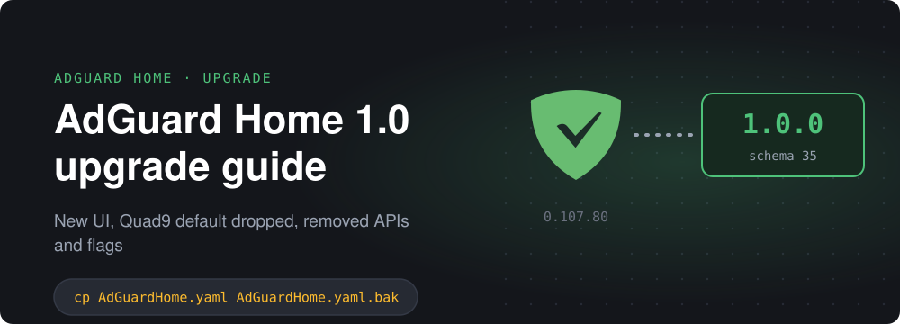
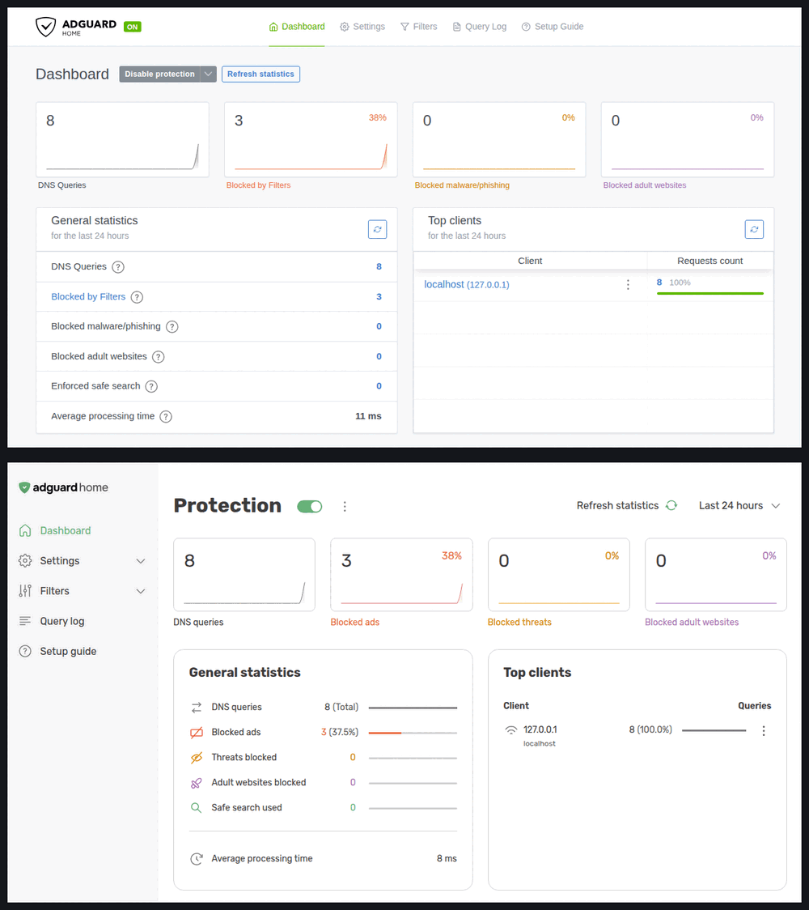

{: width="1000" height="360"}

[AdGuard Home 1.0](https://github.com/AdguardTeam/AdGuardHome/releases/tag/v1.0.0) came out on 19 November 2026 with a rewritten web interface. For most people the upgrade takes a minute and DNS keeps working. But it also removes old API endpoints, changes the default upstream, and **upgrades your config file to a version that 0.107.80 refuses to read**, so a careless rollback leaves you without DNS.

I upgraded 0.107.80 to 1.0.0 on Linux amd64 in a throwaway directory, tried the built-in updater and rolled back again. I ran the binary by hand, so the Docker, systemd and Raspberry Pi steps below follow the official docs rather than my own test.

> **TL;DR**
> - **In France and using Quad9?** Change your upstream **today**. Quad9 stopped serving France on 24 November, and [upgrading doesn't change it for you](#quad9-and-france-check-this-first).
> - **Copy `AdGuardHome.yaml` before you upgrade.** You need it [to roll back](#rolling-back).
> - **Home Assistant:** use 2026.11 or newer. The HA app (add-on) [is still on 0.107.80](#home-assistant).
> - **Scripts and exporters:** check them against the [12 removed endpoints](#removed-api-endpoints).
> - **Hold off** if you use [per-client blocked services, access lists or a screen reader](#known-problems-in-100).

## Quad9 and France: check this first

Until now, a new AdGuard Home install used Quad9 as its upstream. On 24 November 2026 at 09:00 Paris time, Quad9 [stopped serving users in France](https://quad9.net/news/blog/quad9-service-deactivation-in-france/) after losing a court case brought by the sports broadcaster beIN. Rather than block the disputed domains, it left. In its words, "any query reaching any Quad9 service address will be refused".

AdGuard Home 1.0 uses Cloudflare instead, but **only for new installs**. Your config isn't touched. After my upgrade the upstream was still Quad9:

```console
$ curl -s http://127.0.0.1:3999/control/dns_info | jq -c '{upstream_dns,bootstrap_dns}'
{"upstream_dns":["https://dns10.quad9.net/dns-query"],"bootstrap_dns":["9.9.9.10","149.112.112.10"]}
```

| | Old default | New default |
|---|---|---|
| Upstream | `https://dns10.quad9.net/dns-query` | `https://cloudflare-dns.com/dns-query` |
| Bootstrap | `9.9.9.10`, `149.112.112.10` | `1.1.1.1`, `1.0.0.1` |
| Bootstrap (IPv6) | `2620:fe::10`, `2620:fe::fe:10` | `2606:4700:4700::1111`, `2606:4700:4700::1001` |

If you're affected, go to **Settings → DNS settings** and change the upstream **and the bootstrap servers**. If you only change the upstream to another DoH hostname, AdGuard Home may have no working server to look that hostname up with. Check the **fallback servers** too.

You don't have to live in France to be hit. Quad9 locates users by IP address and calls its own method "inexact", so a VPN that exits in France can be refused as well. You don't need to upgrade to fix this. It works the same in 0.107.x.

Outside France, Quad9 works as before. My [list of free DNS servers]() has alternatives, including EU-run DNS4EU.

## What's new

{: width="1000" height="1124"}
*The same config and the same eight queries in 0.107.80 (top) and 1.0.0 (bottom)*

- **A new web interface.** The menu moved from the top to a sidebar, there's a proper mobile layout, and AdGuard says it's faster and uses less memory. There's no switch back to the old one.
- **Client settings are split up.** *Use global settings* now covers only protection. Blocked services have their own *Use global blocked services* switch, and per-client upstreams and cache are always editable.
- **Many fixes**, including DHCP subnet validation, expired leases being served over DNS, rewrites with trailing dots, and a crash in the command-line updater.
- **A security update.** It's built with Go 1.27.4, which fixes vulnerabilities in the Go standard library. 0.107.80 was built with 1.27.3.
- **A new release model.** From now on, [minor versions may contain breaking changes](https://github.com/AdguardTeam/AdGuardHome/releases/tag/v1.0.0). Read the changelog before going from 1.0 to 1.1, and think about pinning your Docker tag.

Automatic TLS certificates, bulk import of filter lists and a self-diagnostics page are planned for later versions. They aren't in 1.0.

## What breaks

### Your config moves to schema 35

The release notes say "no migration needed: v1.0 keeps the same configuration schema as v0.107.x". Going forward that's true in practice, but the version number does change. This is my log from the first start:

```
[info] config_migrator: upgrade yaml from=34 to=35
```

The [migration itself](https://github.com/AdguardTeam/AdGuardHome/blob/v1.0.0/internal/configmigrate/v35.go) does very little. Unless you start AdGuard Home with `--no-etc-hosts`, it only changes the number. But the old version checks that number, and won't start:

```
[error] failed to parse configuration file err="unknown current schema version 35"
```

1.0 also writes the keys in a different order. If you keep the file in git, expect a big diff with nothing in it.

### Removed API endpoints

Twelve deprecated endpoints are gone. I called the six `GET` ones: all answered 200 in 0.107.80 and **404** in 1.0.0.

| Removed | What it did |
|---|---|
| `GET /control/stats_info`, `POST /control/stats_config` | statistics settings |
| `GET /control/querylog_info`, `POST /control/querylog_config` | query log settings |
| `POST /control/safesearch/enable`, `POST /control/safesearch/disable` | Safe Search |
| `GET /control/blocked_services/list`, `GET /control/blocked_services/services`, `POST /control/blocked_services/set` | blocked services |
| `GET /control/clients/find` | look up a client |
| `GET /control/i18n/current_language`, `POST /control/i18n/change_language` | UI language |

Some fields went too: `filterId` and `rule` in the query log response, `filter_id` and `rule` in `check_host`, `safesearch_enabled` on clients, and the `response_status` query log parameter. An empty `upstream_mode` is no longer accepted. Use `load_balance`.

Search your scripts before upgrading:

```bash
grep -rnE 'stats_info|stats_config|querylog_info|querylog_config|safesearch/(enable|disable)|blocked_services/(list|services|set)|clients/find|i18n/(current|change)_language|safesearch_enabled|response_status' ~/scripts
```

**[adguardhome-sync](https://github.com/bakito/adguardhome-sync/releases)** users: syncing DNS settings from a 0.107.x origin to a 1.0 replica [failed](https://github.com/bakito/adguardhome-sync/issues/1004) because of that empty `upstream_mode`. Update to 0.10.1 or newer first, or upgrade both instances.

### Removed command-line flags

`--port`/`-p`, `--host`/`-h` (as a bind address), `--no-etc-hosts` and `--no-mem-optimization` are listed as removed. In my test 1.0.0 still started with them, but ignored them and logged a warning:

```
WARNING: ADGUARD HOME OPTION -p IS A NO-OP AND TO BE REMOVED; UPDATE YOUR SCRIPTS AND/OR REINSTALL ADGUARD HOME
```

So nothing crashes, but the **web UI may not be on the port you expect**. Use `--web-addr 0.0.0.0:3000` instead. `--no-etc-hosts` is converted for you, to `hostsfile_enabled: false` and `runtime_sources.hosts: false`. Check your systemd unit and the `command:` in your compose file:

```bash
systemctl cat AdGuardHome | grep ExecStart
docker inspect adguardhome --format '{{.Config.Cmd}}'
```

## Known problems in 1.0.0

These are the reports most likely to bite, as of 24 November:

| Problem | Status |
|---|---|
| [Per-client blocked services aren't saved](https://github.com/AdguardTeam/AdGuardHome/issues/8752) in the new UI | open |
| [Rewriting a name to itself is rejected](https://github.com/AdguardTeam/AdGuardHome/issues/8775) in the UI, which breaks exceptions to a wildcard (split-horizon DNS) | open |
| [Screen readers](https://github.com/AdguardTeam/AdGuardHome/issues/8768) struggle with the query log, clients and settings pages | open |
| [Saving *Allowed clients* resets *Disallowed domains*](https://github.com/AdguardTeam/AdGuardHome/issues/8748), and the reverse | fixed, not released |
| [Renaming a blocklist disables it](https://github.com/AdguardTeam/AdGuardHome/issues/8728) | fixed, not released |
| [The query log crashes](https://github.com/AdguardTeam/AdGuardHome/issues/8754) on DNSCrypt queries | fixed, not released |

The fixes are in the [changelog](https://github.com/AdguardTeam/AdGuardHome/blob/master/CHANGELOG.md) for **1.0.1**, pencilled in for around 1 December.

**Two that look like bugs but aren't:**

- **Certificate paths.** You can still point to files on the server, but if a certificate is already configured you have to click [*Reset DNS protocols*](https://github.com/AdguardTeam/AdGuardHome/issues/8733) first. It clears your current certificate settings, so copy the paths from the YAML.
- **Lost statistics.** One user [reported](https://github.com/AdguardTeam/AdGuardHome/issues/8734) a reset dashboard, then closed the issue because a toggle was set wrong. My statistics survived the upgrade. If yours look low, check the time period at the top right of the dashboard.

## How to upgrade

Whichever way you installed it, back up first. The paths below are the defaults from the install script.

### Binary (Linux, Raspberry Pi)

```bash
cd /opt/AdGuardHome
sudo ./AdGuardHome -s stop
sudo cp -a AdGuardHome.yaml AdGuardHome.yaml.0107
sudo cp -a data data.0107
sudo ./AdGuardHome -s start
sudo ./AdGuardHome --update -v
```

Or click the update prompt in the web UI. The updater downloaded and replaced everything without trouble in my test, and it left a copy of the old binary and `AdGuardHome.yaml` in `agh-backup/`. It did **not** back up the `data` directory, which holds your statistics and query log, so the `cp` above is worth doing.

If the Pi is your only DNS server, its own lookups go through AdGuard Home too. Keep a second resolver you can switch to, in case the service doesn't come back.

### Docker

Image updates replace the container, so there's no `agh-backup` here. Copy the config volume yourself:

```bash
docker compose stop adguardhome
sudo cp -a ./conf ./conf.0107
sudo cp -a ./work ./work.0107
```

Pin the version in `compose.yaml`. With the new release model, I wouldn't leave DNS on `:latest`:

```yaml
services:
  adguardhome:
    image: adguard/adguardhome:v1.0.0
```

```bash
docker compose pull adguardhome && docker compose up -d adguardhome
```

### Home Assistant

There are two separate things here:

- **The integration** (sensors and switches). Up to 2026.10 it used a library that calls `stats_info`, `querylog_info`, `querylog_config` and `safesearch/enable`, all gone in 1.0. Home Assistant **2026.11** moved to [a rewritten library](https://github.com/frenck/python-adguardhome/releases/tag/v1.0.0) that doesn't. I read the code rather than testing it, but I'd update Home Assistant **before** AdGuard Home. My [2026.11 post]() covers that release.
- **The app** (formerly add-on). It's [on version 6.3.2](https://github.com/hassio-addons/app-adguard-home/releases), which ships AdGuard Home 0.107.80. The [update to 1.0](https://github.com/hassio-addons/app-adguard-home/pull/749) is still an open pull request, so there's nothing to do yet except take a backup before it arrives.

## Check that it worked

Replace `192.168.1.2` with your server's address:

```bash
dig +short @192.168.1.2 example.com          # should return an IP
dig +short @192.168.1.2 doubleclick.net      # 0.0.0.0 if your lists block it
/opt/AdGuardHome/AdGuardHome --version       # AdGuard Home, version v1.0.0
```

Then open the web UI and look through your blocklists, per-client settings and access lists. Reload with Ctrl+Shift+R if the page looks broken, since the browser may have cached the old interface.

## Rolling back

Going back works, if you restore the **old config** along with the old binary:

```bash
cd /opt/AdGuardHome
sudo ./AdGuardHome -s stop
sudo cp -a AdGuardHome.yaml AdGuardHome.yaml.v1
sudo cp -a agh-backup/AdGuardHome ./AdGuardHome
sudo cp -a AdGuardHome.yaml.0107 AdGuardHome.yaml
sudo ./AdGuardHome -s start
```

In Docker, set the image to `adguard/adguardhome:v0.107.80` and copy `conf.0107` back over `conf`.

| What I tried | Result |
|---|---|
| Old binary + config written by 1.0 | **doesn't start**: `unknown current schema version 35` |
| Old binary + old config + data used by 1.0 | works, statistics kept |

**No backup?** Since the migration normally changes only the number, editing `schema_version: 35` to `34` in the YAML, with the service stopped, should be enough. AdGuard has documented that method for earlier schema changes. I haven't tested it for this one, so treat it as a last resort.

## Should you upgrade now?

- **Home user, default setup:** yes. Copy the config and go. You get the Go security fixes.
- **You use per-client blocked services, access lists, DNSCrypt or self-rewrites:** wait for 1.0.1, or check that your bug is fixed there. Until then, 0.107.80 works fine.
- **You rely on a screen reader:** stay on 0.107.80 for now.
- **Home Assistant app:** wait for the update to show up.
- **In France on Quad9:** change the upstream now, and upgrade whenever you like.
