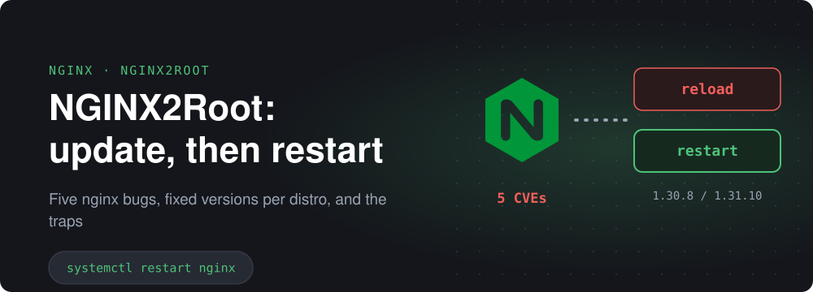

{: width="1000" height="360"}

On 18 November 2026, nginx fixed five memory-safety bugs that researchers at Xint published together as [NGINX2Root](https://xint.io/blog/nginx2root-remote-code-execution). The worst one, **CVE-2026-123007**, can let anyone who can open an **HTTP/2** connection run code as the nginx worker, with no login. The code has been there since nginx 1.9.5, from 2015. A separate **Linux kernel bug in SCTP** then takes the attacker from the worker to root, including out of a Docker container.

Patching the nginx from your distro is the easy part. Homelabs usually have several more, inside Nginx Proxy Manager, SWAG, a mail server or a Home Assistant app, and `apt upgrade` doesn't touch those. There are also two easy ways to think you're safe when you aren't, and I tested both below.

> **TL;DR**
> - **Fixed in nginx 1.30.7 and 1.31.9.** Go straight to **1.30.8 / 1.31.10**, released on 23 November. Distros [backport the fix](#fixed-versions) under older version numbers.
> - **Restart nginx after updating.** [A reload keeps the old binary running](#2-restart-dont-reload).
> - **Containers have their own nginx.** [Check each project](#self-hosted-projects). Nginx Proxy Manager needs 2.17.1.
> - **Can't patch yet?** Turn off HTTP/2 on **every** site. [One leftover `listen ... http2` keeps it on](#1-http2-off-may-not-turn-it-off).
> - **Block the SCTP module** on the host. [It's one line](#block-sctp-on-the-host).
> - No confirmed attacks so far, but a public exploit exists.

## The five bugs

| CVE | Where | You're exposed if | Does disabling HTTP/2 help? |
|---|---|---|---|
| **CVE-2026-123007** | HTTP/2 flow control | HTTP/2 is on | yes |
| CVE-2026-123633 | HTTP/2 use-after-free | HTTP/2 is on and you proxy to a backend | yes |
| CVE-2026-121810 | HTTP/3 use-after-free | HTTP/3 (`listen ... quic`) is on and you proxy to a backend | no, turn off HTTP/3 |
| CVE-2026-123634 | `resolver` | `resolver` is used with a variable backend and `mirror` or SSI | no |
| CVE-2026-113425 | mail proxy | you have a `mail {}` block with `auth_http` | no |

The first is the one to worry about, because it only needs HTTP/2, and most HTTPS setups have that on. The second is also common in homelabs, since proxying is what a reverse proxy does, but it needs the worker to be short of connections. The other three need less common setups.

F5 scores all five **9.2** (CVSS 4.0). Red Hat gives them 8.1 (CVSS 3.1). nginx itself rates CVE-2026-123007 and CVE-2026-113425 "major" and the rest "medium".

The same releases fix [five more bugs](https://nginx.org/en/security_advisories.html), including **CVE-2026-118899**, a TLS 1.3 infinite loop that's also rated major. Disabling HTTP/2 does nothing for those, so treat it as a stopgap.

### How bad is it really?

- **Working exploits exist.** Xint says its chain works over the internet against servers on AWS, Google Cloud and Azure, and is holding back the final steps. Wiz reports code execution too.
- **A public exploit exists,** from Rapid7. It targets the official nginx 1.31.8 Docker image and is described as hard to use outside a lab.
- **Others got less far.** Censys reproduced memory corruption in four of the five bugs without reaching code execution. F5 says ASLR has to be off or bypassed. Xint says it bypassed it.
- **No confirmed attacks** in any source I found, the latest from 21 November. None of the five was in [CISA's KEV catalog](https://www.cisa.gov/known-exploited-vulnerabilities-catalog) when I checked today's version.

So this isn't a mass worm yet. But the fix is public and [about 8.8 million](https://www.bleepingcomputer.com/news/security/critical-nginx-nginx2root-bugs-let-attackers-hijack-servers/) services looked exposed on 19 November. Patch anything reachable from the internet today.

## Find every nginx you run

A container's nginx is still a process on the host, so this lists all of them, including the ones in Docker:

```bash
ps -eo pid,user,lstart,args | grep '[n]ginx: master'
```

`lstart` shows when each one started. Anything older than your last update is still running the old code. To see which containers they belong to:

```bash
for c in $(docker ps --format '{{.Names}}'); do
  v=$(docker exec "$c" sh -c 'nginx -v || openresty -v || angie -v' 2>&1 | grep -i 'version:')
  [ -n "$v" ] && echo "$c: $v"
done
```

Then check for the ones these miss: your NAS, router or firewall (OPNsense has an nginx plugin), Kubernetes ingress, and the VPS you forgot about.

**Don't trust `nginx -v` on its own.** Ubuntu's *patched* package reports `nginx version: nginx/1.30.4`, which looks vulnerable. Nginx Proxy Manager's fixed release still says `openresty/1.31.8.1`. For distro packages, compare the package version instead:

```bash
dpkg -l nginx            # Debian, Ubuntu
rpm -q nginx             # RHEL, Alma, Rocky
apk info -v | grep nginx # Alpine
```

## Fixed versions

### nginx.org and the official Docker image

| Branch | First fixed | Use this |
|---|---|---|
| Stable | 1.30.7 | **1.30.8** |
| Mainline | 1.31.9 | **1.31.10** |

The 23 November releases also fix CVE-2026-132779, a CPU-exhaustion bug that only applies with `ssl_early_data on`. The official `nginx` Docker tags were rebuilt on 23 and 24 November.

### Ubuntu

Canonical fixed this in two rounds. [USN-9159-1](https://ubuntu.com/security/notices/USN-9159-1) (19 November) covers NGINX2Root. [USN-9182-1](https://ubuntu.com/security/notices/USN-9182-1) (20 November) adds three other bugs. If you updated on the 19th, **update again**.

| Release | NGINX2Root fixed in | Latest |
|---|---|---|
| 26.10 | 1.30.4-7ubuntu1.2 | **1.30.4-7ubuntu1.3** |
| 26.04 LTS | 1.28.3-2ubuntu1.13 | **1.28.3-2ubuntu1.14** |
| 24.04 LTS | 1.24.0-2ubuntu7.20 | **1.24.0-2ubuntu7.21** |
| 22.04 LTS | 1.18.0-6ubuntu14.23 | **1.18.0-6ubuntu14.24** |
| 20.04 LTS (Pro) | 1.18.0-0ubuntu1.7+esm5 | **1.18.0-0ubuntu1.7+esm6** |
| 18.04 LTS (Pro) | 1.14.0-0ubuntu1.11+esm6 | **1.14.0-0ubuntu1.11+esm7** |

### Other distros

| Distro | Fixed in |
|---|---|
| Debian 13 trixie | 1.26.3-3+deb13u11 (DSA-6642-1) |
| Debian 12 bookworm | 1.22.1-9+deb12u11 (DLA-4918-1) |
| RHEL 10 | 1.26.3-16.el10_3.3 (RHSA-2026:100744) |
| RHEL 9 | 1.20.1-32.el9_9.2 ([RHSA-2026:100748](https://access.redhat.com/errata/RHSA-2026:100748)); streams 1.24 (RHSA-2026:100746) and 1.26 (RHSA-2026:100745) |
| RHEL 8 | 1.24 stream only (RHSA-2026:100747) |
| Alpine 3.24, edge | 1.30.7-r0 |
| Alpine 3.22, 3.23 | 1.28.3-r8 |
| Alpine 3.21 | 1.26.3-r4 |
| Arch | nginx 1.30.7-1, nginx-mainline 1.31.9-1 |
| Amazon Linux 2023 | 1.30.7-1.amzn2023.0.1 |

Raspberry Pi OS gets nginx from Debian, so use the Debian rows. AlmaLinux [shipped early builds](https://almalinux.org/blog/2026-11-18-nginx2root/) on the 18th and has since released updates matching Red Hat's. Update again if you have the first ones. Rocky 8 and 9 were rebuilt by the 21st, but Rocky 10, Fedora and openSUSE Leap still had no fix at the last [check I found](https://ma.ttias.be/nginx-http2-cve-2026-123633-123007/) (20 to 21 November). On EL8, the older nginx streams (1.14 to 1.22) aren't getting one. Switch to 1.24.

## Self-hosted projects

As of 24 November:

| Project | Status |
|---|---|
| **Nginx Proxy Manager** | **Fixed in [2.17.1](https://github.com/NginxProxyManager/nginx-proxy-manager/releases/tag/v2.17.1)**, with backported patches. It also updates Certbot, which can break some DNS plugins |
| jlesage/nginx-proxy-manager (Unraid and others) | [New image](https://github.com/jlesage/docker-nginx-proxy-manager/issues/357) since 20 November |
| NPMplus | Fixed in [2026-11-18-r1](https://github.com/ZoeyVid/NPMplus/releases/tag/2026-11-18-r1) |
| **Home Assistant NPM app** (add-on) | **Not fixed.** The latest, 4.1.1, ships nginx 1.31.8, and the [update is still open](https://github.com/hassio-addons/app-nginx-proxy-manager/issues/783). Turn off HTTP/2 |
| SWAG (LinuxServer) | Fixed, [on nginx 1.30.7](https://github.com/linuxserver/docker-swag/issues/637) |
| nginx-proxy (jwilder) | [Merged today](https://github.com/nginx-proxy/nginx-proxy/pull/2792), but no release yet. `ENABLE_HTTP2=false` [misses the fallback server](https://github.com/nginx-proxy/nginx-proxy/issues/2791) |
| mailcow | Fixed in [2026-11a](https://github.com/mailcow/mailcow-dockerized/issues/7668) |
| **Mailu** | **Not fixed**, [PR open](https://github.com/Mailu/Mailu/pull/4214). It uses nginx for mail, so disabling HTTP/2 isn't enough |
| OpenResty | Fixed in 1.31.9.1. Docker images are appearing now |
| Angie | Fixed in [1.12.5](https://github.com/webserver-llc/angie/releases/tag/Angie-1.12.5) |
| freenginx | Fixed in [1.31.6](https://freenginx.org/en/CHANGES), released today |
| BunkerWeb | Fixed in 1.6.18, except on [Fedora packages](https://github.com/bunkerity/bunkerweb/issues/4214) |
| OPNsense `os-nginx` | On 20 November the fix was only in a [snapshot](https://github.com/opnsense/plugins/issues/5939): `opnsense-revert -z nginx` |
| **ingress-nginx** (Kubernetes) | **No fix coming.** The project is archived. Set `use-http2: "false"` in its ConfigMap and plan a move |

If something isn't listed, assume it's affected until its maintainers say otherwise. Caddy, Traefik, HAProxy and Apache don't use nginx's code, so these CVEs don't apply to them.

## How to patch

**1. Update**

```bash
sudo apt update && sudo apt upgrade                          # Debian, Ubuntu
sudo dnf clean metadata && sudo dnf upgrade 'nginx*'         # RHEL, Alma, Rocky
docker compose pull && docker compose up -d                  # containers
```

If you built or installed third-party dynamic modules, update them too. A module built for 1.30.6 won't load in 1.30.7. Run `sudo nginx -t` before restarting.

**2. Restart**

```bash
sudo systemctl restart nginx
```

**3. Check that nothing is running a deleted binary**

```bash
for p in $(pgrep -f 'nginx: (master|worker)'); do
  sudo readlink "/proc/$p/exe"
done | sort | uniq -c
```

Any line ending in `(deleted)` is the old nginx.

## Two ways to think you're safe

I tested these on Ubuntu's patched nginx 1.30.4, on localhost, using `openssl s_client` to see whether HTTP/2 was offered.

### 1. `http2 off` may not turn it off

There are two ways to enable HTTP/2: the old `listen 443 ssl http2;` and the newer `http2 on;`. They don't behave the same:

| Config on one address and port | site a | site b |
|---|---|---|
| a: `http2 on;` b: `http2 off;` | **h2** | http/1.1 |
| a: `listen ... http2` b: `http2 off;` | **h2** | **h2** |
| one server: `listen ... http2` **and** `http2 off;` | **h2** | **h2** |
| `http2` removed from every `listen`, b: `http2 off;` | http/1.1 | http/1.1 |

The old `listen ... http2` **wins over `http2 off`**, and it turns HTTP/2 on for **every site on that address and port**. The newer directive works per site, but a site left on is enough for an attacker to reach the vulnerable code.

So find every one, including IPv6 listeners:

```bash
sudo nginx -T 2>/dev/null | sed 's/#.*//' | grep -nE 'listen[^;]*(http2|quic)|http2[[:space:]]+on|http3[[:space:]]+on'
```

Remove `http2` from the `listen` lines, change `http2 on;` to `http2 off;`, and remove `quic` listeners if you have them. `http2 off;` only exists from nginx 1.25.1, so on older versions just edit the `listen` lines. Then check from outside, **for each hostname**:

```bash
echo | openssl s_client -connect example.com:443 -servername example.com \
  -alpn h2,http/1.1 2>/dev/null | grep ALPN
```

You want `ALPN protocol: http/1.1`. Browsers fall back without anyone noticing, but **native gRPC stops working**. In Nginx Proxy Manager, switch off *HTTP/2 Support* on every host. One host left on is enough.

If Cloudflare or another CDN sits in front, test your **origin** too. The CDN answers with its own HTTP/2, and an attacker who finds your origin IP skips it.

### 2. Restart, don't reload

I started nginx, replaced its binary the way a package update does, and reloaded:

```console
$ ls -l /proc/$(cat nginx.pid)/exe
... -> /.../nginxcopy (deleted)
$ nginx -s reload
$ ls -l /proc/$(cat nginx.pid)/exe
... -> /.../nginxcopy (deleted)
```

A reload starts new workers, but **from the old binary still in memory**. Use `systemctl restart`. Containers get this for free, as long as you *recreate* them: `docker restart` starts the same old image again.

## Block SCTP on the host

The kernel bug is what turns "code as `www-data`" into root, even from a container. According to Xint it's a use-after-free in SCTP's send path, present since Linux 4.15. When its post came out there was no CVE and no fix.

Almost nobody at home uses SCTP, which is mostly a telecoms protocol. But the kernel loads it on demand: on my Ubuntu 26.10 desktop nothing blocks it, and `modprobe -n -v sctp` was ready to load it. Blocking it takes one line, **on the host**, since containers share its kernel:

```bash
echo 'install sctp /bin/false' | sudo tee /etc/modprobe.d/disable-sctp.conf
```

Check it:

```console
$ modprobe -n -v sctp
install /bin/false
$ lsmod | grep -w sctp
$ grep CONFIG_IP_SCTP= /boot/config-$(uname -r)
CONFIG_IP_SCTP=m
```

- `lsmod` should print nothing. If SCTP is **already loaded**, the block doesn't unload it. Make sure nothing uses it, then reboot.
- If the config says `=y` instead of `=m`, it's built into the kernel and can't be blocked this way.

**Is there a kernel fix yet?** A different-looking SCTP use-after-free, [CVE-2026-99583](https://security-tracker.debian.org/tracker/CVE-2026-99583), was published on 20 November. Debian 13 has fixed it in 6.12.118-1, and Ubuntu's generic kernels were still listed as vulnerable when I checked. It's in a similar area, but I found **no source saying it's the NGINX2Root bug**, and Debian credits other researchers. Install the update when you get it, and keep SCTP blocked.

This block stops only Xint's root step. An attacker in the nginx worker can still read what nginx can: your sites, backend credentials in the config and, in memory, your TLS keys.

## Should you check for signs of a break-in?

Failed attempts are likely to crash workers, so look for that first:

```bash
sudo grep -E 'worker process [0-9]+ exited on signal' /var/log/nginx/error.log*
```

A few crashes don't prove an attack, and Xint warns that this one can leave little in the logs. If you see a burst on a server that was exposed, also look for unexpected child processes of nginx, new cron jobs and new SSH keys. If you have real reason to suspect a break-in, rebuild the machine and replace its TLS keys and the passwords in its nginx config.

## What to do, in order

1. List every nginx with the `ps` command above.
2. Update, **restart**, and check for `(deleted)`.
3. Recreate containers with fixed images.
4. Turn off HTTP/2 where no fix exists: the Home Assistant NPM app, ingress-nginx and nginx-proxy. For Mailu, also restrict the mail ports until it's fixed.
5. Block SCTP on every host.

Then look at the kernel. If you haven't rebooted since the [TCP bug earlier this month](), do both at once. And if your nginx also runs PHP, check [PHP2Shell]().

## Sources

- [nginx security advisories](https://nginx.org/en/security_advisories.html) and [CHANGES](https://nginx.org/en/CHANGES)
- [Xint: NGINX2Root](https://xint.io/blog/nginx2root-remote-code-execution)
- [Red Hat RHSB-2026-019](https://access.redhat.com/security/vulnerabilities/RHSB-2026-019)
- [Ubuntu: CVE-2026-123007](https://ubuntu.com/security/CVE-2026-123007), [Debian: CVE-2026-123007](https://security-tracker.debian.org/tracker/CVE-2026-123007), [Alpine: CVE-2026-123007](https://security.alpinelinux.org/vuln/CVE-2026-123007)
- [AlmaLinux: NGINX2Root](https://almalinux.org/blog/2026-11-18-nginx2root/)
- [ma.ttias.be: patch status per distro](https://ma.ttias.be/nginx-http2-cve-2026-123633-123007/)
- [GetPageSpeed: NGINX2Root](https://www.getpagespeed.com/nginx2root)
- [Tenable: NGINX2Root FAQ](https://www.tenable.com/blog/nginx2root-cve-2026-123007-frequently-asked-questions-about-five-critical-nginx)
- [Qualys](https://blog.qualys.com/product-tech/patch-management/2026/11/18/nginx2root-five-nginx-flaws-led-by-cve-2026-123007-how-to-find-mitigate-and-patch-now), [Northwave](https://northwave-cybersecurity.com/threat-response-nginx2root) and [BleepingComputer](https://www.bleepingcomputer.com/news/security/critical-nginx-nginx2root-bugs-let-attackers-hijack-servers/)
