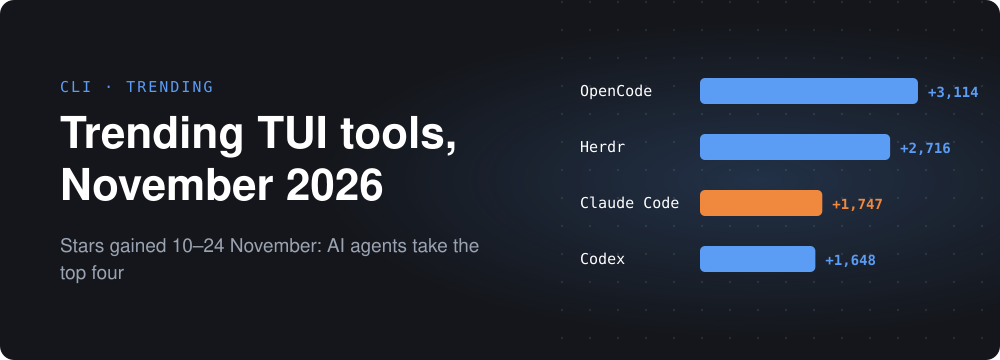
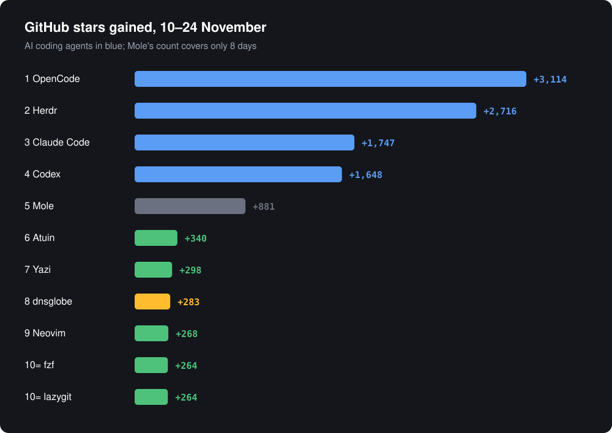
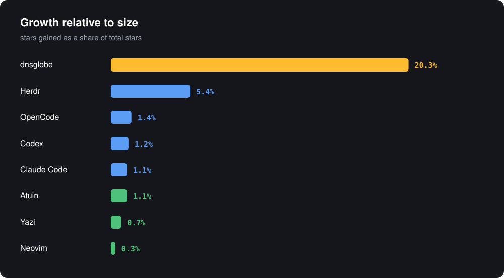

{: width="1000" height="360"}

These are the ten terminal UI tools that gained the most GitHub stars over the last two weeks, from the [trending list](https://cli.masoko.net/?sort=trending) on The Terminal Index, the directory of terminal tools I run. It tracks 333 of them, so this is the top ten of that list, not of all GitHub.

> **TL;DR**
> - **AI agents take the top four places:** OpenCode, Herdr, Claude Code and Codex.
> - **dnsglobe grew fastest for its size,** up 20% in two weeks.
> - **Herdr's new phone app doesn't work with Herdr's TUI.** [Details below](#2-herdr).
> - **Close to the list:** tmux, zellij and [netwatch](#just-missed-the-list), which just reached 1.0.

## The list

| # | Tool | What it is | Stars gained | Total | Growth |
|---|---|---|---|---|---|
| 1 | [OpenCode](https://cli.masoko.net/tools/opencode/) | AI coding agent | 3,114 | 228,900 | 1.4% |
| 2 | [Herdr](https://cli.masoko.net/tools/herdr/) | Multiplexer for AI agents | 2,716 | 52,593 | 5.4% |
| 3 | [Claude Code](https://cli.masoko.net/tools/claude-code/) | AI coding agent | 1,747 | 156,900 | 1.1% |
| 4 | [Codex](https://cli.masoko.net/tools/codex/) | AI coding agent | 1,648 | 136,303 | 1.2% |
| 5 | [Mole](https://cli.masoko.net/tools/mole/) | System cleaner | 881* | 76,058 | 1.2%* |
| 6 | [Atuin](https://cli.masoko.net/tools/atuin/) | Shell history | 340 | 32,587 | 1.1% |
| 7 | [Yazi](https://cli.masoko.net/tools/yazi/) | File manager | 298 | 43,627 | 0.7% |
| 8 | [dnsglobe](https://cli.masoko.net/tools/dnsglobe/) | DNS propagation checker | 283 | 1,674 | **20.3%** |
| 9 | [Neovim](https://cli.masoko.net/tools/neovim/) | Text editor | 268 | 103,804 | 0.3% |
| 10= | [fzf](https://cli.masoko.net/tools/fzf/) | Fuzzy finder | 264 | 84,381 | 0.3% |
| 10= | [lazygit](https://cli.masoko.net/tools/lazygit/) | Git client | 264 | 84,052 | 0.3% |

{: width="1000" height="708"}

\* Mole was only added to the index on 16 November, so its count covers 8 days instead of 14.

**What counts as a TUI here:** something you mainly use through an interactive screen. That leaves out command-line tools that gained more, such as sherlock (8,664) and yt-dlp (2,261), and also Ollama (915) and OpenClaw (866), which are mainly background services.

{: width="1000" height="552"}

## 1. OpenCode

**+3,114.** An open-source (MIT) coding agent that works with many model providers. Version 1 [now offers the upgrade to version 2](https://github.com/anomalyco/opencode/releases/tag/v1.19.6) (plugins made for version 1 need an update), and version 2 is releasing quickly: [2.3.0](https://github.com/anomalyco/opencode/releases/tag/v2.3.0) on 13 November moved subagents to the background, and [2.4.0](https://github.com/anomalyco/opencode/releases/tag/v2.4.0) on 23 November gave the TUI a new look and added scheduled automations. If you don't like the new colors, pick `opencode-classic` under **Theme**.

Two things to know first. GitHub still marks **1.19.6** as the latest release, and some older install commands may give you version 1. And in October, OpenCode said a [breach affected 1.4% of Console users](https://bleepingcomputer.com/news/security/opencode-hack-exposes-api-keys-amid-ai-distillation-attacks) and may have exposed their provider API keys. If it emailed you, replace them.

```bash
brew install anomalyco/tap/opencode-v2   # or: npm i -g @opencode/cli@latest
```

I compared it with number three in [OpenCode vs Claude Code]().

## 2. Herdr

**+2,716.** A terminal multiplexer, like tmux, made for running several coding agents. It marks each pane as working, blocked or idle, and the agents keep running when you detach or lose SSH. Thoughtworks put it on its [Technology Radar](https://www.thoughtworks.com/radar/tools/herdr) this month, under "Assess".

The name now covers two products. The **[mobile apps](https://herdr.dev/mobile/)** shared on Hacker News on 10 November work with the separate Herdr desktop app, and the page says plainly: "Herdr TUI isn't supported." Both can run on the same computer, but agents you start in the TUI won't show up on your phone. The latest TUI release is still [0.9.5](https://github.com/ogulcancelik/herdr/releases/tag/v0.9.5), from 14 October, so these stars may partly be for the app.

```bash
brew install herdr
```

`Ctrl+b q` detaches, and running `herdr` again brings you back.

## 3. Claude Code

**+1,747.** Anthropic's coding agent. It's the only one here that isn't open source. The newest release, [2.1.331](https://github.com/anthropics/claude-code/releases/tag/v2.1.331) from 23 November, adds an API connectivity check to `claude doctor`. I couldn't tie its stars to any single event: it gained about 125 a day, with no big spike.

```bash
curl -fsSL https://claude.ai/install.sh | bash
```

## 4. Codex

**+1,648.** OpenAI's coding agent, open source under Apache-2.0. [0.172.0](https://github.com/openai/codex/releases/tag/rust-v0.172.0), from 24 November, completes slash-command arguments with `Tab` and lets you jump between task groups in its agent command center with `Shift+Up` and `Shift+Down`.

```bash
npm install -g @openai/codex
```

## 5. Mole

**+881 in 8 days.** A system cleaner you start with `mo`. It began on the Mac and now has Windows and Linux versions. The TUI parts are the menu (`mo`), the disk explorer (`mo analyze`) and the live dashboard (`mo status`).

It deletes files, so preview first:

```bash
brew install mole        # macOS
mo clean --dry-run
```

The [Linux version](https://github.com/tw93/mole/releases/tag/V0.7.1-linux) is much younger (0.7.1, against 1.74 on the Mac). Its 21 November release fixed a case where cleaning could remove files behind a **bind mount**. If you use Mole on Linux, update before running it again.

## 6. Atuin

**+340.** Replaces your shell history with a searchable SQLite database and can sync it, end-to-end encrypted, between machines. `Ctrl+R` opens the search screen.

The new part is **[Atuin Threads](https://blog.atuin.sh/threads-agent-sessions/)**, which does the same for AI agent sessions: start one in Claude Code, then run `atuin resume` and continue in Codex on another machine. It was announced on 27 October with version 18.24 and reached [Hacker News](https://news.ycombinator.com/item?id=50453637) on 11 November. It's opt-in, so your history works as before if you skip it.

```bash
brew install atuin
```

## 7. Yazi

**+298.** A fast file manager with image previews and Lua plugins. Nothing new was released in these two weeks. The current version, [26.9.1](https://github.com/sxyazi/yazi/releases/tag/v26.9.1), is from September, so this is just steady growth of about 20 stars a day.

```bash
brew install yazi
```

It's also in my [TUI file managers comparison]().

## 8. dnsglobe

**+283, and the biggest jump for its size.** You give it a domain, and it asks 34 public DNS resolvers around the world for the record, compares the answers and draws them on a world map. Wide terminals get a flat map, and narrower ones a rotating globe. It gained 127 of its stars in one day, between the 12 and 13 November counts. I couldn't find what caused it.

It also has a plain mode for scripts. Part of what I got for `example.com`:

```console
$ dnsglobe --once example.com A
Google Public DNS    →SOF     8.8.8.8         OK         32ms  ttl=   300  104.20.23.154, 172.66.147.243
Cloudflare           →SOF     1.1.1.1         OK         11ms  ttl=   181  104.20.23.154, 172.66.147.243
Yandex DNS           RU       77.88.8.8       DIFFERS    98ms  ttl=    82  8.47.69.0, 8.6.112.0
CNNIC sDNS           CN       1.2.4.8         FAIL     1878ms  SERVFAIL (can't resolve — broken delegation or DNSSEC?)
...
31 of 32 responding · 1 servfail · 2 unreachable · 2 answer group(s)
```

`→SOF` means the server that answered me is in Sofia. A few failures are normal, and `DIFFERS` isn't always an error, since a domain can have different addresses in different places. Queries go straight to all 34 operators, so don't use it for names you want to keep private.

```bash
brew install dnsglobe
```

If you're choosing a resolver, see [free DNS that blocks ads]().

## 9. Neovim

**+268.** Neovim reached 104,000 stars in the 23 November count, then **lost 196 by the next day**. Without that drop it would have been sixth. tmux also fell over the same days. GitHub removing spam accounts would explain it, but I found nothing confirming that. Stable is 0.12.6.

```bash
brew install neovim
```

## 10. fzf and lazygit

**+264 each**, a tie.

**fzf** filters any list as you type: files, history, branches, processes. [0.75.0](https://github.com/junegunn/fzf/releases/tag/v0.75.0), from 7 November, changes how a few actions behave. If your scripts use `transform-nth` or `change-with-nth`, read the notes before updating.

**lazygit** puts staging, branches, stashes and rebases on one screen. [0.66.3](https://github.com/jesseduffield/lazygit/releases/tag/v0.66.3), also from 7 November, ignores submodules whose name or path points outside the repository. That's a good reason to update if you open repositories you don't trust.

```bash
brew install fzf lazygit
```

## Just missed the list

- **[tmux](https://cli.masoko.net/tools/tmux/)** (+246) and **[zellij](https://cli.masoko.net/tools/zellij/)** (+226), the two classic multiplexers. zellij released [0.46.1](https://github.com/zellij-org/zellij/releases/tag/v0.46.1) on 24 November.
- **[netwatch](https://cli.masoko.net/tools/netwatch/)** (+208). It shows your network connections and the process behind each one. It had hardly moved until [1.0.0](https://github.com/matthart1983/netwatch/releases/tag/v1.0.0) on 19 November, then gained 196 stars in four days. If that continues, it will be in the next top ten.

## How it's counted

The index saves every tool's star count daily. "Trending" is the count on 24 November minus the one on 10 November. A few limits:

- **Big projects win.** A list by growth would start with dnsglobe, so I included that column.
- **It's a net number.** Removed stars are subtracted, as with Neovim.
- **Stars aren't users,** and they can be faked. A star means someone noticed the project, nothing more.

The numbers change daily, so the [live list](https://cli.masoko.net/?sort=trending) will already look a little different. Missing a tool? [Submit it](https://cli.masoko.net/submit).
