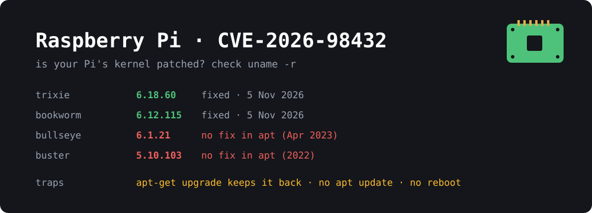
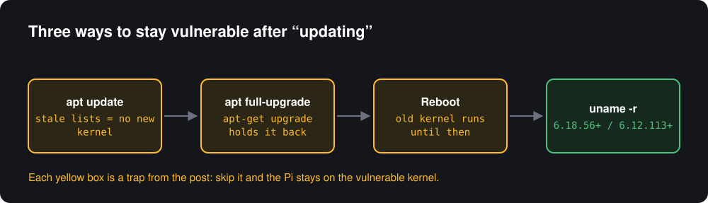
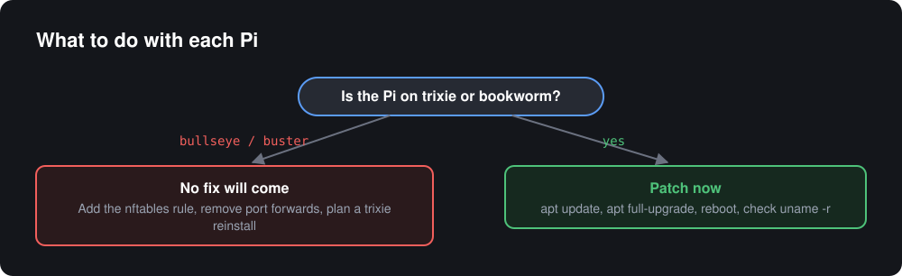

{: width="1000" height="360"}

Ten days ago I wrote about [CVE-2026-98432](), the remote use-after-free in the kernel's IPv4 TCP code. That post covered Ubuntu, Debian and RHEL. It didn't cover Raspberry Pi OS, which doesn't use Debian's kernel. Raspberry Pi builds its own, from its [own kernel tree](https://github.com/raspberrypi/linux), and ships it from its own apt repository.

So I checked that repository, and then every Pi in my house. **None of the four I could reach was patched.** One was a single `apt update` away from the fix. The other three can't get it from apt at all.

> **TL;DR**
> - **Fixed Raspberry Pi OS kernels came out on 5 November:** `6.18.60` for trixie and `6.12.115` for bookworm.
> - **Bullseye and buster never get a fix.** Their kernels stopped at **6.1.21** (April 2023) and **5.10.103** (2022).
> - **`apt-get upgrade` keeps the kernel back.** Use `apt full-upgrade`, run `apt update` first, and **reboot**.
> - [Check your Pi](#check-your-pi) with `uname -r`, or the script below.
> - Can't upgrade yet? [The nftables stopgap](#stopgap-if-you-cant-patch-today) works on Raspberry Pi OS. I validated it on three Pis.

## What Raspberry Pi actually shipped

Raspberry Pi merges upstream stable releases into its kernel branches every week. The source has had the fix since upstream 6.18.56 and 6.12.113 in October. What matters is when it reached apt. Here's what [archive.raspberrypi.com](https://archive.raspberrypi.com/debian/) has for each release today. The dates are from the package files on the server:

| Raspberry Pi OS | Kernel in apt | Published | CVE-2026-98432 |
|---|---|---|---|
| **13 trixie** | `6.18.60-1+rpt1` | 5 Nov 2026 | fixed (needs 6.18.56+) |
| **12 bookworm** | `6.12.115-1+rpt1` | 5 Nov 2026 | fixed (needs 6.12.113+) |
| 12 bookworm, previous | `6.12.109-1+rpt1` | 15 Sep 2026 | **vulnerable** |
| 11 bullseye | `raspberrypi-kernel 1:1.20230405-1` = **6.1.21** | Apr 2023 | **vulnerable, no update** |
| 10 buster | `raspberrypi-kernel 1:1.20230509~buster-1` = **5.10.103** | May 2023 | **vulnerable, no update** |

The CVE came out on 15 October, so the trixie and bookworm fix took about three weeks to reach apt. That's why forum threads (like this [DietPi one](https://dietpi.com/forum/t/please-upgrade-your-kernel-to-fix-cve-2026-98432/25548)) suggested `rpi-update`, and why Home Assistant OS 18.5 fixed the Pi and Yellow later than its other boards. That's sorted now.

**Bullseye and buster are not.** Their kernel package hasn't changed since 2023, so every kernel bug fixed since then is still in it, this one included. A bullseye Pi that runs `apt upgrade` every night and reboots weekly is fully "up to date" and still vulnerable.

All the trixie and bookworm kernel flavours are on the same version: `rpi-v8` (Pi 3/4/Zero 2 W, 64-bit), `rpi-2712` (Pi 5), `rpi-v6` and `rpi-v7`/`v7l` (32-bit), and the `-rt` real-time builds.

## Check your Pi

```bash
uname -r
. /etc/os-release && echo "$VERSION_CODENAME"
```

On trixie and bookworm, `uname -r` looks like `6.18.60+rpt-rpi-2712`. The part before the `+` is the upstream version. On bullseye and buster it looks like `6.1.21-v8+` or `5.10.103-v7l+`.

To get a verdict, paste this. It compares the running kernel against the upstream versions that fixed the bug:

```bash
k=$(uname -r); v=${k%%[-+]*}
case $v in
  7.3|7.3.*) min=7.3 ;;  7.2.*) min=7.2.10 ;;  6.18.*) min=6.18.56 ;;
  6.12.*) min=6.12.113 ;; 6.6.*) min=6.6.159 ;; 6.1.*) min=6.1.190 ;;
  5.15.*) min=5.15.223 ;; 5.10.*) min=5.10.272 ;; *) min= ;;
esac
case $k in *-raspi|*-generic) min= ;; esac   # Ubuntu numbers don't map to upstream
if [ -z "$min" ]; then echo "$k: check your distro's tracker"
elif [ "$(printf '%s\n' "$min" "$v" | sort -V | head -1)" = "$min" ]; then echo "$k: fixed (>= $min)"
else echo "$k: VULNERABLE (needs >= $min)"; fi
```

It only works for Raspberry Pi kernels, which follow upstream version numbers. **Ubuntu on a Pi** (`linux-raspi`, `uname -r` like `6.8.0-1040-raspi`) backports fixes under its own numbers. Its fixed versions are in the [Ubuntu CVE tracker](https://ubuntu.com/security/CVE-2026-98432) and were already out for 22.04 and newer when I wrote the first post. **Home Assistant OS** needs **18.5** or newer. **DietPi** installs Raspberry Pi's kernel packages, so the table above applies.

## My Pis

Here's what I found, via SSH:

| Pi | OS | Running kernel | Result |
|---|---|---|---|
| Pi 5 | bookworm | `6.12.93+rpt-rpi-2712` | VULNERABLE, fix available |
| Pi 4 (SSD) | bullseye | `5.10.103-v7l+` | VULNERABLE, no fix in apt |
| Pi 4 | buster | `5.10.103-v7l+` | VULNERABLE, no fix in apt |
| Pi 3B | buster | `5.10.103-v7+` | VULNERABLE, no fix in apt |

The Pi 4 on bullseye runs the **buster** kernel, because it was upgraded from buster in place and its sources still list the buster Raspberry Pi repo. Upgrades in place leave things like this behind.

The Pi 5 was the interesting one. It runs Home Assistant, Mosquitto and Lyrion among other things, with **20 TCP ports** listening on IPv4. It also showed me two ways to upgrade and still not get the fix.

{: width="1000" height="287"}

### Trap 1: `apt-get upgrade` keeps the kernel back

Kernels on trixie and bookworm come as versioned packages (`linux-image-6.12.115+rpt-rpi-2712`). The `linux-image-rpi-2712` metapackage pulls in the new one. `apt-get upgrade` never installs new packages, so it holds the metapackage back:

```text
$ apt-get -s upgrade
The following packages have been kept back:
  linux-headers-rpi-2712 linux-headers-rpi-v8 linux-image-rpi-2712
  linux-image-rpi-v8 rpi-eeprom
```

`apt upgrade` (without `-get`) and `apt full-upgrade` do install it. If you have a cron job or Ansible task running `apt-get upgrade -y`, your Pi's kernel hasn't moved in a while.

### Trap 2: stale package lists

The Pi 5's package lists were last updated on 9 October. Here's what `apt upgrade` would have installed:

```text
Inst linux-image-6.12.109+rpt-rpi-2712 (1:6.12.109-1+rpt1 Raspberry Pi Foundation:oldstable [arm64])
```

That's the September kernel, **still vulnerable**. Without `apt update`, apt only knows about what was in the repo on the day of the last update.

### Trap 3: no reboot

Same as on any Linux machine: the new kernel only runs after a reboot. `unattended-upgrades` doesn't reboot unless you tell it to.

## Fix: trixie and bookworm

```bash
sudo apt update
sudo apt full-upgrade
sudo reboot
```

After the reboot, `uname -r` should show `6.18.60+rpt-…` or `6.12.115+rpt-…` (or newer).

If you've run `rpi-update` in the past, check `uname -r` after the reboot. It should end in `+rpt-…`, which marks an apt kernel. Raspberry Pi's [documentation](https://www.raspberrypi.com/documentation/computers/os.html#rpi-update) gives `sudo apt install --reinstall raspi-firmware` to go back to the stable firmware. It doesn't give a separate command for the kernel, so I'd also reinstall your `linux-image-rpi-*` package before rebooting.

## Fix: bullseye and buster

There's no package to install. Your options, best first:

1. **Reinstall with trixie.** Raspberry Pi still builds trixie for the oldest boards: the repo has `rpi-v6` and `rpi-v7` kernels for Pi 1, Zero and Pi 2. Back up, write a fresh card with Raspberry Pi Imager, restore your config. It takes longer than an upgrade, but you get a kernel that's still maintained. Upgrading from buster to bullseye in place is what gave me the mismatched Pi 4 above.
2. **Firewall it** with the stopgap below and keep it off the internet until you reinstall. That reduces the risk but doesn't remove it.
3. **`rpi-update`.** It installs the latest pre-release kernel (today `6.18.65`) on any release, bullseye included. Raspberry Pi says it's "intended for use by developers and engineers" and "can introduce instability, rendering your system unreliable or unbootable." On a Pi 4 or 5 it also updates the EEPROM bootloader. On an old userland, a 6.18 kernel with 2023 firmware tools is a combination nobody tests. I wouldn't do it on a Pi I care about.

## Stopgap if you can't patch today

The nftables rule from the [first post](#stopgap-drop-tcp-packets-with-ip-options) works on Raspberry Pi OS. It drops incoming IPv4 TCP packets that carry IP options, which the exploit needs. I checked it with `nft -c` (validate without applying) on buster (nftables 0.9.6), bullseye (0.9.8) and bookworm (1.0.6):

```bash
sudo tee /etc/cve-2026-98432.nft >/dev/null <<'EOF'
table inet cve_2026_98432 {
  chain input {
    type filter hook input priority -310; policy accept;
    ip protocol tcp ip hdrlength > 5 counter drop
  }
}
EOF
sudo nft -c -f /etc/cve-2026-98432.nft && sudo nft -f /etc/cve-2026-98432.nft
```

`nft` is in `/usr/sbin`, so it won't be found without `sudo`. On Pis without nftables, this iptables rule does the same job with the `u32` match. It parsed with `iptables-restore --test` on all four Pis:

```bash
sudo iptables -I INPUT -p tcp -m u32 --u32 "0>>24&0x0F=6:15" -j DROP
```

The same limits apply as before: Red Hat and Ubuntu say it **reduces risk but doesn't fully prevent exploitation**, it only covers traffic to the host itself (containers with their own network go through `forward`), and it's gone after a reboot.

## What to do, in order

{: width="1000" height="306"}

1. Run `uname -r` on every Pi. Don't forget the one running the 3D printer, the one in the garage, and the one behind the TV.
2. **Trixie/bookworm:** `apt update`, `apt full-upgrade`, reboot. Then check `uname -r` again.
3. **Bullseye/buster:** add the firewall rule today, plan a trixie reinstall, and take it off any port forward until then.
4. Replace any `apt-get upgrade` in scripts with `apt-get dist-upgrade` or `apt full-upgrade`.

I have three Pis to reinstall this weekend. If you're unsure which Pi is worth reinstalling, my [which Pi to buy]() post covers what each model is still good for. Prices went up again this month, so reinstalling an old Pi is cheaper than replacing it.

## Sources

- [Raspberry Pi apt repository](https://archive.raspberrypi.com/debian/): `dists/{trixie,bookworm,bullseye,buster}` package indexes and `pool/main/l/linux/`
- [raspberrypi/linux](https://github.com/raspberrypi/linux) `rpi-6.18.y` and `rpi-6.12.y` branches, and [raspberrypi/firmware](https://github.com/raspberrypi/firmware) (tag `1.20230405` = 6.1.21)
- [Ubuntu: CVE-2026-98432](https://ubuntu.com/security/CVE-2026-98432)
- [DietPi forum: Please upgrade your kernel to fix CVE-2026-98432](https://dietpi.com/forum/t/please-upgrade-your-kernel-to-fix-cve-2026-98432/25548)
- [smarthomeassistent.de: Home Assistant OS 18.5 kernel update for Raspberry Pi and Yellow](https://www.smarthomeassistent.de/home-assistant-os-18-5-kernel-sicherheitsupdate-raspberry-pi-yellow/)
- [Raspberry Pi documentation: rpi-update](https://www.raspberrypi.com/documentation/computers/os.html#rpi-update)
