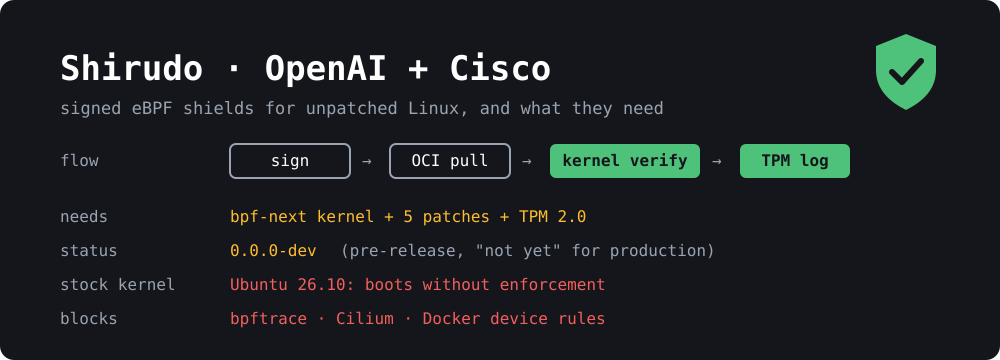
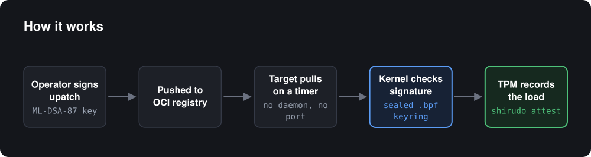
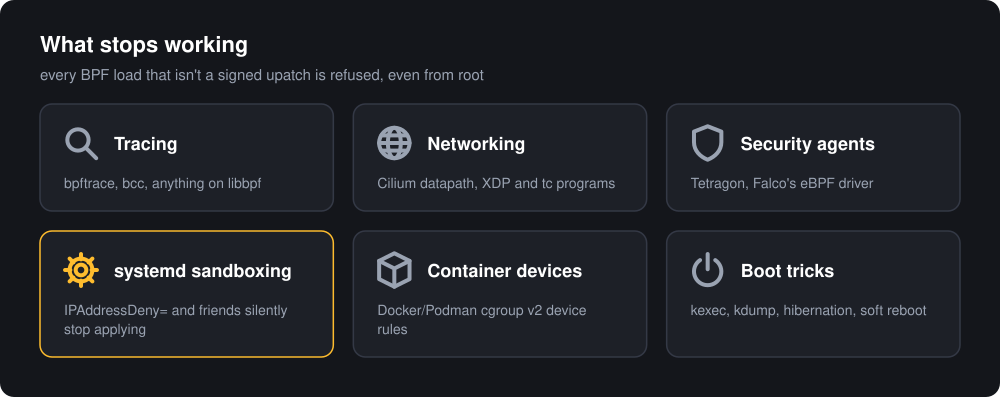

{: width="1000" height="360"}

On 23 November, OpenAI and Cisco released [Shirudo](https://openai.com/index/introducing-shirudo/), an open-source tool that blocks an exploit on a running Linux machine while you wait for the real patch. No reboot, no restart of the service. Most coverage made it sound like something you install next to `unattended-upgrades`.

It isn't, at least not yet. I read the [repository](https://github.com/shirudo-dev/shirudo) and its documentation and checked my own machine against the requirements. This post explains what Shirudo does, what it needs, and what it switches off once it's running.

> **TL;DR**
> - Shirudo loads small **signed eBPF programs ("upatches")** that block a vulnerable code path, and records every load in the **TPM**.
> - It's **pre-release** (version `0.0.0-dev`, no tagged release). The FAQ answers "ready for production?" with "Not yet."
> - It needs a **bpf-next kernel with five extra patches** and a **TPM 2.0**. A stock Ubuntu 26.10 kernel has [part of what it needs](#check-your-kernel), not all.
> - Once running it **blocks all other eBPF**: [bpftrace, Cilium, Falco's eBPF driver, systemd's `IPAddressDeny=` and the device rules containers use](#what-it-breaks).
> - For a homelab, keep patching and rebooting. Shirudo is worth watching, and trying in a VM.

## What Shirudo actually is

Shirudo (シールド, Japanese for "shield") comes from Isovalent, the Cilium and Tetragon company Cisco bought. It was first shown at [Linux Plumbers 2026](https://lpc.events/event/20/contributions/2437/) by Daniel Borkmann and John Fastabend. It's written in C and released under the **BSD 2-Clause** license. The BPF programs are dual BSD/GPL.

The protection is called a **upatch**: a small eBPF program, or a Java agent, that blocks the input or syscall that a known bug needs. Each upatch is meant to cover one bug and stay only until the machine runs a fixed kernel or a fixed app.

The design, from the README:

- **An operator and targets.** You build and sign upatches on an operator machine with an **ML-DSA-87** key (post-quantum, and the only key type it accepts). You push them to an OCI registry, the same kind of registry container images live in.
- **Targets pull.** There's no daemon and no open port. A systemd timer runs one-shot commands that pull packages and load them.
- **The kernel checks the signature.** At boot, `shirudo init` runs from the initrd, puts your certificate in the kernel's `.bpf` keyring and seals it. After that, the kernel only loads BPF from a signed loader, **even for root**.
- **The TPM records everything.** Every load and unload extends a TPM register. `shirudo attest` produces signed evidence you can check offline, so you can prove what a machine is running.

{: width="1000" height="266"}

The AI part is about writing the upatches, not running them. OpenAI's demo had Codex write a shield for a Java bug and attach it to a running Elasticsearch. The repo ships that example as [`java-base64`](https://github.com/shirudo-dev/shirudo/tree/main/upatches/java-base64), a guard for **CVE-2026-114938**, an AVX-512 overflow in `java.util.Base64`. A person still approves each shield and holds the signing key.

The bundled kernel examples are more modest. One blocks AF_ALG sockets for CVE-2026-31431. The others only **count** suspicious packets for three kernel CVEs and don't block anything. The repo marks those three as `source_derived_unvalidated`.

## What a target needs

The [system requirements](https://github.com/shirudo-dev/shirudo/blob/main/Documentation/operate/plan/system-requirements.rst) page states "shirudo has no compatibility mode and no fallback for an older kernel." A target needs:

| Requirement | Notes |
|---|---|
| **bpf-next kernel** with the signed-loader ABI | Not a release version. The test kernel reports `7.4.0-rc1-bpf-next+`. |
| **Five carried kernel patches** | A `tpm_command` LSM hook, an `mm_read_access` LSM hook, and three BPF LSM changes. None are in bpf-next yet. |
| **TPM 2.0** at `/dev/tpmrm0` | "There is no mode without a TPM." A software TPM only works in the test VM. |
| `CONFIG_BPF_LSM`, `CONFIG_CRYPTO_MLDSA`, `CONFIG_MODULE_SIG`, dm-verity root hash signatures | And about 20 more options. |
| Boot parameters `bpf.keyring_unsealed=1` and `dm_verity.keyring_unsealed=1` | In production they live in a signed unified kernel image. |
| **systemd 256+**, a dracut systemd initrd, booted through `systemd-stub` | So the TPM measures the boot phases. |
| x86-64 or arm64 | riscv64 builds, but no riscv64 target has booted yet. |

The operator side is easier: any Linux with **OpenSSL 3.5+** and **clang 23**. Fedora 45 and Debian unstable ship clang 23. On Ubuntu 24.04 you need apt.llvm.org.

So you can't add Shirudo to the kernel you already run. Isovalent builds production kernels in a separate [shirudo-dev/kernel](https://github.com/shirudo-dev/kernel) repo. If you go that way you're running their kernel, and you're back to waiting for someone to ship a fixed kernel, which is what Shirudo was supposed to help with.

## Check your kernel

The repo's own check, `shirudo init --check-only`, needs the Shirudo binary installed as root. You can do a rough version with `bpftool`, no root needed. It looks in the kernel's type info (BTF) for the pieces Shirudo checks for:

```bash
grep -qw bpf /sys/kernel/security/lsm && echo "OK   bpf LSM active" || echo "MISS bpf LSM (add lsm=...,bpf)"
[ -e /dev/tpmrm0 ] && echo "OK   TPM 2.0 at /dev/tpmrm0" || echo "MISS TPM 2.0"
btf=$(bpftool btf dump file /sys/kernel/btf/vmlinux format raw 2>/dev/null)
for s in keyring_serial excl_prog_sha bpf_inode_init_xattr bpf_lsm_tpm_command bpf_lsm_mm_read_access; do
  grep -q "'$s'" <<<"$btf" && echo "OK   $s" || echo "MISS $s"
done
```

My desktop runs the stock Ubuntu 26.10 kernel (`7.3.0-11-generic`) and has a real TPM:

```text
OK   bpf LSM active
OK   TPM 2.0 at /dev/tpmrm0
OK   keyring_serial
OK   excl_prog_sha
MISS bpf_inode_init_xattr
MISS bpf_lsm_tpm_command
MISS bpf_lsm_mm_read_access
```

The first two `OK` lines matter more than they look. Signed BPF programs are already upstream, so Ubuntu's kernel has the fields the signature check needs. What's missing is Shirudo's own patches. Without `bpf_lsm_tpm_command`, the [kernel patches page](https://github.com/shirudo-dev/shirudo/blob/main/Documentation/internals/kernel-patches.rst) says `init` "stops before it loads anything", and the machine **boots without enforcement**. So on a normal distro kernel Shirudo does nothing, even if you get it installed.

**Raspberry Pi:** arm64 is supported, but the Pi has no TPM and runs the Raspberry Pi kernel fork. A TPM add-on board covers the first part. Nobody has published a patched Pi kernel.

## What it breaks

This is the part the announcements leave out. On a running target, Shirudo blocks **every** BPF load that isn't a signed upatch, from every process including root. The [interoperability page](https://github.com/shirudo-dev/shirudo/blob/main/Documentation/operate/plan/interoperability.rst) lists what stops working:

{: width="1000" height="397"}

- **bpftrace, bcc and anything built on libbpf.** They "Fail at their first map creation or program load."
- **Cilium and other eBPF network plugins.** "the datapath does not come up."
- **Tetragon and Falco's eBPF driver.** Falco's kernel module driver still works.
- **XDP and tc programs** from `ip` and `tc`, sched_ext schedulers.
- **systemd's BPF settings**: `IPAddressDeny=`, `DeviceAllow=`, `RestrictFileSystems=`, `SocketBindDeny=`. The units start, but the restrictions don't apply. You get one log line, and for some settings only at debug level.
- **Container device rules.** On cgroup v2, Docker and Podman restrict device access with BPF programs, and those loads are refused. The docs say "How a runtime reacts is up to the runtime: test yours."
- **kexec and kdump, hibernation, soft reboot**, and `systemd-keyring-setup` from systemd 263.

The systemd one is the trap. Units that look locked down quietly aren't, and nothing tells you unless you read the debug log.

That's a fair trade on a dedicated server where you control everything. On a typical homelab box with Docker, Home Assistant and a few systemd sandboxes, it's a lot to give up.

## Is the idea good?

Yes. Patches often come out days before a reboot window, and a signed, audited eBPF shield is a better stopgap than turning features off by hand. It's also much safer than downloading a random kernel module. The design is careful: it holds up against root on the target, there's no daemon, and the TPM records every change. The docs are unusually honest about where it stops, and the [threat model](https://github.com/shirudo-dev/shirudo/blob/main/Documentation/security/threat-model.rst) is worth reading even if you never run it.

The gap is who it's for right now. It suits teams that already build their own kernel, boot signed UKIs and run fleets with TPMs. For everyone else it depends on the kernel patches going upstream and distros enabling them. Until then, the workarounds in my [NGINX2Root]() and [kernel TCP]() posts are what a homelab can actually use.

## Try it without touching your machine

- **In a browser:** Isovalent's [getting-started lab](https://labs.isovalent.com/#/lab/shirudo-getting-started).
- **In a local VM:** the [quickstart](https://github.com/shirudo-dev/shirudo/blob/main/Documentation/start/quickstart.rst) builds Shirudo, downloads the patched test kernel and boots an Ubuntu VM with a software TPM. You need KVM, QEMU, `swtpm`, clang 23 at `/usr/bin/clang` and OpenSSL 3.5. It takes you through signing, loading, attesting and unloading a do-nothing upatch:

```bash
testing/vm/kernel-artifact.sh fetch
make && make shirudo-build
export PATH="$PWD:$PWD/tools/shirudo-build:$PATH"
make -C testing vm VM_NAME=quickstart
make -C testing vm-ssh VM_NAME=quickstart
```

Isovalent also has a webinar on 15 December.

## Sources

- [OpenAI: Introducing Shirudo](https://openai.com/index/introducing-shirudo/)
- [Isovalent: Cisco and OpenAI launch Shirudo](https://isovalent.com/blog/post/cisco-openai-shirudo/)
- [shirudo-dev/shirudo on GitHub](https://github.com/shirudo-dev/shirudo): README, FAQ, system requirements, carried kernel patches, interoperability, `upatches/`
- [Linux Plumbers 2026: shirudo, BPF live-patching infra for the agentic era](https://lpc.events/event/20/contributions/2437/)
- [CASRAI: Cisco, OpenAI launch Shirudo](https://casrai.org/news/cisco-openai-launch-shirudo-ebpf-agentic-ai-linux-security-2026)
