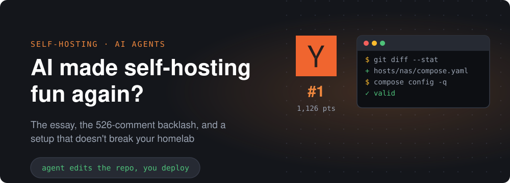
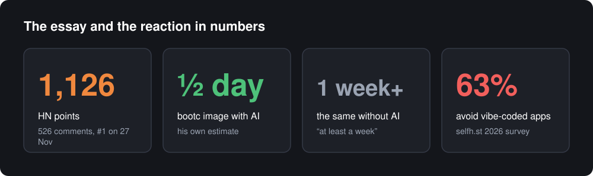
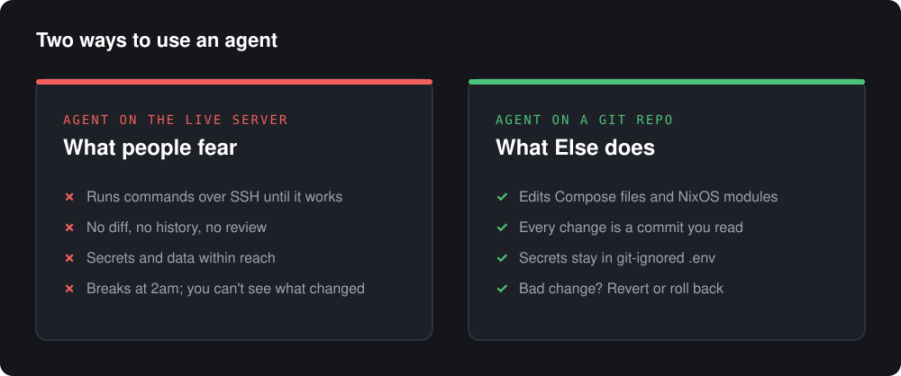
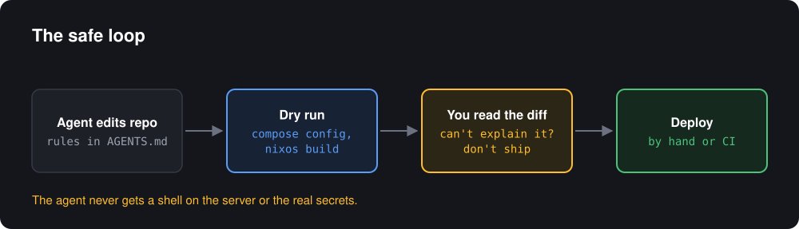

{: width="1000" height="360"}

On 26 November Jan-Lukas Else posted a short essay called [AI made self-hosting fun again](https://janlukas.blog/posts/ai-self-hosting). By the next morning it was the top story on [Hacker News](https://news.ycombinator.com/item?id=50660180), with 1,126 points and 526 comments, and his server was at 90% CPU until he put the blog behind a CDN.

The essay is calm and the claim is modest. The thread was neither. It turned into the argument the self-hosting community has been having all year: is an AI agent a power tool for your homelab, or does it take away the whole point of having one?

Here's what he wrote, what people objected to, and the setup I'd suggest if you want the upside without handing a chatbot root on your server.

> **TL;DR**
> - **The claim:** AI agents remove the friction (boilerplate, unfamiliar tools, half-finished migrations) that made self-hosting feel like a chore. He estimates a bootc VPS image took half a day with AI and "at least a week" without.
> - **The backlash:** it removes the learning, which for many people *is* the hobby. And you end up running config you don't fully understand.
> - **Both are true.** The deciding factor is whether your infrastructure is code the agent edits and you review, or a live server the agent pokes at.
> - **The safe setup:** everything in Git, the agent works on the repo and never on the box, you read every diff, secrets stay out of its reach, and changes go through a dry run.

## What the essay actually says

Else didn't stop self-hosting. He'd just stopped experimenting: "I never really stopped self-hosting, but I became less inclined to experiment with new things." What changed is that "AI is a big reason" he's excited about it again.

His setup is what makes that work:

- **Infrastructure in Git.** "Most of my infrastructure configuration lives in Git repositories, mainly in the form of Docker Compose files." Renovate opens update pull requests, and Forgejo or GitHub Actions deploy them.
- **NixOS at home.** "With the help of AI, I'm now making much more extensive use of NixOS on my home server." NixOS is famously powerful and famously hard to learn, which is exactly where an assistant helps most.
- **A custom VPS image.** He built his own Debian-based [bootc](https://containers.github.io/bootc/) image: "Even with the help of AI, it still took me half a day… Without AI, it would probably have taken me at least a week."
- **Small tools of his own** in Go, for things like downloading invoices, e-papers and Linux ISOs.

He mostly uses open-weight models, and he's upfront about the costs:

- "Every additional service is another thing that needs to be maintained."
- "AI-generated software isn't exempt from bugs, security issues, or technical debt."
- Letting an agent change his infrastructure "doesn't absolve me of the responsibility of understanding those changes."
- "There's also the temptation to build or deploy things simply because I can."
- And the irony of using big-tech AI to depend less on big tech: "I'm aware that this also creates a new kind of dependency."

His conclusion: "AI hasn't fundamentally changed why I like self-hosting." It changed how much it costs to try something.

{: width="1000" height="298"}

## Where Hacker News pushed back

The thread split roughly four ways.

**"Yes, this is great."** Plenty of people recognised the experience. One commenter summed up the mood: "Solo vibey self hosting llm usage - bliss." Another said the agent showed them they "enjoyed CREATING things MORE" than the plumbing.

**"You've removed the fun part."** This was the biggest objection. For a lot of people the point of a homelab is learning how DNS, reverse proxies and systemd actually work. "But for your hobbies? That's eliminating half the fun!" And from someone who tried it: "I quickly loose interest because I have very little personal investment in the process."

**"It only gets you to average."** "These LLMs will get you to 'average' but any more than that you have to become a knowledgeable domain expert yourself." An agent will happily write a working Compose file. It's less good at knowing why your particular setup should be different.

**"It's a security problem."** Non-deterministic tools changing the config of internet-facing services worried people, as did running services you couldn't debug at 2am without the agent. The self-hosting community already leans this way: in selfh.st's [2026 survey](https://selfh.st/weekly/2026-11-13/) of more than 6,000 people, **63% said they avoid "vibe coded" apps**, 25% don't mind them, and 7% avoid AI-assisted projects altogether.

There's also a fair note of genre fatigue. "AI made X fun again" posts come along every few weeks.

## Both sides are right, and the difference is the setup

Reading the essay next to the thread, the people who were happy and the people who were worried mostly describe different setups.

Else's works because his infrastructure is **code in a repository**. The agent edits files. Renovate and CI deploy them. He reviews the diff like any pull request. If the agent writes something wrong, it's a bad commit that he can read, reject or revert.

The horror stories come from the other model: an agent with a shell on the live server, running commands until something works. Nothing is reviewed, nothing is versioned, and when it breaks you can't see what changed.

{: width="1000" height="418"}

On the "it removes the learning" point, it depends how you use it. Asking an agent to *explain* a NixOS module, then writing it yourself, is faster learning than an evening of forum threads. Asking it to "make Jellyfin work" and pasting the result is not learning anything. The tool doesn't decide which of those you do.

## A safe setup for letting an agent touch your homelab

If you want to try it, this is the shape I'd recommend, in order of importance.

### 1. Put the infrastructure in Git first

Before an agent touches anything, get your config into a repository: Compose files, reverse-proxy config, NixOS modules, Ansible playbooks, whatever you use. A layout like this is enough:

```
homelab/
├── AGENTS.md            # rules for the agent (below)
├── hosts/
│   ├── nas/compose.yaml
│   └── vps/compose.yaml
├── caddy/Caddyfile
├── .env.example         # names of secrets, never values
└── .gitignore           # .env, *.key, data/
```

This is also worth doing even if you never use AI. It's your documentation, your backup and your undo button.

### 2. The agent edits the repo, not the server

Run the agent in the repository on your laptop, not over SSH on the box. It produces commits. You deploy them, by hand or with CI, the way Else does. That one rule removes most of the risk people raised in the thread.

{: width="1000" height="287"}

### 3. Write the rules down

Most coding agents read a file in the repo root (`AGENTS.md`, `CLAUDE.md` or similar). Use it to tell the agent what it may and may not do:

```markdown
# Rules for this repo
- Never run commands on remote hosts. Never run `docker compose up`, `nixos-rebuild switch` or `ssh`.
- Never read or write `.env` or anything under `secrets/`.
- Pin image tags; no `:latest`.
- Don't expose new ports to 0.0.0.0. Services go behind Caddy on the internal network.
- Validate before finishing: `docker compose -f hosts/<host>/compose.yaml config -q`.
- Explain every change in the commit message.
```

An agent won't follow these perfectly, which is why the next two points matter.

### 4. Keep secrets out of reach

Secrets go in `.env` files that are git-ignored, or in [sops](https://github.com/getsops/sops)/agenix if you're on NixOS. The agent sees `.env.example` with variable names only. If a tool can't do its job without a real token, that's a job for you, not the agent.

### 5. Dry-run everything

Make the cheap checks part of every change, and run them yourself before deploying:

```bash
docker compose -f hosts/nas/compose.yaml config -q   # syntax and interpolation
caddy validate --config caddy/Caddyfile              # proxy config
nixos-rebuild build --flake .#nas                    # builds, doesn't activate
git diff --stat main                                 # what actually changed
```

NixOS and bootc have an extra safety net here: a bad generation or image can be rolled back at boot. That's part of why Else's choice of tools works so well with an agent.

### 6. Read the diff

This is the rule that matters most and gets skipped most. If you can't explain a change, don't deploy it. Ask the agent to explain it, or look it up. That's also how the learning comes back.

### 7. Consider a local model

Several commenters suggested local models to deal with the dependency and privacy concerns. Else mostly uses open-weight models himself. A model running through Ollama or llama.cpp on your own hardware won't match the big hosted ones, but for editing Compose files and explaining config it's often enough, and nothing about your network leaves the house.

## Is it still self-hosting?

I think so. The services still run on hardware you control, the data is still yours, and you still have to understand what you run. The agent is a faster way to write config, not a replacement for knowing what the config does.

If tinkering by hand is the part you enjoy, nothing about this essay says you have to stop. If, like Else, you'd stopped trying new things because each one meant a weekend of yak-shaving, an agent working on a Git repo you review is a sensible way to start again.
