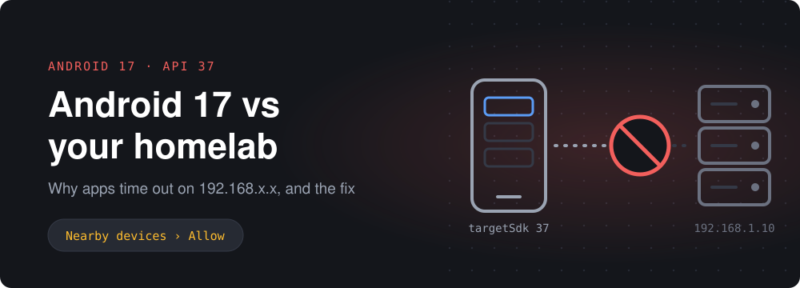
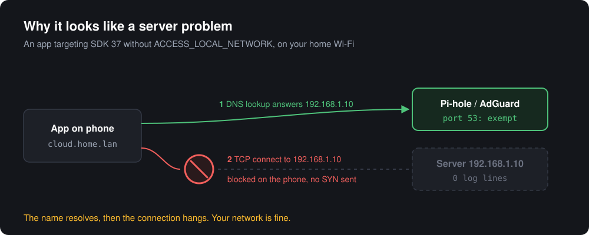
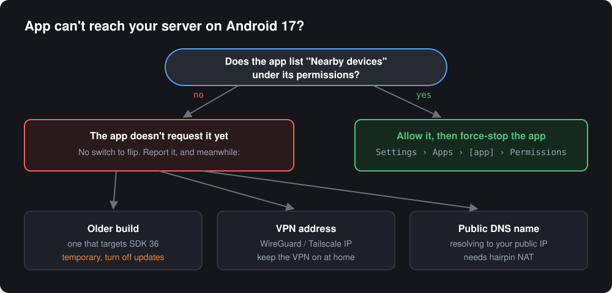

{: width="1000" height="360"}

You update an app on your Android 17 phone and it can't reach your server any more. Login hangs. Sync never finishes. The server log shows **no request at all**, but the same app still works on mobile data through your reverse proxy, and other apps on the same phone reach the server fine.

It's not your firewall or your DNS. Android 17 added a new runtime permission, `ACCESS_LOCAL_NETWORK`, and apps that target Android 17 can't open connections to your LAN without it. If the app doesn't ask for it, you get no prompt and no error message. The connection just times out.

This post explains what changed, how to confirm it's the cause, what you can do as a user, and what developers need to add. At the end there's a table of the self-hosting apps I checked.

> **TL;DR**
> - **Symptom:** an app times out on `192.168.x.x` / `10.x` / `*.local` addresses after an update, but works over the internet.
> - **Quick fix:** Settings › Apps › *[app]* › Permissions › **Nearby devices** › Allow.
> - **No "Nearby devices" entry?** The app doesn't ask for the permission yet. Your options are an [older build, a VPN, or a public DNS name](#when-the-app-doesnt-ask-for-the-permission).
> - **Developers:** declare `ACCESS_LOCAL_NETWORK` and request it at runtime [before the first LAN connection](#for-developers-the-fix).

## What changed in Android 17

Google's [local network permission page](https://developer.android.com/privacy-and-security/local-network-permission) puts it in one sentence: "Starting in Android 17 (API level 37), local network protections are enforced for apps targeting Android 17 or higher."

The details that matter for self-hosters:

- **It depends on the app's target SDK, not your phone.** An app built for SDK 36 or lower still gets local network access implicitly through its normal `INTERNET` permission. Once the developer bumps `targetSdk` to 37, which the Play Store will eventually require, the app needs the new permission. That's why a plain app update is what breaks things.
- **It covers everything on the LAN.** TCP connections in both directions, UDP unicast, multicast and broadcast, and looking up `.local` names over mDNS. It applies to all networking libraries, OkHttp and Cronet included.
- **Your DNS server is exempt.** If your resolver (Pi-hole, AdGuard Home) is on the LAN, port 53 traffic to it is still allowed. So the name resolves fine and *then* the connection fails, which makes it look like a server problem.
- **It lives in the "Nearby devices" group,** next to the Bluetooth permissions. If you already gave an app Bluetooth access, you won't be asked again for local network access.
- **WebViews inherit the host app's permission.** An app that shows your dashboard in an embedded web page needs the permission too.
- **Internet and mobile data are untouched.** Your server is still reachable through its public hostname, if you have one.

Google's page doesn't list exactly which address ranges count as "local". In the bug reports below, the blocked addresses are RFC 1918 ones (`192.168.x.x`, `10.x.x.x`) and `.local` names. If Android treats an address the wrong way, Google has a [feedback page](https://developer.android.com/about/versions/17/feedback) for it.

## How to tell it's this and not your network

Google's docs say a blocked TCP connection "will typically result in a timeout error", and UDP gets `EPERM`. So you see a spinner rather than "connection refused".

{: width="1000" height="400"}

The signs:

1. **Nothing reaches the server.** Check your reverse proxy or app server access log while you retry. A blocked app produces zero log lines. One [Harmonic HN reporter](https://github.com/SimonHalvdansson/Harmonic-HN/issues/415) ran a packet capture and saw no SYN packets at all.
2. **Other apps work.** Open the same URL in Chrome on the same phone. If it loads there, the network is fine.
3. **It started after an app update,** and your phone is on Android 17.
4. **It works away from home** through a public hostname, or over mobile data.

With USB debugging enabled, you can confirm the app's target SDK from a computer:

```bash
adb shell dumpsys package com.example.app | grep -m1 targetSdk
```

If it says `targetSdk=37` and the app's permission list has no `ACCESS_LOCAL_NETWORK`, that's your answer.

## The user fix: allow "Nearby devices"

If the app has been updated to ask for the permission, the fix is to say yes. If you tapped "Don't allow" earlier, or never saw a prompt:

**Settings › Apps › *[app name]* › Permissions › Nearby devices › Allow**

The wording differs a bit between Pixel, Samsung and other skins, but it's always under the app's permissions. Then force-stop the app and open it again.

This works in browsers too. In a [Selfhosted Lemmy thread](https://lemmy.imagisphe.re/post/3130659) about Nextcloud failing to load in Firefox, a Firefox tester reported that "Nearby devices" alone is enough. You don't need to grant location.

## When the app doesn't ask for the permission

Android can only grant permissions an app declares. If the app targets SDK 37 but its developer hasn't added `ACCESS_LOCAL_NETWORK`, there's **no switch you can flip**. Granting "Nearby devices" for its Bluetooth permissions won't help either. While you wait for the developer, you have three options.

{: width="1000" height="480"}

### 1. Install the previous release

A build that still targets SDK 36 gets implicit access. RunnerUp users [went back to 2.11.0.1 from F-Droid](https://github.com/jonasoreland/runnerup/issues/1422), which targets SDK 36, and sync to their WebDAV server worked again. F-Droid keeps older versions on each app's page, and GitHub releases often include old APKs.

Turn off auto-update for that app, or the next update will break it again. Google calls the implicit access "temporary", so this only buys you time.

### 2. Connect over a VPN instead of the LAN address

Reporters on several issues said that reaching the server through WireGuard, Tailscale or a similar tunnel works. That's because the app then connects to the tunnel address rather than a LAN address. If you already run Tailscale or WireGuard on your server, point the app at the tunnel IP or MagicDNS name and leave the VPN on at home too.

### 3. Use a public DNS name that resolves to your public IP

The Habitica maintainers [declined to add the permission](https://github.com/HabitRPG/habitica-android/issues/2206), citing Play Store disclosure requirements. Their suggestion was HTTPS behind a proper domain.

That only helps if the name resolves to your **public** IP. Many homelabs use split DNS (a local DNS rewrite in Pi-hole or AdGuard Home) so `cloud.example.com` points straight to `192.168.1.10` at home. That's a LAN address again, and it gets blocked. You can drop the local rewrite for that one hostname and let your router's hairpin NAT (NAT loopback) route the traffic. Not every router supports hairpin NAT, and the traffic now goes through the router instead of straight to the server.

## For developers: the fix

The fix is short. Declare the permission:

```xml
<uses-permission android:name="android.permission.ACCESS_LOCAL_NETWORK" />
```

Then check it and request it **before** the first connection to a LAN address. Google's doc says apps "must check if the permission has been granted. If not, they must call `Activity.requestPermissions()`."

```kotlin
private const val LOCAL_NETWORK = "android.permission.ACCESS_LOCAL_NETWORK"

fun ensureLocalNetwork(activity: Activity, requestCode: Int): Boolean {
    if (Build.VERSION.SDK_INT < 37) return true          // implicit before Android 17
    if (activity.checkSelfPermission(LOCAL_NETWORK) == PackageManager.PERMISSION_GRANTED) return true
    activity.requestPermissions(arrayOf(LOCAL_NETWORK), requestCode)
    return false
}
```

Some things the existing fixes got right:

- **Only ask when the server is actually local.** [UltimateTunes](https://github.com/qtekfun/UltimateTunes/pull/107) resolves the configured hostname first and only asks when it maps to a LAN address. Users who connect through a public domain never see the prompt. This also deals with split DNS, where a public-looking hostname resolves to `192.168.x.x` at home.
- **Explain the prompt.** "Nearby devices" sounds like Bluetooth. Show one line first, for example "To reach your server on your home network, allow Nearby devices."
- **Turn the timeout into an error message.** A blocked connection looks just like a dead server. If a LAN connection fails while the permission is denied, say so and link to the app's settings. For native code, Google provides `android_getnetworkblockedreason()`, which returns `ANDROID_NETWORK_BLOCKED_REASON_LNP` for sockets blocked by this permission.
- **Don't ship the permission early.** Google says apps targeting SDK 36 or lower shouldn't declare or request it yet.

If all you need is to *find* servers on the LAN, `NsdManager` with the system picker (`DiscoveryRequest.FLAG_SHOW_PICKER`) lets the user pick a device, and connecting to the chosen IP doesn't need the permission.

## Which self-hosting apps are affected

This is what I found in each project's issue tracker on 28 November 2026. "Fixed" means the project merged a change. It doesn't mean the fix is in a Play Store release yet.

| App | Status | Notes |
|---|---|---|
| **Home Assistant** companion | Handled | Requests the permission since [May 2026](https://github.com/home-assistant/android/pull/6866) and targets SDK 37 since [July](https://github.com/home-assistant/android/pull/7259). An [open issue](https://github.com/home-assistant/android/issues/7304) says the "Local network access required" notification can't be dismissed permanently. |
| **Nextcloud** | In progress | [Draft PR](https://github.com/nextcloud/android/pull/17934) from 2 November, not merged yet. |
| **Jellyfin** | No reports | No issues in the [Jellyfin Android](https://github.com/jellyfin/jellyfin-android) tracker mention it. |
| **Aktual** (Actual Budget) | Fixed | [Fix](https://github.com/jonapoul/aktual/issues/2421) merged 17 November, in nightly builds. |
| **RunnerUp** | Broken | [Open issue](https://github.com/jonasoreland/runnerup/issues/1422) since 2.12. Workaround: 2.11.0.1 from F-Droid. |
| **Habitica** (self-hosted) | Won't fix | [Closed by maintainers](https://github.com/HabitRPG/habitica-android/issues/2206). Use a VPN or a public DNS name. |
| **Harmonic HN** (LAN AI endpoint) | Fixed | [Commit](https://github.com/SimonHalvdansson/Harmonic-HN/issues/415) on 10 November. |
| **WebLibre** browser | Fixed | [Fixed in an alpha](https://github.com/FaFre/WebLibre/issues/636) in September. |
| **UltimateTunes** | Fixed | [Merged](https://github.com/qtekfun/UltimateTunes/pull/107) 14 October. |
| **Firefox** | Grant manually | Allow "Nearby devices" ([Lemmy thread](https://lemmy.imagisphe.re/post/3130659)). |

This will keep growing. As more apps move to SDK 37 for the Play Store deadline, any app that talks to a LAN server will break unless it requests the permission. If one of your apps breaks, check its issue tracker for `ACCESS_LOCAL_NETWORK` before you start debugging your network. If nobody has reported it yet, link the developer to [Google's documentation](https://developer.android.com/privacy-and-security/local-network-permission). The fix takes about twenty lines.

## Should you just allow it everywhere?

Mostly, yes, for apps whose whole job is talking to your server. The permission exists because ordinary apps used to scan home networks quietly to fingerprint devices. A shopping or game app has no business on your LAN, so leave it off for those. For your Home Assistant, Nextcloud or Jellyfin client, allowing it puts things back the way they were before Android 17.

*Running your services on a Raspberry Pi? See [Monitor a Raspberry Pi in Home Assistant with MQTT](), and [free DNS ad blocking]() if you run your own resolver.*
