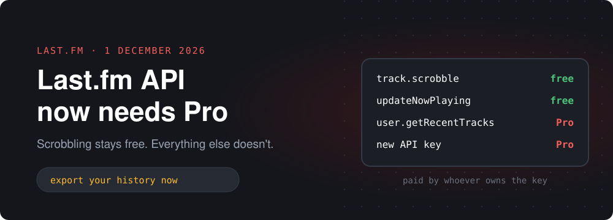

{: width="1000" height="360"}

On 18 November 2026 Last.fm [announced](https://support.last.fm/t/api-keys-will-require-pro-from-1st-december/121030) that from **1 December** its API would need a paid Pro subscription. After a week of complaints from people running scrobblers, it [walked part of that back](https://support.last.fm/t/api-update-pro-will-not-be-required-to-use-scrobbling-methods/121188) on 26 November: **scrobbling stays free**, and almost everything else doesn't.

If you self-host music, this probably touches you: Navidrome, Jellyfin, multi-scrobbler, a homemade "now playing" widget, or a stats dashboard. Here's exactly what changes, who has to pay, and what to do in the three days before it starts. The most urgent item is exporting your listening history while it's still easy.

> **TL;DR**
> - **Scrobbling keeps working** with existing API keys, Pro or not.
> - **Reading data needs Pro** (recent tracks, top artists, loved tracks), and so does **creating a new API key**.
> - **The key's owner pays,** not the people using the app. Using someone else's app (Web Scrobbler, Pano Scrobbler, etc.) costs you nothing.
> - **Export your history before 1 December.** After that, export tools need a Pro key. [How to export](#export-your-history-before-1-december).
> - **Consider ListenBrainz** as your main scrobble target. It's free and open, and [Navidrome supports it natively](#navidrome).

## What exactly changes on 1 December

Last.fm's announcement says: "Creating a new key will require a Pro account, and without it all API methods other than those required for scrobbling will stop working until you subscribe."

The 26 November update lists the methods that stay free:

| Method | Needs Pro from 1 Dec? |
|---|---|
| `track.scrobble` | No |
| `track.updateNowPlaying` | No |
| `track.removeNowPlaying` | No |
| `auth.getToken`, `auth.getSession` | No |
| `user.getRecentTracks`, `user.getTopArtists`, `user.getLovedTracks`… | **Yes** |
| `artist.getInfo`, `track.getInfo`, `album.getInfo`… | **Yes** |
| Creating a new API key | **Yes** |

The update also says that "all existing API keys will keep scrobbling with no action needed", and that "once created, your API key can be freely used for scrobbling even after your Pro subscription ends." In other words, one month of Pro gets you a scrobble-only key you can keep.

Some things are still open in the forum thread: whether `auth.getMobileSession` and `track.love` count as scrobbling methods, and what error a non-Pro key gets for a blocked call. If a tool breaks in a strange way after 1 December, check those first.

## Who has to pay

This is the part people have misread. In Last.fm's words: "This applies to whoever owns the key in the app or service. If you're using an app someone else built, you don't need a Pro account."

- **You use Web Scrobbler, Pano Scrobbler, MusicBee, foobar2000, fmbot…** The developer owns the key. Last.fm staff said these "will not be affected". Nothing changes for you.
- **You run a self-hosted server with your own API key** (Navidrome, multi-scrobbler, a script). That key is yours, so anything beyond scrobbling needs *your* Pro subscription.
- **Commercial or research use** needs a separate licence through `partners@last.fm`.

Last.fm's Pro page wouldn't load for me, so I can't confirm the current price. Forum users report $5 a month, billed monthly.

## What breaks in self-hosted tools

### Navidrome

Navidrome's [scrobbling docs](https://www.navidrome.org/docs/usage/features/scrobbling/) were updated on 19 November, before Last.fm's climb-down, and say the Last.fm account that owns your server's API key must have Pro. Under the 26 November update, **an existing key keeps scrobbling**. Things that read from Last.fm, such as artist bios and images fetched with your key, need Pro.

Navidrome also supports **ListenBrainz** natively. Each user pastes their ListenBrainz token into their personal settings, and you can enable both services side by side. The docs also mention that ListenBrainz's base URL can point at a compatible self-hosted server such as Maloja or Koito. Navidrome has kept its own play history locally since v0.59.0, so your server-side play counts don't depend on either service.

### multi-scrobbler

[multi-scrobbler](https://github.com/FoxxMD/multi-scrobbler) is hit hardest, because it reads from Last.fm as well as writing to it. The maintainer's [summary after the update](https://github.com/FoxxMD/multi-scrobbler/discussions/788):

- **Last.fm as a client** (scrobbling *to* Last.fm) keeps working, but "turn off refreshEnabled". That option fetches your existing scrobbles to avoid duplicates, and fetching is no longer free.
- **Last.fm as a source** (pulling your plays *from* Last.fm into other services): "You will need a Last.fm Pro account to continue using this Source."
- Version 0.21.2 added importing your Last.fm scrobbles and sending them to any configured client, such as ListenBrainz or Maloja. That's a ready-made migration path, but it reads from Last.fm, so **run it before 1 December**.

### Jellyfin, Plexamp, beets and others

I couldn't find a current statement from the Jellyfin Last.fm plugin, Plexamp or beets' `lastgenre` plugin. The rule is the same for all of them: if it ships its own key, the developer pays. If it asks for *your* API key and secret, anything other than scrobbling needs your Pro subscription. beets' `lastgenre` reads tags from Last.fm, so it falls into the second group if you configured your own key.

## Export your history before 1 December

Your scrobble history is the one thing you can't recreate later. All the export tools read it through the API with their own keys, and after 1 December those reads need Pro. Do it this weekend.

**JSON export for Maloja or Koito:** [lastfm.ghan.nl/export](https://lastfm.ghan.nl/export/) builds a full export. Both [Koito's import guide](https://koito.io/guides/importing/) and [Maloja](https://github.com/krateng/maloja) accept its JSON format. Download a CSV too as a backup.

**CSV export:** [lastfm-to-csv](https://benjaminbenben.com/lastfm-to-csv/) gets your history in the browser by username. It lets you set your own API key and a delay between requests, which helps with large histories.

**ListenBrainz import:** create a [ListenBrainz](https://listenbrainz.org/) account, then use the Last.fm import in its settings to pull your Last.fm history straight into it. This is the easiest option if you plan to switch. Afterwards, ListenBrainz's *Settings › Export* gives you a ZIP you own.

Check the result before you close the tab. Compare the number of exported scrobbles with the total on your Last.fm profile. Big exports take a long time and go through rate-limited API calls, so make sure yours actually finished.

## Where to scrobble instead

| Service | Type | Cost | Notes |
|---|---|---|---|
| [ListenBrainz](https://listenbrainz.org/) | Hosted, open source (MetaBrainz) | Free | Open data, public API, Last.fm import. Supported by Navidrome, Web Scrobbler, multi-scrobbler. |
| [Koito](https://github.com/gabehf/koito) | Self-hosted | Free (MIT) | Modern UI, ListenBrainz-compatible API, imports Last.fm/ListenBrainz/Spotify/Maloja. Its README says it's still "unstable". |
| [Maloja](https://github.com/krateng/maloja) | Self-hosted | Free (GPL-3.0) | Mature, but "only receiving security updates" while a [Rust rewrite](https://github.com/krateng/maloja-rs) is built. |
| [Libre.fm](https://libre.fm/) | Hosted | Free | Uses Last.fm's scrobbling protocol. Web Scrobbler and multi-scrobbler support it. I couldn't reach the site to check its current state. |

My pick for most people: **ListenBrainz as the main target**, with Last.fm kept as a second destination if you like its recommendations. Scrobbling to Last.fm stays free, and both Navidrome and multi-scrobbler can send each play to both. If you want the data on your own hardware, run **Koito** as a ListenBrainz-compatible server and point Navidrome's ListenBrainz URL at it. It's a single service with a small database, a good fit for the box that already runs Navidrome.

## Is Pro worth it?

If you use Last.fm every day for its stats and you run your own tools on top of the API, $5 a month for a key you control is a fair price. The awkward part is that the paywall lands on exactly the people who built the ecosystem around Last.fm: hobbyists with their own keys. And the most important feature, getting your own data out, is now behind it.

Whatever you decide, run the export first. Having a copy of your history means you can choose later without losing anything.

*Reddit made a similar move this month: [Reddit RSS feeds are gone, and here's what still works]().*
