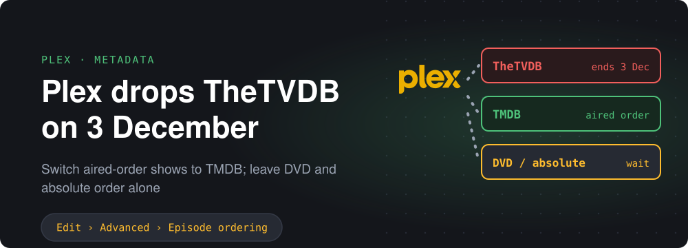
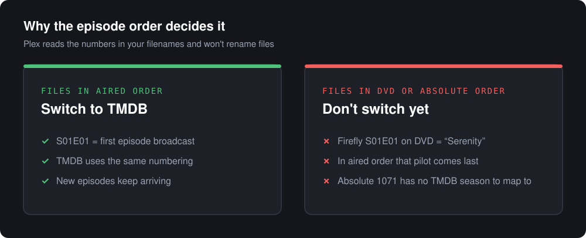
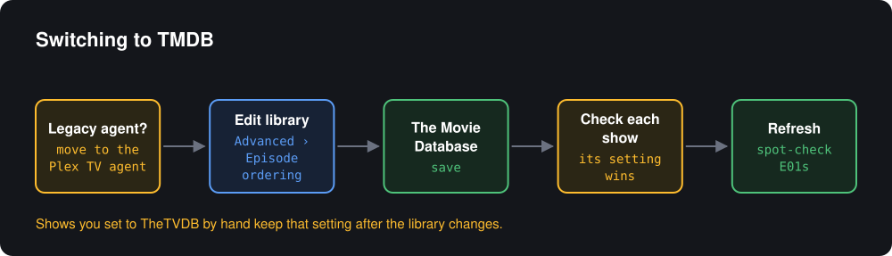
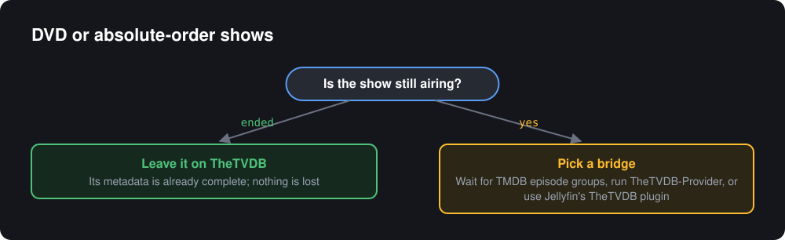

{: width="1000" height="360"}

On 20 November Plex [announced](https://forums.plex.tv/t/upcoming-change-thetvdb-metadata-support-ending-on-december-3rd/946215) that from **3 December 2026** "TheTVDB will no longer be available as a metadata source." The reason was short: "we weren't able to reach terms with the company that owns TheTVDB on a new agreement."

Plex's advice is to switch to The Movie Database (TMDB). For most shows that takes a couple of clicks. For some it will scramble your episode titles. The deciding factor is which **episode order** your files are numbered in, so this post sorts your library into "switch now" and "leave alone", walks through the switch, and covers the options for shows that can't move yet.

> **TL;DR**
> - **Nothing is deleted on 3 December.** Plex says "Your settings, shows, and current metadata stay exactly as they are."
> - **Ongoing shows still on TheTVDB stop getting new episodes and seasons.** Ended shows are barely affected.
> - **Switch aired-order shows to TMDB now:** Edit library → Advanced → Episode ordering → *The Movie Database*. Then check per-show overrides, which win over the library setting.
> - **Leave DVD-order and absolute-order shows (most anime) on TheTVDB for now.** TMDB in Plex has no alternate orders yet. Plex says "a future release" will add TMDB episode groups, with no date.
> - **Can't wait?** A third-party [TheTVDB provider](#option-b-run-your-own-thetvdb-provider) with your own TVDB API key, or Jellyfin/Emby, which keep TheTVDB.

## What happens on 3 December

From Plex's announcement:

- **Existing metadata stays.** Titles, posters, summaries and watched status already in your library aren't touched.
- **No new data from TheTVDB.** Libraries and shows set to TheTVDB episode ordering "will no longer get updated metadata from TheTVDB." Ongoing shows "will stop picking up details for new episodes / seasons." Plex "will attempt to match new titles against our other metadata sources", but doesn't promise how well that will go.
- **Ended shows are mostly fine**, "since their metadata is already complete."
- **The legacy TheTVDB agent stops working.** If a library still uses the old agent rather than the modern Plex TV agent, new shows and episodes "will not be matched" at all.

So nothing visibly breaks on the day. The problem shows up a week later, when a new episode of something you follow arrives as "Episode 5" with no title, no summary and a frame grab for a thumbnail.

## Why you shouldn't flip everything to TMDB

TheTVDB supports several orders for the same show: **aired** (broadcast order), **DVD** (the order on the box set) and **absolute** (episode 1 to 1000 with no seasons, common for long anime). Plex reads your files' `S01E05` numbers and looks them up in whatever order the show is set to.

TMDB in Plex only does aired order today. Plex says TMDB episode groups, which cover alternate orders, will come in "a future release". Until then:

- A show numbered in **aired order** maps cleanly to TMDB. Switch it.
- A show numbered in **DVD order** gets the wrong titles. [ARSTECH's write-up](https://arstech.net/plex-thetvdb-tmdb-switch/) uses *Firefly*: its two-part pilot "Serenity" is episode 1 on the DVDs but was aired last, so every DVD-numbered file shifts.
- A show numbered in **absolute order** (`One Piece - 1071.mkv`) has no seasons to map to at all.

Plex won't rename your files. If the numbers in the filenames don't match the order you pick, you get mismatches.

{: width="1000" height="406"}

There's also a quieter case. Sonarr names files using TheTVDB's numbering, and for most shows TheTVDB and TMDB agree. Where they don't (split seasons, specials counted differently, anime), Sonarr-named files can drift after a switch even in "aired" order.

## Sort your library into three groups

| Your show is… | Do this before 3 Dec | Why |
|---|---|---|
| Aired order, and TheTVDB and TMDB agree on seasons | **Switch to TMDB** | Clean mapping, keeps getting new episodes |
| Aired order, but seasons or specials differ (split seasons, anime with arcs as seasons) | **Spot-check, then decide** | Compare TMDB's season list with your files first |
| DVD or absolute order (most anime, some classics) | **Leave on TheTVDB** | Nothing in Plex can replace it yet |

The quick way to check one show: open it on [themoviedb.org](https://www.themoviedb.org/), look at the season and episode counts, and compare them with your folders. If season 3 has 22 episodes in both places, you're fine.

## Switching a library to TMDB

From Plex's post, for a whole library:

1. **Edit** the TV library (the ⋯ menu next to its name).
2. Open **Advanced**.
3. Set **Episode ordering** to **The Movie Database**, and save.

And for a single show: **Edit** the show → **Advanced** → **Episode ordering** → **The Movie Database**.

Then the step people miss: **"A show's setting overrides its library's setting.** If you've set a show to TheTVDB, switching the library alone won't change that show, so check both." Any show you ever hand-tuned to "TheTVDB (DVD)" or similar keeps that setting after you change the library.

After switching, refresh metadata on the library and spot-check episode 1 of each season of a few long-running shows. Watched status is tied to the item, not to the metadata source, so it should survive, but check a show you're halfway through.

{: width="1000" height="287"}

If a library still uses the legacy TheTVDB agent, change the agent in the same Edit Library screen to the modern Plex TV agent first. Plex's [agents article](https://support.plex.tv/articles/200241558-agents/) covers which one is which.

### Pin the right show

TMDB sometimes matches the wrong show for remakes and common titles. You can pin the exact entry with the TMDB ID in the folder name:

```
TV Shows/
└── Battlestar Galactica (2004) {tmdb-1972}/
    └── Season 01/
        └── Battlestar Galactica (2004) - S01E01.mkv
```

Or put a `.plexmatch` file in the show folder:

```
title: Battlestar Galactica
year: 2004
tmdbid: 1972
```

Look up the ID in the URL of the show's TMDB page (`themoviedb.org/tv/1972-...`).

## The shows that can't switch

For DVD-order and absolute-order shows you have three options.

{: width="1000" height="306"}

### Option A: wait

Leave them on TheTVDB. Ended shows already have complete metadata and lose nothing. Ongoing ones stop getting new episode data until Plex ships TMDB episode groups. For a weekly anime that means titles and summaries go missing for new episodes, but playback works.

### Option B: run your own TheTVDB provider

Plex Media Server 1.43.0 added custom metadata providers, and [TheTVDB-Provider](https://github.com/o51r15/TheTVDB-Provider) uses that to serve TheTVDB data, including DVD and absolute orders, from a small container on your network. You need your own TheTVDB v4 API key from [thetvdb.com/api-information](https://thetvdb.com/api-information) (and, for user-supported keys, your TVDB subscriber PIN). Check TheTVDB's current pricing there before you commit.

The setup from its README:

```bash
mkdir tvdb-provider && cd tvdb-provider
curl -O https://raw.githubusercontent.com/o51r15/TheTVDB-Provider/main/docker-compose.yml
cat > .env <<'EOF'
TVDB_API_KEY=your-v4-key
TVDB_PIN=your-subscriber-pin
TZ=Etc/UTC
EOF
docker compose up -d
curl http://localhost:8081/tvdb   # should answer
```

Then in Plex: **Settings → Metadata Agents → Add Provider**, enter `http://your-server:8081/tvdb`, add an agent that uses it, and choose that agent under the TV library's **Advanced** tab. Per-show order is still set under Edit → Advanced → Episode ordering.

Before you rely on it, know what it is: a third-party project with 8 stars and one maintainer, MIT licensed. The README says Plex sends custom providers unauthenticated requests, so **keep port 8081 on your LAN**, and that switching to it means re-matching shows (Fix Match, not just a refresh). It's a good bridge for a handful of anime libraries. I wouldn't point my whole TV library at it.

### Option C: let Jellyfin or Emby handle those libraries

This deal only affects Plex. Jellyfin has an official [TheTVDB plugin](https://github.com/jellyfin/jellyfin-plugin-tvdb) (install it from the plugin catalogue; it takes an optional subscriber PIN), and it supports DVD and absolute ordering per show. If you already run Jellyfin next to Plex, pointing it at your anime folder costs nothing. If you've been thinking about moving anyway, this is a reasonable push.

## What to do, in order

1. **Find legacy-agent libraries** and move them to the modern Plex TV agent.
2. **Switch aired-order libraries** to The Movie Database under Edit → Advanced → Episode ordering.
3. **Check per-show overrides** on anything you've hand-tuned. They beat the library setting.
4. **Leave DVD and absolute-order shows** on TheTVDB, and decide between waiting, TheTVDB-Provider and Jellyfin for the ongoing ones.
5. **Refresh and spot-check** a few long-running shows, especially Sonarr-named ones.

Do it before 3 December. After that, everything you leave on TheTVDB is frozen until Plex ships episode groups.
