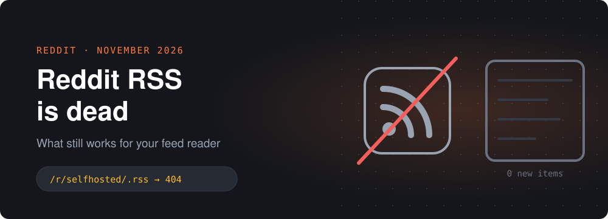
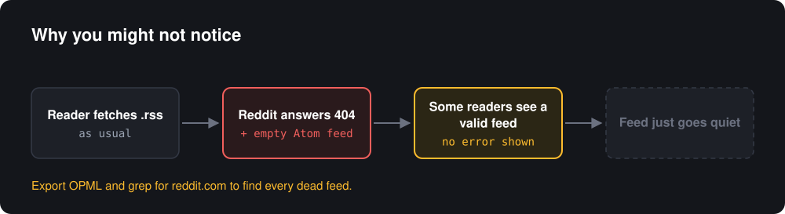
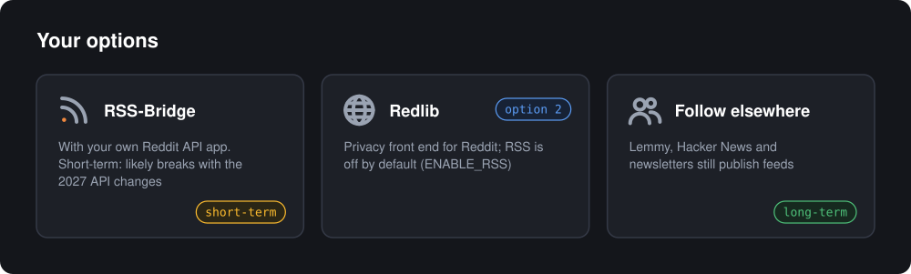

{: width="1000" height="360"}

If your feed reader has gone quiet on Reddit lately, it's not because nobody's posting. Reddit [announced on 30 September 2026](https://techcrunch.com/2026/09/30/reddit-is-killing-rss-feeds-ending-public-api-access-because-of-ai-bots/) that it would end RSS support, and the feeds have now stopped. Every `/r/whatever/.rss` subscription in FreshRSS, Miniflux, Feedly or NetNewsWire is dead.

This post covers what the old URLs return now (it's a little sneaky), how to find the dead feeds in your reader, and what you can replace them with. Most replacements are stopgaps, and I explain why below.

> **TL;DR**
> - **Reddit `.rss` URLs now return HTTP 404 with an empty Atom feed.** Some readers [won't show it as an error](#what-the-old-feed-urls-return-now).
> - **Find your dead feeds:** export OPML and [grep it for reddit.com](#find-the-dead-feeds-in-your-reader).
> - **Short-term fix:** [RSS-Bridge with your own Reddit API app](#option-1-rss-bridge-with-a-reddit-api-app). Expect it to stop working once Reddit's API changes land in 2027.
> - **Long-term:** move the communities you care about to places that still publish feeds, such as [Lemmy, Hacker News and newsletters](#option-3-follow-the-same-topics-somewhere-that-still-has-feeds).

## What Reddit announced

According to [TechCrunch's report](https://techcrunch.com/2026/09/30/reddit-is-killing-rss-feeds-ending-public-api-access-because-of-ai-bots/) on Reddit's announcement, RSS was the first of several changes:

- **RSS feeds end.** TechCrunch quotes Reddit saying RSS "will cease on November 13". The [Self-Host Weekly newsletter](https://selfh.st/weekly/2026-11-20/) reported that feeds "finally stopped working" on Monday 16 November. Either way, they're gone.
- **Reddit's reason:** RSS had become a "common surface for large-scale scraping and automated abuse". In plain terms, AI scrapers.
- **Third-party apps and bots must register by 12 January 2027.** After that, Reddit will remove API access for unregistered developers.
- **Public API access ends by March 2027.**
- **Old Reddit gets "safeguards".** Logged-in access is limited to people who used Old Reddit recently.

For moderators who used RSS to pipe new posts into Discord, Reddit points to a developer-platform app called [Discord Relay](https://developers.reddit.com/apps/discord-relay). For everyone else, Reddit says there's no replacement.

I couldn't load Reddit's own announcement posts for this article, so the dates above come from TechCrunch and Self-Host Weekly.

## What the old feed URLs return now

I requested a few feeds with plain `curl` on 28 November 2026:

```console
$ curl -s -w '\n%{http_code} %{content_type}\n' https://www.reddit.com/r/selfhosted/.rss
<?xml version="1.0" encoding="UTF-8"?>
<feed xmlns="http://www.w3.org/2005/Atom">
<updated>2026-11-27T23:26:34Z</updated>
<id>https://rss.reddit.com/</id>
<link rel="self" href="https://rss.reddit.com/" type="application/atom+xml" />
<title>Not Found</title>
</feed>
404 application/atom+xml; charset=UTF-8
```

The status is 404, but the body is a **valid, empty Atom feed** titled "Not Found". A reader that checks the status code will flag the feed as broken. A reader that only parses the body sees a valid feed with zero entries and stays quiet. You only notice weeks later, when you realise nothing from r/selfhosted has shown up.

Other URLs I tried:

| URL | Result |
|---|---|
| `www.reddit.com/r/selfhosted/.rss` | 404, empty Atom feed |
| `old.reddit.com/r/selfhosted/.rss` | 302 redirect |
| `www.reddit.com/r/selfhosted/.json` | 403 (HTML page) |
| user, comment and search feeds | 429, rate limited after a few requests |

The `.json` result matters: it's the trick most workarounds relied on, and it's blocked for anonymous requests too.

{: width="1000" height="273"}

## Find the dead feeds in your reader

Every reader can export an OPML file, usually under Settings or Import/Export. Then list the Reddit feeds in it:

```bash
grep -oE 'xmlUrl="[^"]*reddit\.com[^"]*"' subscriptions.opml | cut -d'"' -f2
```

Miniflux and FreshRSS both mark feeds that fail to fetch, so check their feed lists for errors. If a Reddit feed has no error but hasn't had a new item since mid-November, it's dead too.

Before you delete them, write down which subreddits you followed and why. You need that list for the options below.

{: width="1000" height="282"}

## Option 1: RSS-Bridge with a Reddit API app

[RSS-Bridge](https://github.com/RSS-Bridge/rss-bridge) is a self-hosted PHP app that builds feeds for sites that don't have them. Its Reddit bridge never used Reddit's RSS. The source says so directly: "This bridge does NOT use reddit's official rss feeds. This bridge uses Reddit's JSON API."

By default it uses the **unauthenticated** JSON API on old.reddit.com, the same kind of request that just gave me a 403. The bridge also supports OAuth: set `app_id` and `app_secret` in its configuration and it switches to the official API. To get those:

1. While logged in, create an app of type **script** in your Reddit account's app preferences, if Reddit still lets you. New apps are being moved to its developer-platform registration.
2. Put its client ID and secret into the `RedditBridge` section of RSS-Bridge's config.
3. Make sure `RedditBridge` is in your enabled bridges list.
4. Subscribe your reader to the feed URL the bridge generates for each subreddit.

RSS-Bridge caches Reddit results for two hours, which keeps you well away from rate limits for a handful of subreddits.

**Don't get comfortable with it, though.** It depends on Reddit's API, and Reddit says public API access ends by March 2027, with unregistered apps losing access after 12 January. It's not clear yet whether a personal script app for one user will still qualify. Treat this as a bridge to spring 2027, not a solution.

## Option 2: Redlib's built-in RSS

[Redlib](https://github.com/redlib-org/redlib) is a privacy front-end for Reddit, and it can generate RSS. The feature is off by default. Its README lists an `ENABLE_RSS` setting ("Enables RSS feed generation") and a `FULL_URL` setting that RSS needs, so the links in the feed point back to your instance.

The problem is that Redlib scrapes Reddit's signed-out pages, and Reddit is closing those off. The project's issue tracker has [thread pages failing with 403](https://github.com/redlib-org/redlib/issues/591) (fixed in October) and an open discussion titled ["Reddit has decided to force everyone to log in"](https://github.com/redlib-org/redlib/issues/609). If you already run Redlib, turning on RSS costs nothing. I wouldn't deploy it just for this.

## Option 3: Follow the same topics somewhere that still has feeds

This is the only option that doesn't depend on Reddit changing its mind. For self-hosting and Linux topics:

- **Lemmy** publishes RSS for every community. The feed link is on the community page, for example the [Selfhosted community on lemmy.world](https://lemmy.world/c/selfhosted). It's also where one of the busiest threads on [Android 17 breaking LAN apps]() happened.
- **Hacker News**: [hnrss.org](https://hnrss.org/) builds feeds for the front page, keyword searches and minimum-points filters.
- **Newsletters with feeds:** [Self-Host Weekly](https://selfh.st/weekly/) covers most of what r/selfhosted talks about each week, and it has an RSS feed.
- **Project feeds directly:** GitHub publishes an Atom feed of releases for every repo at `https://github.com/OWNER/REPO/releases.atom`. If you mostly followed a subreddit to hear about new versions, these are faster and less noisy.

For r/selfhosted specifically, release feeds for the five or six apps you actually run, plus Self-Host Weekly, cover most of what I used to read there.

## What about the official Reddit app or email?

You can still follow subreddits in the official app and turn on notifications, but that's a different habit from reading everything in one place. If the whole point of RSS was *not* opening Reddit, there's no official way to keep doing that.

## The bigger picture

Reddit isn't the only one closing doors. [Last.fm now charges for most of its API](), and the free web services self-hosters rely on keep getting more expensive or more locked down. RSS still works fine on sites that want you to read their content. The fix is to put your attention on those sites.

*More on running your own services: [free static site hosting with a custom domain]() and [what Codeberg's domain suspension taught us about registrar risk]().*
